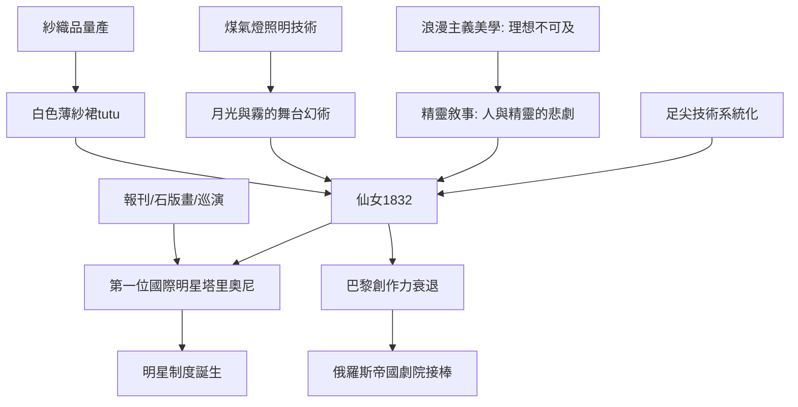

# 4.1 《仙女》與塔里奧尼：足尖鞋的革命

時間：1832年

## 一場為女兒量身定做的革命

1832年3月12日，巴黎歌劇院首演《仙女》（La Sylphide），編舞是義大利裔的菲利波·塔里奧尼（Filippo Taglioni），主演是他的女兒瑪麗·塔里奧尼（Marie Taglioni，1804年至1884年）。這部作品開創了浪漫芭蕾的完整範式，而它的誕生是徹頭徹尾的家族工程：父親為女兒設計了一個「只有她能跳」的角色——蘇格蘭森林中的精靈（sylphide），輕盈、不可觸及、逃向月光。

瑪麗·塔里奧尼的技術秘密有兩層。其一是足尖技術（pointe）：她以特製的緞面舞鞋（鞋尖以布與漿糊加固，遠非今日的硬鞋盒）在足尖上完成短暫的平衡與移動——這不是炫技，而是戲劇手段：蘇菲（劇中仙女）在腳尖上的懸浮感，讓「精靈不落地」的幻覺成立。雖然此前有舞者（如1815年巴黎歌劇院的Amalia Brugnoli、1820年代的Geneviève Gosselin）嘗試過足尖動作，塔里奧尼是第一位把足尖系統化為完整表演風格的舞者。其二是服裝革命：她穿著新設計的白色紗裙（tutu）——多層薄紗鐘形裙，裙長及小腿，配以緊身胸衣與翅膀，露出手臂與小腿線條。這在1832年是巨大的身體暴露（當時女性劇場服裝的常態是長裙與遮蔽），批評界為之震動。白色紗裙＋足尖＋月光，從此成為浪漫芭蕾的標誌性視覺。

## 浪漫主義的身體需求

《仙女》的範式不是憑空而來，而是浪漫主義美學在舞蹈中的落地。19世紀上半葉，浪漫主義（在文學：雨果、在音樂：蕭邦與舒曼、在繪畫：德拉克洛瓦）的主題是：現實無法滿足靈魂，理想存在於遠方（異國、過去、超自然、女性化精靈的世界）。芭蕾迅速吸納這套語彙：《仙女》之後，1836年丹麥布農維爾改編的《仙女》（哥本哈根版，保留至今）、1841年《吉賽爾》（巴黎歌劇院，編舞科拉利與佩羅，少女死後化為威爾希精靈）、「白色芭蕾」（ballet blanc，第二幕白裙群舞的經典結構）相繼問世。芭蕾的敘事核心從神話英雄轉向「人與精靈的愛情悲劇」——女人第一次成為芭蕾的絕對主角，而她必須死（或消失）：浪漫芭蕾的女性形象是「不可擁有的他者」，這正是當時社會性別結構的鏡像。

技術的社會土壤同樣值得注意：煤氣燈照明（1820年代劇院引進煤氣燈）讓舞台可以製造月光與霧氣的光效——沒有新照明技術，就沒有「精靈在月光下」的視覺幻術；工業化的紗織品讓多層薄紗裙可以大量生產。浪漫芭蕾是「技術＋美學＋性別」的三重產物。

## 明星制度的誕生

瑪麗·塔里奧尼成為史上第一位國際芭蕾明星。1837年至1842年她受邀赴聖彼得堡帝國劇院（年薪居當時舞者之冠），巴黎的粉絲把她的緞面鞋（演出後被焚毀的傳說：塔里奧尼的支持者以100盧布買下她演出後的舞鞋，配以醬汁與麵包分食——此為當時文人筆記中的著名軼事，具體細節難考，但反映狂熱程度）。她的名聲依賴的是新的傳播基礎：報刊評論（芭蕾批評成為媒體常欄）、石版畫舞姿複製品（大量發行的「仙女」畫像讓她的形象進入千家萬戶）、以及鐵路時代愈發頻繁的國際巡演。「明星」（star）的機制——獨特形象＋媒體放大＋粉絲經濟——在舞蹈中與歌劇男高音（馬里奧、魯比尼）同步成形。這條線直通20世紀的電影明星與21世紀的流量偶像。

## 女舞者的代價

但明星制度的另一面是殘酷的身體成本。足尖技術對足部、踝與膝的損傷（當時醫學界已有文獻記錄職業舞者的足部畸形與早衰）；以病態纖細為美的身體標準（塔里奧尼以纖瘦著稱，成為後世「芭蕾身體」的範本）催生了飲食與健康問題的長期陰影。19世紀芭蕾女舞者的身體，是被市場與美學共同塑形的「勞動工具」——這個議題要到20世紀現代舞與當代性別研究才被真正提出。

## 範式的高峰與轉折

浪漫芭蕾的巔峰是短暫的：塔里奧尼1847年退役，《吉賽爾》首演後不久卡洛塔·格里西等名伶接棒，1840年代末巴黎芭蕾創作力下滑（歌劇與雜耍劇場分流觀眾）。芭蕾的重心向東遷移——俄羅斯帝國劇院以國家資源高薪挖角法國與義大利技術（馬里烏斯·佩蒂帕1858年抵聖彼得堡），並請來義大利頂尖教師（切凱蒂）訓練俄國舞者。俄羅斯模式的關鍵在於：帝國劇院是國家機構，舞者是公務員（領終身年金），創作有國家預算與音樂委約（柴可夫斯基即受帝國劇院委約）。下一節，是三大芭蕾與佩蒂帕的黃金時代。

