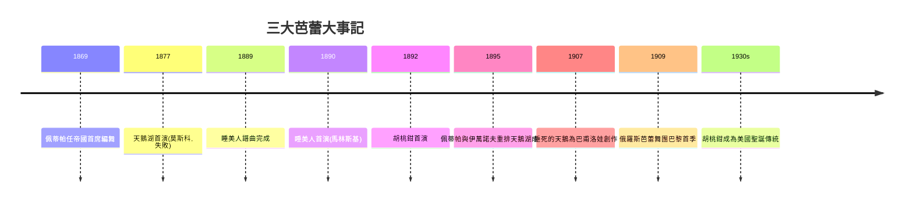

# 4.2 柴可夫斯基三大芭蕾與佩蒂帕的黃金時代

時間：1877年至1895年

## 帝國劇院：國家芭蕾的實驗室

19世紀末的聖彼得堡，擁有世界最大規模的國家劇院體系：馬林斯基劇院與帝國舞蹈學校由皇室直轄，舞者是領薪的帝國公務員，學校學生食宿全包。這套制度的直接好處是：創作有穩定預算、舞團規模空前（群舞動輒五六十人）、技術訓練長年不斷（學制九年起）。法國與義大利的頂尖人才被高薪挖角：馬里烏斯·佩蒂帕（Marius Petipa，1818年至1910年）1858年從法國抵俄，先任首席舞者，1869年起任首席編舞；義大利教師恩里科·切凱蒂（Enrico Cecchetti）1887年起任教，帶來義大利學派的跳躍與旋轉技術（如fouetté的強化）。俄羅斯成為世界芭蕾的熔爐：法國的優雅、義大利的技術、俄國的規模與紀律。

佩蒂帕確立了古典芭蕾大舞劇的結構範式：敘事場景（啞劇與戲劇舞）與純舞蹈段落（群舞corps de ballet、變奏variation、雙人舞pas de deux的展示結構）交替，最後以華麗的慶典場景（grand pas）收束。他的隊形幾何（對稱、放射、梯形群舞）把「活的幾何」推向極致——這是路易十四遺產在帝國規模上的完成。

## 三大芭蕾的誕生與坎坷

柴可夫斯基（1840年至1893年）受帝國劇院委約創作《天鵝湖》（1876年完成譜曲），1877年3月首演於莫斯科大劇院——首演是失敗的：編舞（捷克人列津格爾 Wenzel Reisinger）平淡，編舞者甚至與作曲家關係緊張，首演版對音樂動機的運用粗疏（部分段落以他曲湊用，史載編舞者並未充分理解柴可夫斯基的總譜結構），評論譏諷音樂「太交響化、不宜跳舞」（其中一位批評者甚至說這音樂只能「聽」不能「舞」）。柴可夫斯基生前沒有看到《天鵝湖》的成功。1895年（他去世後），佩蒂帕（第一、三幕）與列夫·伊萬諾夫（第二、四幕，包括著名的四小天鵝舞）在聖彼得堡重排《天鵝湖》，大獲成功——今天的《天鵝湖》直接承襲1895年版本。

《睡美人》（1889年，佩蒂帕編舞）的誕生是俄國制度資源的極致展示：帝國劇院總監弗謝沃洛日斯基（Ivan Vsevolozhsky）親自撰寫腳本與服裝設計，柴可夫斯基受委約創作（他被明確要求寫「聽覺上極盡豐富」的音樂——總監的自信前所未有）。1890年首演於馬林斯基劇院，沙皇亞歷山大三世在場，帝國傾力打造。柴可夫斯基在《睡美人》中把交響樂的動機發展引入舞劇音樂（紫丁香仙女的圓舞曲主題貫穿全劇），使舞劇音樂從伴奏提升為交響詩——這是與歌劇史同步的「音樂主體性」革命。

《胡桃鉗》（1892年，編舞佩蒂帕與伊萬諾夫——佩蒂帕因健康原因只完成部分）首演時評價平平（同期首演的《約蘭塔》歌劇更受批評界關注），但憑藉伊萬諾夫設計的雪花圓舞曲與花之圓舞曲，成為20世紀全球聖誕季的文化儀式：美國從1944年（舊金山芭蕾）與1954年（紐約城市芭蕾巴蘭欽版）開始的年度演出傳統，使《胡桃鉗》成為全球演出頻率最高的芭蕾——一部帝國俄國的作品，成為資本主義美國的家庭節日。

## 黃金時代的舞者與觀眾

帝國劇院培養了世界第一批超級芭蕾明星：瑪蒂爾達·克謝辛斯卡婭（Mathilde Kschessinska，沙皇尼古拉二世的情婦，位階罕見）與安娜·巴甫洛娃（Anna Pavlova，1881年至1931年）。巴甫洛娃1909年起與佳吉列夫的俄羅斯芭蕾舞團赴巴黎，隨後自組舞團巡演全球（印度、日本、南美、澳洲——她自比「候鳥」，巡演里程驚人），使芭蕾第一次成為全球性演出產品。〈垂死的天鵝〉（福金1907年為她創作，兩分半鐘的獨舞）是她最著名的招牌，也是芭蕾史上最短的名作——明星經濟的產物：一個可複製、可巡演、可打包的「作品」。

## 黃金時代的三重基礎與危機

古典芭蕾的黃金時代，建立在三重基礎上：帝國的資源（國家劇院）、法義技術的融合、以及交響化音樂的提升。但基礎中已有裂縫。其一，帝國劇院的創作是「宮廷趣味」的延伸，離社會現實愈來愈遠（與同期工業化都市的巨大苦難形成反差）；其二，技術日趨炫技化、身體日趨標準化（俄國學派的身體規訓近乎軍事化），藝術家的自主空間收窄；其三，沙皇體制的政治危機（1905年革命、1917年二月與十月革命）即將掀翻整個帝國劇院體系。當舊秩序崩塌時，一批在帝國劇院成長的藝術家（福金、尼金斯基、巴蘭欽）將以革命性的方式重新發明芭蕾——並在流亡中把俄羅斯芭蕾帶向西方。這是第五章的序曲：鄧肯與《春之祭》。

