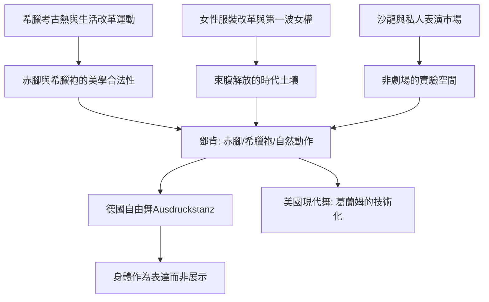

# 5.1 鄧肯：脫下舞鞋與束腹的赤腳革命

時間：1877年至1927年

## 一個在加州海灘上長大的孩子

伊斯多拉·鄧肯（Isadora Duncan，1877年至1927年）生於舊金山，父母離異，母親（音樂教師）獨力撫養四個孩子。她自述童年最重要的兩件事：母親讓她聽古典音樂（貝多芬、蕭邦、舒伯特——這些將成為她終生使用的伴奏音樂），以及在加州的自然中奔跑（她自述最早的舞蹈記憶是海邊的浪、騎馬與奔跑的節奏）。六歲起她就教鄰居小孩「跳舞」——自創的、無師承的動作。她從未受過正規芭蕾訓練，這在某種意義上是她最大的資產：她的身體沒有被任何學院「規訓」過。

1890年代的芝加哥與紐約沒有接納她（她在劇場與沙龍間輾轉，曾被經理人嫌「太不商業」），1899年她移居歐洲。1900年前後的倫敦與巴黎，她的轉機是兩種觀看方式的相遇：其一，大英博物館的希臘雕塑與瓶畫——她終日在館中研究古希臘人的動作、衣袍與姿態，自述「在帕德嫩浮雕中找到了我的舞蹈」；其二，巴黎的象徵主義與尼采熱潮（她在巴黎接觸了羅丹——羅丹為她塑像並讚嘆她的身體是「流動的建築」）。

## 赤腳、希臘袍與束縛的解放

鄧肯的舞台形象是革命性的：赤腳、古希臘式的薄紗長袍（這也是希臘考古熱的時尚延伸——希臘復興風格的服裝讓身體的曲線可見）、頭髮鬆散、不化濃妝。她跳的是「無預設的動作」：沒有程式化的舞步，而以自然動作（走、跑、跳、旋轉、手臂的波浪）為基礎，跟隨音樂的呼吸。她明確反對芭蕾：在她1903年的《舞蹈家演說》（The Dancer of the Future）中，她批評芭蕾是「扭曲身體的機器」——足尖鞋使「重心錯位」，束腹與緊身衣壓迫呼吸，學院舞步「使身體離開自然」。她主張：舞蹈應回到身體的源頭——太陽神經叢（她稱之為運動的中心與靈魂的源頭），動作應是「人的靈魂在身體中的顯現」。

這場革命的歷史條件值得拆解。其一，束腹的解放是有時代背景的：1890年代起歐美女性服裝改革運動（健康與活動性的訴求）、騎自行車的女性潮、第一波女權運動，共同為「女性身體的自由化」鋪路——鄧肯的赤腳是這場服裝革命在舞蹈中的極端表現。其二，古希臘熱是19世紀考古學與教育學的產物：希臘的「自然與健康」被浪漫化為對抗工業都市僵化的藥方（德國的「生活改革」Lebensreform運動、裸體主義、體操改革都與此相關）。其三，表演市場的新空間：沙龍與私人表演（歐洲富裕階層的沙龍文化）允許非劇場的、實驗性的表演存在——鄧肯的早期成功多在沙龍（1899年前後在倫敦與巴黎，她為私人聚會表演並獲貴族贊助）。

## 制度之外的學校

1904年，鄧肯在柏林近郊的格呂內瓦爾德創辦第一所舞蹈學校（後在巴黎、莫斯科等地設校），招收兒童，教自然運動、希臘舞蹈與音樂（包括讓孩子跑、跳、模仿海浪與樹——她的教學法是「以自然的動作為教材」）。這些學校經濟上多不成功（鄧肯常年因辦學破財），但她影響了整個現代舞教育：德國的「自由舞」（Ausdruckstanz，拉邦與魏格曼的傳統）、美國的「舞蹈體操化」與「舞蹈劇場」都承認她的源頭地位。蘇聯革命後（1921年）她應邀赴莫斯科辦學（獲列寧政府資助——革命政權對新藝術的興趣），並與詩人葉賽寧結婚（這段婚姻以悲劇收場：葉賽寧1925年自殺）。

## 明星的悲劇結局與遺產

鄧肯的晚年生活多舛：1927年9月14日，她在尼斯被自己的圍巾（長長的希臘式披巾）捲入汽車輪輻而亡——一位歌頌自由身體的舞者，死於自己的衣袍。她的技術沒有形成完整的傳承體系（她反對「方法」，自己的動作難以系統化教學），但她開啟的觀念革命影響深遠：身體應該自由、舞蹈應該表達靈魂而非展示技術、藝術可以來自非學院的身體。這三條，分別被瑪莎·葛蘭姆（技術化）、德國表現主義舞蹈（表達化）、與20世紀後期的身體研究（去學院化）繼承。葛蘭姆自述看過鄧肯的演出（1920年代）並深受觸動；德國的瑪麗·魏格曼直接承認赤腳與自然的啟發。歷史因此記住：20世紀的現代舞，始於一位拒絕學院的女人在海灘上的奔跑。

