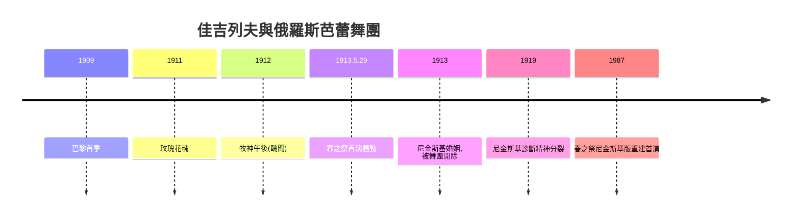

# 5.2 《春之祭》與尼金斯基：巴黎的肢體暴動

時間：1913年

## 一個二三十歲的天才與一個製作人的野心

瓦茨拉夫·尼金斯基（Vaslav Nijinsky，1889年至1950年）是帝國舞蹈學校的天才：聖彼得堡培養的技術巔峰（他著名的越空跳躍使他能「在空中停留」——攝影當時難以捕捉，但同代舞者的證言一致）、極端的身體控制與驚人的性格張力。1909年起，他成為謝爾蓋·佳吉列夫（Sergei Diaghilev）俄羅斯芭蕾舞團（Ballets Russes）的絕對主角與佳吉列夫的伴侶。佳吉列夫是20世紀最偉大的製作人之一：他不編舞、不作曲、不演出，但以驚人的品味與資源把俄羅斯頂尖人才（福金、尼金斯基、巴克斯特的舞台設計、斯特拉文斯基的音樂）組裝成巴黎的文化現象。1909年至1913年，俄羅斯芭蕾舞團在巴黎的每一季都製造醜聞與轟動：〈玫瑰花魂〉（1911年，尼金斯基與安娜·巴甫洛娃的獨舞，成為巴黎的流行話題）、〈牧神午後〉（1912年，尼金斯基自編自演，以幾乎水平的「側面移動」與結尾的暗示性動作引發輿論風暴——批評家稱之為「下流的舞蹈」，連支持者也分歧）。

## 《春之祭》：肢體的反芭蕾

1913年5月29日，巴黎香榭麗舍劇院。斯特拉文斯基的《春之祭》音樂由皮埃爾·蒙特指揮，編舞是尼金斯基，舞台設計是考古學家尼古拉·羅里奇（Nicholas Roerich）。腳本：史前斯拉夫異教部落以少女祭舞（少女跳舞至死）祭祀春神與大地。

編舞與此前的芭蕾徹底決裂。舞者不立足尖、不伸展線條、不做輕盈的跳與旋：全體舞者（男女角色均由舞者擔當，含男性與女性）內八字、屈膝、重心下壓、手臂收攏——身體是笨重的、向地的、原始的；動作是跺、踏、晃、顫，以「群體同步的撞擊」為核心。這是尼金斯基對芭蕾美學的徹底顛覆：優雅與輕盈被笨重與原始取代，直線被內曲取代，向上被向下取代。

首演的騷動是20世紀文化史最著名的場景之一：觀眾在開場後不久開始噓聲、嘲笑與鬥毆（多份當代記述證實了尖叫、吹口哨、互毆與警察介入；斯特拉文斯基與尼金斯基在側台對舞者大叫「別管觀眾，繼續跳節拍」——由於音樂被噪音淹沒，蒙特與斯特拉文斯基在後台以數拍子指揮舞者）。需要誠實記錄的是後來史學的修正：騷動的對象是複合的（音樂的噪音、編舞的醜陋、舞台設計的野蠻、佳吉列夫的「醜聞行銷」傳統）；部分評論者認為騷動規模在後來的記述中被誇大（斯特拉文斯基晚年的回憶也有渲染成分）；而表演本身在後續場次觀眾逐漸接受（之後又演出數場，觀眾反應漸趨平靜）。但《春之祭》作為「藝術現代性突破」的象徵地位已無可動搖：它證明藝術可以用「醜」、用「暴力」、用「反美學」來推進。

## 為什麼是1913年

《春之祭》的爆炸性有具體的時代溫床。其一，19世紀末至20世紀初的原始主義（primitivism）浪潮：人類學博物館（巴黎的特羅卡德羅民族誌博物館）、高更的塔希提、畢卡索的非洲面具（1907年《亞維農的少女》同年靈感）——歐洲藝術家瘋狂地從「非西方」與「史前」尋找逃離理性文明的出口。其二，世紀末的焦慮：工業化、都市化、社會主義運動與帝國競爭使人們預感「大戰將至」；《春之祭》以獻祭與死亡為主題，命中了集體潛意識。其三，巴黎的文化消費市場：俄羅斯芭蕾舞團本質上是「高端文化商品」（佳吉列夫善於經營爭議以維持票房與名聲），《春之祭》的醜聞在一定程度上是被製造與消費的。其四，音樂的革命（斯特拉文斯基不規則重音與原始節奏）與舞蹈的革命（尼金斯基的反芭蕾）在佳吉列夫的製作框架中互相加持。

## 尼金斯基的悲劇

《春之祭》是尼金斯基作為編舞者的頂點，也是下坡的開始。1913年，佳吉列夫因尼金斯基的閃電婚姻（與匈牙利裔女性羅莫拉·德·普爾茨基，在南美巡演船上突然結婚）將他開除出舞團；1914年起尼金斯基自組舞團嘗試獨立，商業失敗；第一次世界大戰期間他被軟禁於匈牙利（奧匈帝國的俄裔）；1919年，他被診斷為精神分裂症（早發性失智），餘生三十年在療養院度過（1950年去世於倫敦）。他的編舞記譜（《春之祭》的原始記譜由女舞者瑪麗·蘭伯特保存）長期散失；1980年代起，霍奇森（Millicent Hodson）與肯尼斯·阿徹（Kenneth Archer）依據記譜與圖像重建了《春之祭》的尼金斯基版本（1987年，若弗蕾（Joffrey）芭蕾舞團首演重建版）——我們今天看到的「尼金斯基的春之祭」，是一次考古學式的復原。藝術史因此又一次證明：舞蹈的保存比繪畫、音樂困難得多——若無人記譜與重建，一場革命可以在檔案中消失七十年。

