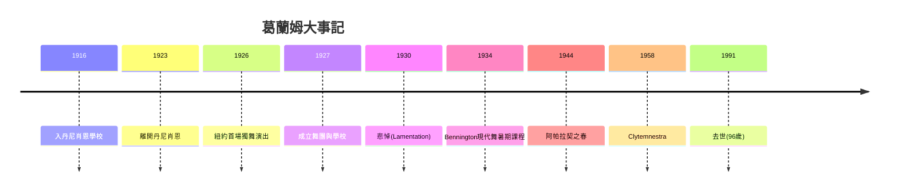

# 6.1 瑪莎·葛蘭姆：把痛苦寫進肌肉

時間：1894年至1991年

## 從德尼肖恩學校走出來

瑪莎·葛蘭姆（Martha Graham，1894年至1991年）生於賓州阿勒格尼，父親是神經精神科醫生（他對「身體動作反映內心狀態」的診斷直覺，成為她後來舞蹈觀的種子）。1910年代她隨家人遷往加州，1916年入洛杉磯的丹尼肖恩學校（Denishawn，露絲·聖丹妮絲Ruth St. Denis與泰德·肖恩Ted Shawn創立）——這是當時美國最成功的現代舞搖籃，融合東方舞台化舞蹈、鄧肯式自然舞與異國風格巡演。葛蘭姆在丹尼肖恩的核心團演出多年（她1920年代的代表作是一支「孔雀舞」，聖丹妮絲熱愛的東方主義風格），但仍感到不滿足：她想表達的不是異國的裝飾，而是「我們這個時代的我們自己」。

1923年，她離開丹尼肖恩（部分原因是肖恩把她放到「歌舞喜劇」演出而她不願意——她自述「我想走自己的路，哪怕孤獨」），1926年在紐約舉辦首場自己的獨舞演出，1927年成立自己的舞團與學校。同期的同伴包括多麗絲·漢弗萊與查爾斯·魏德曼（丹尼肖恩的另一支脈絡，發展出「跌落與復原」技術）——美國現代舞的第一代，幾乎全部來自丹尼肖恩，然後反叛它。這是藝術史常見的句式：形式的孕育者，也常是形式的第一個叛逃者。

## 收縮與釋放

葛蘭姆的技術革命是「收縮與釋放」（contraction and release）：以骨盆與脊椎為軸，呼氣時腹部內收、脊柱彎曲（收縮），吸氣時展開（釋放）——用一次呼吸完成一次身體上的情感弧線。這個技術的美學意義是：痛苦不是被表現的，而是被發生的；觀者看到的不是「悲傷的姿勢」，而是悲傷本身在肌肉中的物理過程。她的身體理念明確反對芭蕾的「無重力」：她說「讓身體落在地面上，地面是人的來處」，並名言腳步聲很重要的說法：「我想要讓人聽見我的腳落地。」地板、重量、呼吸、脊椎——美國現代舞的技術骨架由此確立。

題材上，葛蘭姆從女性的心理與社會處境出發：《異端》（Heresiad，1929）表現女性的孤獨與拒絕、《悲悼》（Mourning Tree，1930年代的代表作品之一是《悲悼》Lamentation，1930年，她整個人裹在一條彈性布筒中，以頭、膝、手的推拉構成哀悼的圖像——這支五分鐘的獨舞是現代舞史最著名的作品之一）、《阿帕拉契之春》（Appalachian Spring，1944年，與作曲家科普蘭合作，呈現美國拓荒女性的堅韌與柔情）、《夜之旅》（Errand into the Maze，1947，以女性穿越迷宮面對恐懼為原型）。她同時建立了一套完整的「葛蘭姆劇場」：固定的舞團、標準化的技術課程（至今全球仍有葛蘭姆技術課）、與作曲家（科普蘭）、設計師（日商野口勇Isamu Noguchi的舞台雕塑）的長期合作——現代舞第一次擁有了接近芭蕾的「體系」。

## 明星舞者與政治意識

葛蘭姆舞團的明星系統培養了美國現代舞的中堅：Eric Hawkins（她的丈夫）、Merle Marsicano、Merce Cunningham（將在下節登場）、保羅·泰勒、以及後來的比蒂（Pearl Primus之外的非裔舞者與舞評人）。「瑪莎主義」（Graham technique）成為20世紀後半葉美國與全球現代舞教育的主流技術（1930年代起她與美國舞蹈教育體制結合， Bennington學院的暑期課程1934年起成為現代舞的制度化節點）。她的政治立場也值得記錄：她生於美國，但拒絕藝術「去政治化」——她為猶太大屠殺創作《梅岱亞》系列的作品（如《Clytemnestra》1958年），並在麥卡錫時代承受「左翼嫌疑」的審查壓力（1950年代她曾因國務院護照政策受阻，未能如期赴一些國際邀約——她與「美國文化外交」的複雜關係是她後期的重要面向；美國國務院1950年代起把現代舞作為冷戰文化外交的一部分派往國外）。

## 一個活得極久的革命者

葛蘭姆持續創作與表演到1991年去世（96歲）——她是最後一位親眼看著現代舞從邊緣走到中心的第一代創始人。1960年代起，她面對年輕一代的反叛（康寧漢、賈德遜舞蹈劇場、後現代舞），年輕人批評她是「新的學院」——葛蘭姆本人對此的回應是忍耐與自我調侃（她說過「我也能被打破」之類的話）。現代舞史因此呈現出一個清晰的邏輯：每一代的革命，都為下一代的革命準備了靶子——鄧肯反芭蕾，葛蘭姆反自然舞的泛化並技術化，康寧漢反葛蘭姆的心理敘事，後現代反技術本身。舞蹈的現代性，就是在不斷的自我否定中前進的。

