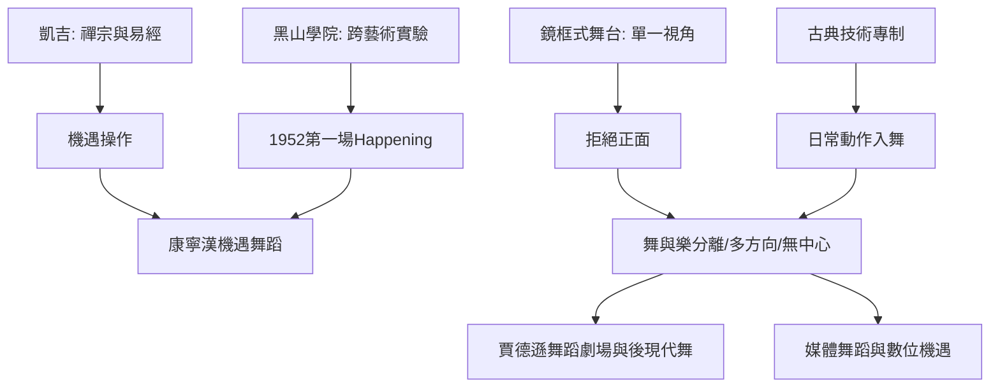

# 6.2 康寧漢與機遇舞蹈：擺脫音樂的附庸

時間：1919年至2009年

## 葛蘭姆舞團的出走者

默斯·康寧漢（Merce Cunningham，1919年至2009年）從華盛頓州偏遠小鎮的雜技少年，一路走進葛蘭姆舞團（1939年至1945年，擔任首席男舞者）。但他在葛蘭姆的體系中愈來愈不安：他要的是「純粹的動作」，而不是「動作作為心理敘事的載體」。同時，他遇見了改變他一生的作曲家約翰·凱吉（John Cage）——當時在葛蘭姆舞團伴奏的年輕先鋒音樂家，後來成為20世紀實驗音樂的核心人物。1942年，康寧漢與凱吉在紐約開始合作；1953年，他們在北卡羅來納的黑山學院（Black Mountain College——當時美國最激進的藝術教育實驗場，包浩斯教育家阿爾伯斯、詩人奧爾森都在此任教）正式成立默斯·康寧漢舞團。

康寧漢的轉向與凱吉的音樂哲學同步。凱吉1940年代中期接觸禪宗（師從鈴木大拙，1950年代哥倫比亞大學的講席使禪宗在紐約藝術圈擴散），並在1951年接觸《易經》，創作《變化的音樂》（Music of Changes，以擲骰決定曲譜元素）；1952年他以《4分33秒》把「無聲與環境音」變成音樂——音樂不必「表達」，聲音就是聲音。

## 機遇舞蹈：讓作品「不知道自己要做什麼」

康寧漢對舞蹈做了同樣的操作，壓縮為幾個原則。其一，舞與樂分離：舞者與音樂家各自排練各自的材料，只在演出那天第一次「相遇」——彼此不知道對方的內容，觀眾看到的是「同時發生的兩件事」。其二，機遇操作：用《易經》擲骰、拋硬幣或電腦亂數決定動作順序、隊形、音樂段落與長度（代表作如1963年的《Field Dances》與後期的《車程》（Travelogue），以及1990年後與電腦軟體LifeForms合作的作品——賽博時代的機遇）。其三，鏡框之外的空間：舞者的動作朝向任何方向（古典舞「面對觀眾」的規範被打破——康寧漢的舞有「正面」嗎？沒有，他說「舞台的中心不是任何地方特別的中心」）。其四，日常動作入舞：走路、跳躍、坐下、倒地的動作與古典技術同等地位，身體不必「唯美」。

這套原則與同期興起的「偶發藝術」（happening，凱吉的黑山學院1952年活動被視為第一場happening）、波普與極簡主義的共同點是：拒絕藝術的「表達責任」。康寧漢明確說過：他的舞不是關於「什麼」的，而是純粹的「做」；他不要觀眾去找意義，「你只管看」。這是他與葛蘭姆的根本分歧：葛蘭姆的身體是心理劇場的載體，康寧漢的身體是宇宙中隨機事件的容器。

## 技術冒險家

康寧漢是舞蹈史上最積極的技術冒險家之一。1960年代起他與媒體藝術家（斯坦納Charles Atlas、尼爾森Nam June Paik的學生圈）合作影片舞蹈（如《Westbeth》1974、《Locale》1979），探索鏡頭中的舞蹈；他早期大量使用電子音樂、廣播噪音與隨機拼貼；1990年代起他與軟體工程師合作LifeForms（一種人體動作建模軟體）與編舞程式，使「機遇」數位化；2000年代他以Wii感應器與隨機影片拼貼（與媒體設計者合作的《eyeSpace》等作品）做體感即興——這些實驗在2009年他去世前後的雲端檔案（《勒克斯莉》Mondance、《Sunsundays》的影片資料庫）中留下了完整檔案（康寧漢基金會持續以「數位存檔與隨機重組」的方式延續其作品）。他與賈德遜舞蹈劇場（1962–1964，後現代舞的中心）的關係密切：他的學生（如雅各德Trisha Brown之外的一批）與鄰近族群構成後現代舞的直接前端。他2009年去世後，紐約市芭蕾與各地舞團重排了他的作品，他不斷被重新認定為「20世紀最重要的編舞者之一」——距離他在葛蘭姆舞團出走的六十多年後，他的「不表達」成為新的傳統。

## 為什麼「不表達」有價值

康寧漢的迷人之處在於：他拒絕的每一樣東西，都有一個具體的歷史對手。「不表達」對抗的是葛蘭姆的心理劇；「舞樂分離」對抗的是「音樂是舞蹈的靈魂」的百年慣例（可上溯至諾維爾1760年的舞劇論）；「多方向」對抗的是鏡框式舞台的單一視角（可上溯至路易十四的凡爾賽芭蕾）；「日常動作」對抗的是古典技術的專制。他的革命不是「更自由」，而是「更精確」：用制度化的方法（機遇、樂譜、排練流程）去除了「表達」這個他自己認為需要被排除的元素。這種「以制度反制度」的做法，使其作品的影響最為深遠：它不依賴天才的灵感，而依賴可以復製的流程——與同期凱吉的音樂、杜恩（Duane）與凱吉的實驗共同構成「流程主義」的藝術史章節。下節轉向百老匯：在同期的美國，另一種舞蹈——「為大眾的舞蹈」——正在以完全不同的邏輯爆發。

