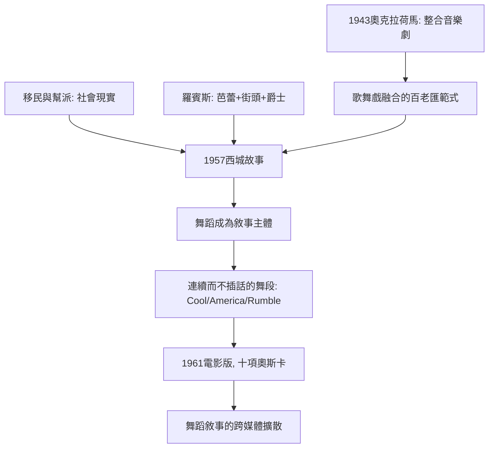

# 7.1 《西城故事》：舞蹈成為敘事語言

時間：1957年至1961年

## 一個寫給莎士比亞的挑釁

1957年9月26日，《西城故事》（West Side Story）在紐約百老匯首演。它的創作團隊是音樂史與舞蹈史的夢幻組合：作曲家李奧納德·伯恩斯坦（Leonard Bernstein）、作詞家史蒂芬·桑坦（Stephen Sondheim，首度擔任歌詞）、劇本亞瑟·勞倫茨（Arthur Laurents）、編舞傑姆·羅賓斯（Jerome Robbins）。靈感來自莎士比亞的《羅密歐與茱麗葉》：把維洛那的世仇家族置換為1950年代紐約西區的街頭幫派——白人的噴射機幫（Jets，波蘭裔、愛爾蘭裔的底層白人青少年）與波多黎各移民的鯊魚幫（Sharks）。勞倫茨與羅賓斯最初1949年就起草過概念（當時取名East Side Story，設定為猶太人與天主教徒的衝突——後因移民議題轉向而擱置多年），1950年代紐約報紙的幫派鬥爭新聞（「青少年犯罪」的恐慌報導）使主題重新可行。

這齣戲的開場是一次徹底的冒險：《序幕》以冗長的群舞（噴射機幫以「抖動指頭」的手勢、彈跳與嘲弄的步伐在街頭巡行）取代傳統的Opening number——沒有一句台詞、沒有一首歌、沒有介紹任何角色。舞蹈被置於戲劇的入口，成為「世界觀的宣告」。觀眾與評論的反應漸趨接受：紐約時報的評論承認它是「一項嚴肅的成就」，並最終獲得東尼獎最佳編舞（羅賓斯）。
羅賓斯的編舞把芭蕾技術與爵士舞、街頭動作、現代舞的呼吸融合（他本人是芭蕾舞者出身，曾於1940年代為美國芭蕾舞校、隨後在柏內特商業舞蹈圈工作——他的雙重身分正是此劇的方法論：用芭蕾的「身體技術」承載街頭的「身體語言」，再以爵士舞的能量推動敘事）。

## 舞蹈第一次「說」完整的故事

《西城故事》在音樂劇史上的突破，在於舞蹈不只是插曲，而是敘事的承重牆：是整個幫派從狂怒轉入壓抑的心理過程（「Cool」一曲，舞蹈的節奏從熱到冷）；「America」以女生唱跳組與男生唱跳組的對答，呈現波多黎各移民對美國的愛與怨（舞蹈成為族群論戰的載體）；「The Rumble」以全舞段完成兩幫的決鬥（幾乎沒有對白，純以身體推進劇情——伯納多死、托尼被抓，「舞蹈」完成了「兇案」）；「Somewhere」夢想場景以群舞的空間詩句呈現兩幫小孩共同的天國想像。高潮與悲劇都由舞蹈執行——對白與歌只是節點。桑坦晚年回憶：羅賓斯在排練場的獨裁（包括要求舞者做極限的身體訓練）使製作一度瀕臨崩解，但最終「舞蹈成為戲劇主體」的目標達成。

伯恩斯坦的音樂同樣做了兩件事：以爵士的切分、拉丁節奏（曼波與倫巴）與歌劇性的複調，為「街頭」與「殿堂」搭橋；以動機的交響化發展（全劇的音樂由少數幾個動機變形貫穿）保證了兩小時的內聚力。伯恩斯坦本人1957年在NBC電視的《青年音樂會》系列中就以交響曲與歌劇為大眾做普及教育，他的創作位置恰好是「嚴肅音樂與大眾市場之間」——這正是《西城故事》的時代位置：美國1950年代中期，百老匯觀眾的中產化與電視的崛起正在擠壓傳統音樂劇，《西城故事》以「高級」的野心回應市場。

## 電影版與文化擴散

1961年，羅伯特·懷斯執導的電影版（羅賓斯因超支被解僱，但獲得聯合導演署名與奧斯卡最佳導演獎之一）獲得十項奧斯卡獎（包括最佳影片），全球票房驚人，使這部作品的「舞蹈敘事」進入全球大眾的視野。後續的影響清晰可查：羅賓斯此後成功執導《國王與我》與《屋頂上的提琴手》（1964年，百老匯連演超過3000場的紀錄，他獲得個人東尼獎最佳導演與最佳編舞）；桑坦成為百老匯最重要的作詞者與作曲者（《伙伴們》Company，1970、《前衛》Follies，1971、《理髮師陶德》Sweeney Todd，1979與《拜訪森林》Into the Woods，1987）；而「舞蹈敘事」的理論遺產，則延續至1990年代後的《獅子王》（朱莉·泰莫的視覺化劇場）與2000年後的《 Hamilton》（林-曼努爾·米蘭達以嘻哈完成羅賓斯式的「以非古典載體說故事」——米蘭達自述受《西城故事》影響直接）。

## 為什麼是此時

《西城故事》的成功有四個時代條件。其一，移民社會的張力：1950年代紐約的波多黎各移民大增（1940年代末至1950年代，每年數萬人移入，與底層白人的居住競爭與職業競爭激化），幫派問題成為媒體焦點——這是創作題材的社會現實。其二，百老匯的制度轉型：1943年的《奧克拉荷馬！》（羅賓斯參與編舞）已確立「音樂劇整合」的方向（歌、舞、戲融合為一體的作品），《西城故事》是此方向的極致。其三，舞蹈技術的多元並存：1940至1950年代，芭蕾、現代舞、爵士舞與商業舞蹈在紐約的排練室與課堂互相滲透，培養了能跳「多重語言」的舞者群體（羅賓斯正是這種多元技術的化身）。其四，戰後青年的議題化：青少年犯罪、幫派、族群衝突成為美國社會的焦點，「青春」首次成為一個需要被政治與文化言說的領域。下一節，我們看另一位把爵士舞推向極端語法的編舞家——鮑勃·福斯。

