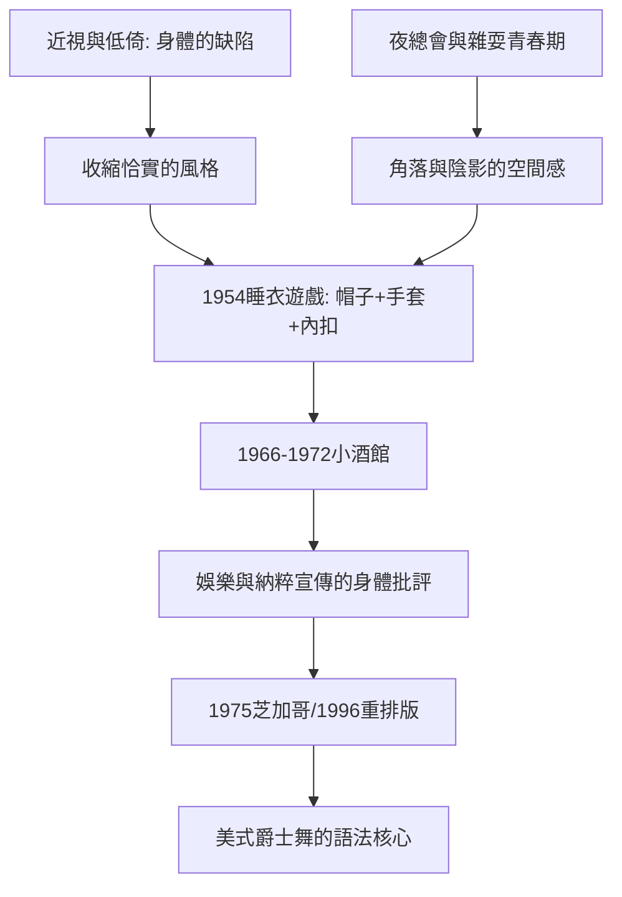

# 7.2 鮑勃·福斯：帽子、手套與微傾的身體

時間：1953年至1987年

## 一個近視的少年與一條偷學的路

鮑勃·福斯（Bob Fosse，1927年至1987年）生於芝加哥。他自幼學舞，但外貌與身型不符合當時商業舞蹈的主流標準（色情兮兮的英俊主角），而且深度近視（幾乎看不見後排觀眾）。他自己討厭自己的這些「缺陷」，但也由此開發出他的舞蹈哲學：既然無法「奉獻於遠觀」，就讓身體「在狹小中精準」——縮肩、內關節、戴帽子壓低視線、半遮臉的手套、斜傾的身體。他在脫衣舞廳與夜總會（芝加哥的Burr Oak旅館等）度過了雜耍演出的青春期，那種「在角落與陰影中表演」的空間感，成為他的語法。

1948年前後他赴紐約，1950年代在百老匯以舞者與編舞嶄露頭角（1954年為《睡衣遊戲》The Pajama Game編舞，在「Steam Heat」一段確立了「帽子、白手套、關節內扣」的風格——至今全球爵士舞課堂仍在教這段）。

## 小酒館、疤痕與心理的裂口

福斯的職業生涯與他的心理歷程高度交織。他在好萊塢短片娛樂（1953年 MGM 的 Kiss Me Kate 的編舞片段引發百老匯注意）起家，隨後因精神崩潰與抑郁（他自述更年期間的酗酒與焦慮）在1970年中期的重組（《 [Dancin']》1978年前後的《 CBS》與電視特輯）不斷自我調整。

《小酒館》（Cabaret）有兩次重要的轉譯：1966年的百老匯（福斯編舞，獲東尼獎最佳編舞）與1972年的電影版（福斯身兼導演與編舞，獲奧斯卡最佳導演獎）。電影版的「納粹青年合唱」（Tomorrow Belongs to Me）以🎌度假般的優天主教旋律隱藏侵略主義——以優美的身體表演承載地複雜的政治：可能純粹的舞蹈總是某種「宣傳」的載體。福斯把這個主題做到了極致：他一系列作品（1972年的《小酒館》、1974年的《倫妮》Lenny、1979年的《爵士春秋》All That Jazz）都反覆回到同一個主題：表演的身體與「為表演而毀滅自我」的焦慮。1979年的《爵士春秋》是半自傳的電影：一個拼命的編舞家在心臟手術的邊緣凝視自己的一生（他自述其片中的減量笑述「我在他身上放了太多我自己」）。1987年9月23日，他在華府劇院彩排《Sweet Charity》復排版時心臟病發去世——他一生心臟疾病的籠罩與作品中的「死亡意象」相同步。

## 《芝加哥》與百老匯的體制化

1975年福斯編舞與共同導演的《芝加哥》（Chicago）在百老匯首演，以爵士舞的諷刺結合「審判即表演」的主題（媒體、觀眾與司法的合謀——「Cell Block Tango」至今仍是爵士舞的經典教材），但當年被《歌舞線上》（A Chorus Line，1975）的巨大成功蓋過，評論與票房並不突出。它真正的「成為經典」是在1996年：百老匯的重排版，以小規模製作、精簡佈景的策略控管成本——這部重排版連演超過25年，成為百老匯史上演出場次最長壽的作品之一，並透過2002年的電影版（羅伯·馬歇爾執導）獲得奧斯卡最佳影片。福斯因此成為「美式爵士舞」的語法化身：至今商業舞蹈圈（MV、常規的音樂劇、選秀節目）中的「網紗手套、腕式手套、弧背與關節微扣」的手勢，全都可以追溯到他的排練室。

## 商業舞蹈的身體理論為何重要

福斯與羅賓斯代表著百老匯舞蹈的兩個頂點：羅賓斯把舞蹈作為「戲劇敘事」，福斯把舞蹈作為「身體的心理批評」。兩人的方法論差異清晰：羅賓斯在排練場對舞者像教練一樣（追求「正確與完整」），福斯則以自己的「不完美」為起點（近視、矮小、不夠帥——把他們轉化為風格）。在商業劇場中，「以缺陷為美」的語法極度重要：它使一部分不受聖像式「主演體格」規範的舞者找到身分。20世紀末霓虹時代的大部分爵士舞，與這個傳統的「戴帽之手」密不可分——福斯以自身的「不完美」完成了一次商業舞蹈的身體解放。

