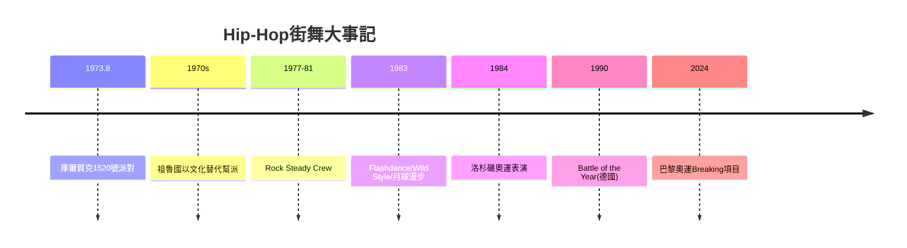

# 8.1 布朗克斯的破拍與B-Boying的誕生

時間：1973年至1980年代

## 一場派對姐姐的生日

1973年8月11日，1520號塞奇威克大道（布朗克斯公寓），牙買加移民DJ庫爾·賀克（Kool Herc）為妹妹辛蒂的生日租下公共空間辦派對。他放的是放克與靈魂樂唱片，但他發現一件事：舞客在歌曲的鼓聲間奏（break，樂隊全停、只留鼓的段落）時最瘋狂。他的解法是「芝加哥兩臺唱盤」（merry-go-round）：準備兩張同一首歌的唱片，交替播放，把幾十秒的break延長為幾分鐘。這個技術決定了嘻哈的全部物理基礎：當一段長的純鼓點持續在空間中震盪，身體在地面上的反應方式改變了——人們開始「掉在地」、「倒立」、「轉圈」。B-Boying（breaking，後來俗稱breakdancing）就誕生在這個物理基礎上。

B-Boying的名字來自B-Boy：beat boy（or break boy），跟著破拍跳的男孩。紐約1960至70年代，布朗克斯的貧民區的幫派文化（由薩維奇七人幫Savage Skulls等）使街頭暴力普遍；1970年代初，兩個非幫派轉向的力量出現：其一，加法尼亞（Afrika Bambaataa，前幫派首領之一）創立「祖魯國」（Zulu Nation，以音樂與文化取代幫派火拼——他的口號「peace, unity, love and having fun」），主張把街頭的能量從拳頭轉到舞池；其二，學生團體與社區中心的活動（布朗克斯河畔的社區中心與學校體育館的派對提供了免費場地）。街頭舞（breaking）的競爭性（battle）恰好承接了幫火的「榮譽文化」：以身體的複雜（旋轉、轉手、凍結）取代武力的攻擊——從這個意義上，B-Boying是「把暴力轉譯為身體的複雜度」。

## 四元素與身體的語法

嘻哈文化的四元素在此期成形：DJing（破拍與刮擦）、MCing（說唱）、breaking（街舞）、graffiti（塗鴉）。B-Boying的技術語匯含四層：toprock（站立的節奏動作——跟著節拍在站立位置的律動）、footwork（floorwork，drop到地面的腿部複雜動作）、freeze（定點定格——在動作的高點停住，証明控制力）、power moves（大規模旋轉動作——windmill風車、flare、headspin頭轉）。這個層次的物理特徵是「以地面為友」：舞者的重心頻繁低於水平線，頭、肩、背、手成为旋轉的軸。這與所有古典與現代舞台舞蹈的「向上」哲學完全相反——芭蕾追求足尖與懸浮，B-Boying追求貼地與逆轉。這種「向地性」是數十年來街頭舞蹈的身體簽名。

## Rock Steady Crew與全球擴散

1980年代的關鍵擴散事件有三。其一，1977年前後成立的Rock Steady Crew（羅賓·迪亞斯Richard Colón aka Crazy Legs為核心人物）在1981年與第二代的紐約青年一起，把breaking推向全球性媒體：1981年他們在紐約的橋下（林肯中心的戶外舞台）參與了 MTV 前身的戶外演出，1983年參與了電影《Flashdance》的舞段，成為全球媒體的焦點。《Wild Style》（1983）與《Beat Street》（1984）等電影把 breaking、塗鴉與 MCing 一起推向世界。其二，1983年麥可·傑克森在 Motown 25週年（下一節將詳細）的月球漫步，為街頭舞與傳統媒體作了連接——moonwalk 的技術本身來源於 mime 與 street dance 的融合，傑克森把 breaking 世代的部分身體語言推入了全球主流。其三，1984年的洛杉磯奧運會表演（霹靂舞者在關閉儀式中的登場）在全球電視直播中亮相——這一年，breaking已經跨越大西洋與太平洋（法國、日本、韓國的舞者在1980年代中期開始形成自己的社群）。

## 為什麼是此時此地的紐約

布朗克斯的街舞興起有其精確的社會經濟條件。其一，都市基礎設施的廢棄：1950至70年代，紐約的「計畫性衰落」（房東縱火領保險、社會服務退出）使布朗克斯有大量空置的建築與牆壁——這正是塗鴉的文化物質基礎（空牆是紙）。其二，唱片技術與黑膠庫：戰後牙買加的 sound system 文化（戶外音會、擴音器競賽）隨移民輸入紐約，為庫爾·賀克的兩唱盤技術提供了技術傳統。其三，青少年失業與貧困：大規模青少年有時間在街頭與室內場地聚集、自娛。其四，媒體的後來介入：1980年代中期，唱片公司與電視的商業化把街頭舞塑形為流行文化商品——原生的社區形式在商業機器中的一半被洗白、一半被忽視（1980年代後期 breaking 在美國一度退潮，街頭舞蹈的保存靠日本、法國、韓國等地的群體接手，1990年代起全球 breaking 復興與競賽體系（Battle of the Year 1990年首辦於德國）成形）。2024年，breaking（Breaking）正式成為巴黎奧運的項目——從布朗克斯的排屋派對，到奧運的賽場，這條路走了五十年。

