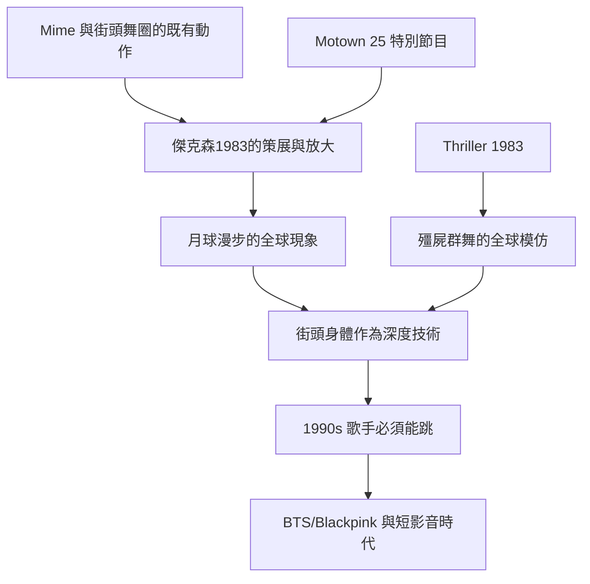

# 8.2 麥可·傑克森與月球漫步：MTV時代的身體

時間：1983年至1990年代

## 一支舞步的政治經濟學

1983年3月25日，Motown 25週年電視特別節目在加州帕薩迪納錄製。麥可·傑克森（Michael Jackson，1958年至2009年）表演〈Billie Jean〉，在演出的尾聲突然後滑，腳尖支撐、腳跟交替抬起——太空漫步（moonwalk）由此進入全球億萬觀眾的視線。太空漫步的源流其實很長：1930年代喜劇演員與舞者（如 Cab Calloway 的背景舞者與默劇藝術家馬塞爾·馬素 Marcel Marceau 的「逆風行走」）已有類似動作，1970至80年代街頭舞圈（Soul Train 電視節目上的舞者、Locking 與 Popping 社群）更是已經流傳相近技術；傑克森本人自述曾向街頭舞者（如 Jeffrey Daniel，Soul Train 與 Shalamar 的舞者，後來也為他編舞）請教。換言之，月球漫步不是傑克森的發明，而是他對一種已存在的街頭身體資源的全球性「策展與放大」——這是流行文化的常規動作，但也再次提出「誰的創造、誰的名聲」的問題（1980年代黑人社區對此有一個真實的疏離感：街頭世代知道他們早已在跳這個動作）。同樣地，他於2009年去世（50歲，去世前仍在為復出演唱會排練），1993年起他被控對兒童的不當行為（2005年刑事審判獲判無罪，2019年的紀錄片《Leaving Neverland》再掀爭議）——他的遺產因此無法簡化，舞蹈史記錄的是他的技術與影響，而爭議本身也在持續被討論。

## 舞蹈與視覺帝國

傑克森的舞蹈不僅是風格，而是一個完整的「視覺帝國」。《Thriller》（1983年，導演約翰·蘭迪斯，13分鐘的影片）以恐怖片類型電影、殭屍群舞與「 MTV 片」的形式，證明了「音樂錄影帶可以是小成本的電影級藝術品」：《Thriller》影片中殭屍群舞的鏡頭，至今是全球模仿頻率最高的群舞之一。他的服裝設計（長期合作的服裝師 Michael Bush 與 Dennis Tompkins）、編舞（Michael Peters 與 Vincent Paterson 等）與導演構成一個與好萊塢同規模的製作系統。他在 1980 年代確立了兩個技術方向：其一，與現代舞者的合作（1987 年《Bad》之後 Wynn Holmes 與 Vincent Paterson 系統化了他的排練與身體訓練）——傑克森本人是精力驚人的排練者（自述每天八小時以上）；其二，快速切換的電視語言（舞蹈動作與鏡頭切換、燈光頻閃同步，把身體的停頓以視覺「定格」強調）——這種「身體以鏡頭為對手」的表演方式是傑克森與他之前的所有舞台明星的差別，它為後來的 MV、廣告與短影音的「表演語法」定了標準。

## 全球的身體模仿

傑克森的舞蹈影響以驚人的規模擴散：1984年《Victory Tour》巡演出場時，舞蹈與人潮的管理難度已成為社會現象（多場演出有粉絲擠壓受傷的記載）；1987至90年的《Bad》世界巡演與1992至93年的《Dangerous Tour》觸及數百萬現場觀眾。他在日本、韓國、台灣、蘇聯與南美都有明確的模仿浪潮——蘇聯解體前後的紅場聚集、東亞的街頭模仿、南美的粉絲狂潮，都是這個全球帝國的日常現象。1991年的《Black or White》影片（導演約翰·蘭迪斯，其中對世界各文化的身體拼貼，片尾的暴力與性暗示段落引發爭議、傑克森本人公開道歉——這是 MV 史上的著名案例）顯示：他的身體也在承受全球化挪用的重量。

## 一個時代的舞蹈符號

傑克森的舞蹈史位置可以這樣概括：他完成了「街頭舞蹈」與「全球主流媒體」的雙重接合。其一，他以驚人的排練強度（自述每天數小時以上）向主流證明：街頭的身體不是「隨意的律動」，而是一種有深度技術的藝術形式；他聘請頂尖編舞（Michael Peters、Vincent Paterson 等），並使現代、非洲與街頭元素進入他的語法（他對不同族裔身體元素的運用同時也是文化挪用爭論的核心，這是他在當代持續被討論的議題）。其二，他讓舞蹈從 MV 的「輔助畫面」成為「核心內容」——1990年代流行歌手的表演標準都指向他：Janet Jackson、Paula Abdul、Usher、Beyoncé 等人的舞蹈性歌曲，與傑克森的語法有直接的血緣；2010年代 BTS 與 Blackpink 的「表演型 MV」可視為此語法的延伸（「影片的第一秒就赤裸地展示身體的精度」）。

