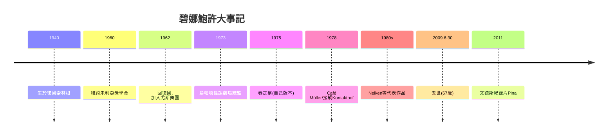

# 9.1 碧娜·鮑許：烏帕塔的泥土與眼淚

時間：1940年至2009年

## 從埃森到烏帕塔

碧娜·鮑許（Pina Bausch，1940年至2009年）生於德國西部工業城市索林根附近，在戰後的瓦礫中長大（她自述童年最深的身體記憶之一是躲防空洞的恐懼；戰後德國的廢墟感與壓抑，是她終生的創作土壤）。她跟隨埃森的庫特·尤斯（Kurt Jooss，德國表現主義舞蹈Ausdruckstanz的重要傳人，1932年名作《綠桌》Green Table以舞蹈譴責戰爭）學舞，1960年獲獎學金赴紐約朱利亞——在美國，她接觸了葛蘭姆、保羅·泰勒與霍塞·林蒙（José Limón）的技術。1962年她回到德國加入尤斯在埃森的舞團，1969年前後開始嘗試編舞。1973年，她被邀請出任烏帕塔（Wuppertal）的舞蹈劇場（Tanztheater Wuppertal）總監——烏帕塔是一座以工業污染與失業著稱的魯爾區城市，地方政府的劇院資源在1970年代的文化氣氛下允許了她的實驗。

## 舞蹈劇場：不是舞蹈，也很少是劇場

鮑許發明的方法可稱為「問答式創作」：她對舞者提出問題（關於初戀、關於童年、關於愛與羞辱的記憶），舞者以口述、即興動作與個人故事回答；她把這些「素材」拆解、重組、精煉，編成表演。作品因此不再有「芭蕾的故事」，而是一群真實的人的關係網：日常動作、日常生活片段與對白，都在舞台上成為編舞的材料。

她的代表作相對清晰：《Café Müller》（1978年）以翻滾的椅子與「看不見彼此的舞者」構成一種親密的失效；《接觸》（Kontakthof，1978年）以社交舞的群落結構拷問尷尬與羞辱；1975年的《春之祭》（Rite of Spring，改編自斯特拉文斯基）以泥土地板與反覆的「選拔」取代尼金斯基的舊版本——一場所有人看到的少女淘汰儀式。泥土、水、玻璃與樹，是她作品的常駐材料（《Nelken》1982年的洋紅色花地毯佈滿整個舞台三小時）。她的舞台美學有兩個特徵：其一，「佈景與真實的張力」（真實的樹、水與泥土打破舞台的假象）；其二，重複的力量——相同的動作段落與情境反覆出現，逼觀眾看著自己。

## 烏帕塔的「制度」為何重要

鮑許能在烏帕塔做這些實驗，依賴德國文化制度的關鍵特徵。其一，地方政府的文化支出穩定：德國的市政劇院制度使藝術總監有長約與穩定預算（這使她可以花數年時間打磨一部作品）。其二，1970年代的「文化民主化」氛圍使新藝術獲得制度性資源。其三，她的舞團由德國、荷蘭、法國、西班牙、韓國、日本等多國背景的舞者組成，「提問—回答」的共同創作流程成為新的知識生產方式（與19世紀帝國劇院的「宮廷—編舞—舞者」結構對比強烈）。她的作品在國際上的傳播依賴制度：1980年代起，倫敦、巴黎、紐約、東京的國際藝術節為她提供市場，並引發了激烈的兩極評價（部分評論者當年稱她的作品「不是舞蹈」）。

鮑許2009年6月30日去世（67歲，肺癌確診後不久）。她死後，作品的「經典化」加速：2011年溫德斯（Wim Wenders）的紀錄片《Pina》獲得奧斯卡提名，把她與烏帕塔帶向全球電影院；烏帕塔舞蹈劇場在她的命名下繼續運作，《春之祭》《Café Müller》《接觸》《Nelken》至今仍是世界各大藝術節的常演作品。她對當代舞蹈的影響深刻而具體：其一，把口述、日常動作與真實經驗正式納入編舞的原料；其二，把女性的、政治的、社會關係中的暴力放上舞台，使舞蹈被重新審視為社會批評的形式；其三，她的製作流程成為當代編舞者的工作範本（從 Jérôme Bel、Meg Stuart 到亞洲的文獻劇場式編舞都可見其影響）。

