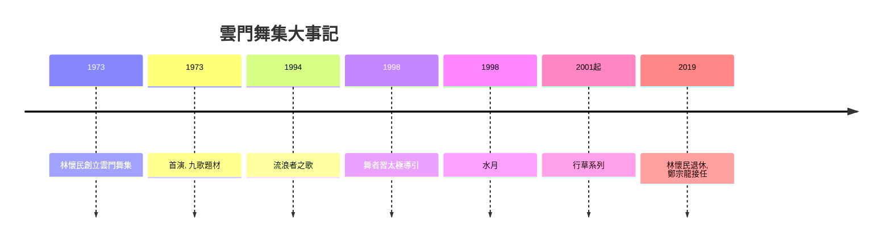

# 9.2 雲門舞集：太極與氣功的當代轉譯

時間：1973年至今

## 台灣第一個職業現代舞團

1973年，林懷民（1947年生）在台灣創立雲門舞集——「雲門」取自傳說中黃帝時代最古老的樂舞之名（呼應本書第二章的中國樂舞傳統）。這不只是一個「純藝術」的決定：戒嚴時期的台灣（1949年至1987年）正面臨文化身分的焦慮——「中國傳統與在地現實」在文化上懸而未決。林懷民青少年時代即已是知名的青年小說家（《蟬》曾在1960年代獲文學獎項），1969年赴美攻讀新聞與文學，在美期間接觸現代舞與舞蹈演出（他曾於瑪莎·葛蘭姆與模斯·康寧漢的演出現場留下強烈的震撼記憶），1972年起在美愛荷華大學獲藝術碩士（小說創作方向），次年回台灣創立舞團。雲門早期口號是「中國人作曲，中國人編舞，中國人跳舞給中國人看」——試圖建立一種「自己的舞蹈」：古典與現代技術、西方語彙與中國文化題材並置。1973年首演節目中即有以屈原《九歌》為題材的作品（後於1993年完成正式編舞的《九歌》，成為雲門經典）。

制度面有兩個關鍵條件。其一，1970年代台灣地區的文化政策空間：行政院文化建設委員會（1979年成立）與地方文化中心的建設為職業舞團的制度化提供了歷史條件。其二，民間經濟的成長：1970與80年代的台灣（出口導向的工業化）培養了足以支持「非營利藝術」的中產階級與企業贊助者。雲門舞團成立時是民間募款與票房模式，1980年代開始獲得公眾資源，成為一個同時依靠票房、政府與企業贊助的職業舞團——這在當時的中華文化圈是罕見的藝術生態。

## 從敘事到身體：《水月》與《流浪者之歌》

雲門世界級的突破高峰是1990年代。先是《流浪者之歌》（1994年，編舞林懷民）：以赫塞小說為題材（但不敘事），九十分鐘的舞台上，一名僧侣面對持續從高處傾瀉的稻穀，身體極度膨脹；舞者在稻穀中緩慢移動，如同苦行。整個作品的技術基礎是靜坐、呼吸與內觀的內在性——速度與重量完全反 usual 的「快與技巧」。林懷民自述作品源於1994年在印度菩提迦耶的一次旅行（他在樹下、在恆河邊所感受的時間，說「我回到劇場，想把那個時間帶回來」）。1998年起，雲門舞者開始修習太極導引（源于台灣太極武術家熊衛的內家功法，強調旋腕轉腰、呼吸沉放）與靜坐，作為每日的訓練與創作方法——這是一個真正的技術革命：現代舞的身體中心，從格拉姆的骨盆收縮轉移到東方的水、氣與丹田。

《水月》（1998年，編舞林懷民）是這個轉向的完整呈現：以巴哈《無伴奏大提琴組曲》為伴奏（西方古典音樂的憂鬱水聲）；舞台鋪以水面與鏡子（舞者映在水中與鏡中的倒影無盡）；舞者以太極導引的沉、轉、鬆與呼吸律動為動作基礎，動靜之間有明顯的「空隙」。標題取自「鏡花水月」的佛家意象：身體似在形成、又在消失。《水月》在國際上的成功拉動了雲門的聲望：1990年代末至2000年代在紐約（下一景 Next Wave Festival）、倫敦、巴黎、柏林、雪梨等地巡演，常被西方主流劇場當作「國際一流」的亞洲舞團接受。2000年代，林懷民持續以書法（《行草》系列2001年起，包括《行草》《行草 貳》《狂草》）與水的意象進行創作——「書法身體」成為雲門的第二個技術簽名：以呼吸帶動筆勢般的流動，力道在身體的停頓與延展之間。

## 為什麼亞洲身體在當代舞蹈成為資源

雲門的成功不是孤例。1990至2000年代，亞洲的身體傳統大量轉譯為當代舞：日本的山海塾（Sankai Juku，天兒牛大主持，源於1970年代土方巽與大野一雄創立的舞踏Butoh——一種在戰後創傷中誕生、以白面、緩慢、變形身體表現的藝術，1980年代起在巴黎與紐約獲得主流成功）；韓國的當代舞者群與2000年起韓國舞蹈節的興盛；香港的新舞蹈藝術與新加坡舞團；以及2000年後中國大陸的舞者群（沈偉2000年起以沈偉舞蹈藝術在紐約確立名聲，融合書法、武術與現代舞的技術框架）。這些案例的共同點是：以西方「現代舞」的技術系統（呼吸、地板、重量、空間）為基礎，重新填入亞洲身體的哲學資源（太極、武術、佛教與道家的內觀）——結果不是「東方民俗」，而是語法與身體的新設計。

雲門在2019年發生轉型：林懷民卸下藝術總監一職（2019年11月起由鄭宗龍接任——新任總監同樣以「台灣在地身體」為創作出發，如《十三聲》以廟會街頭的身體律動與南管音樂為素材），舞團在博物館與國際藝術節繼續運作。今天，雲門是同時具有「技術系統」（太極導引與內觀訓練）、「劇目」（從《九歌》到《水月》）、「制度」（職業舞團、排練場、教育計畫）與「觀眾」的少數職業舞團之一——它證明了太極與呼吸可以是「可以被教導的技術」，而不只是文化象徵。

