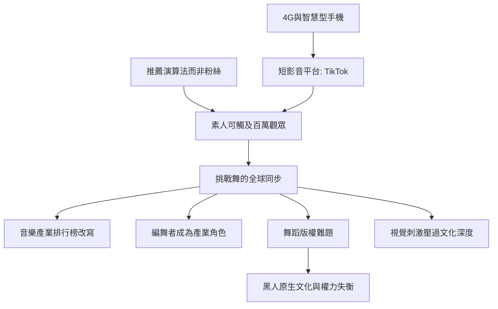

# 10.1 TikTok與挑戰舞：全球最快的視覺語言

時間：2016年至今

## 短影音的物理基礎

要理解TikTok weltauswirkung，得回到三個技術條件。其一，智慧型手機的攝影能力與行動網路的普及（2010年代中期，4G的普及使短影音的上傳與觀看在大多數國家成為日常）。其二，短影音平台的演算法（TikTok的前身是2014年的Musical.ly——初平台以「對嘴與短音樂影片」起家，2018年與字節跳動的抖音合併為TikTok，其推薦演算法根據用戶的停留、重播與互動快速優化內容分發——「演算法而非粉絲」是TikTok與YouTube與Instagram的關鍵差異：素人可在幾分鐘內觸及百萬觀眾）。其三，音樂片段的截取與舞步的複製：TikTok的操作邏輯（同一首歌的15秒片段、同一段舞可以「挑戰性」的複製與變異）使舞蹈成為全球性的視覺流行語言。

「挑戰舞」（dance challenge）的機制不是全新事物：更早的「Macarena」（1996年，全球舞蹈熱）、「YMCA」（1978年，Village People），與1990至2000年代的說唱舞蹈（Crunk/Dougie gibi）都是全球性舞蹈流行。但TikTok的關鍵差異在於「速度與規模」：一支舞可以在數小時內跨越國界；素人的「九次失敗」與「第十次成功的」過程被公開地展示，模仿門檻極低；同時，「挑戰」的參與是「可量化」的（按讚、重複、剪輯）——舞蹈第一次以「可傳播的物品」的邏輯運作（這正是本書自第1章以來的長期主題：從篝火的不可複製，到螢幕上的無限複製）。

## 從素人到「舞蹈網紅」

2019至2020年，兩個代表人物顯示了此結構的商業規模。其一是賈萊亞·哈蒙（Jalaiah Harmon，亞特蘭大十四歲的年輕舞者）：她在2019年9月上傳「Renegade」一段舞（以 K Camp 的〈Lottery〉為節拍）；該舞隨後被多位名人（Charli D'Amelio、Hailey Bieber 等）與 NBA 球星模仿，引發「原創者被忽略」的強烈討論：原始上傳者的名字在早期傳播中未被連結，賈萊亞直到主流媒體追問才被認可；她最終在2020年的 NBA 全明星週末登場表演幾段 Renegade，獲得主流認可。其二，查莉·達美利奧（Charli D'Amelio，2004年生）：2019年加入 TikTok，2020年即成為該平台粉絲數第一的用戶——僅透過舞蹈與舞蹈的翻跳（不唱歌、不主持，不「擁有音樂」），成為當時年收入最高的社群明星之一（據 Forbes 當年的估算，其商業收入達七位數美元）。

## 舞蹈在短影音時代的改變

TikTok的舞蹈效應在產業層面影響顯著。其一，音樂產業的「舞曲化」：2019至2020年，多首歌曲因短影音上的舞蹈潮流而再熱（如 Doja Cat 的〈Say So〉、Lil Nas X 的〈Old Town Road〉延燒現象），Billboard 在2020年把 TikTok 等平台的互動納入 Hot 100 的計算——短影音正式成為主流排行榜的一部分。其二，編舞者成為產業核心角色：TikTok 孵化的編舞者成為重要產業社群（他們與唱片公司直接合作，為 MV 與舞台設計舞步），「招聘一位能發起挑戰的編舞者」成為 2020 年後音樂行業的新職位。其三，疫情封城期間的全球同步：2020年封城時，年輕人在家中跟著短影音跳舞（TikTok 的活躍用戶集中在十至二十九歲群體），全球青少年在同一時間學同一段舞——舞蹈史第一次出現「全球同步的流行」。

## 誰的舞蹈？誰的錢？

但這個體系有深層的分配與倫理問題。其一，舞步的「版權」幾乎無法被執行：在美國，編舞要受版權保護需以「可寫錄的具體編舞」為條件（一般街頭盛行舞步不構成著作權），因此戰鬥、Jersey Club 與其他社區舞蹈被一再「無償借走」；2022至2023年，多起 TikTok 舞蹈者對大型明星與公司的訴訟與公開倡議（爭取 credit 分潤），成果有限——從布朗克斯開始的權力不平衡，在短影音時代更為尖銳。其二，全球流行的「去脈絡化」：舞蹈跨越語言與文化邊界傳播，常不攜帶文化脈絡（黑人文化、原住民文化與宗教族群舞被以表面方式摘取）。其三，注意力經濟的身體標準：短影音傾向以「展示身體」與低面積故手感聚焦的贏得流量的邏輯，形成對舞蹈的「視覺刺激壓過深度」的批評（舞蹈學界近年的主要討論）。下一節，我們回到技術的末端：動態捕捉與 AI 對身體的徵用。

