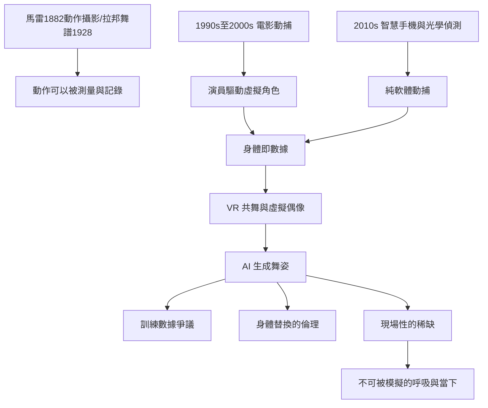

# 10.2 動態捕捉與AI舞姿：身體的數位化

時間：2010年代至今

## 從Mo-Cap到身體的拆解

動態捕捉的技術歷史可以分兩段。第一段是「動作分析」：1882年，法國生理學家馬雷（Étienne-Jules Marey）以攝影槍拍下人體運動的連續影像（與麥布里奇 Eadweard Muybridge 1878年的動作攝影同步），成為動作科學的起點；魯道夫·拉邦（Rudolf Laban）1928年發明的拉邦舞譜（Labanotation）則是舞蹈動作「可書寫」的系統。第二段是「動作驅動」：1970至1980年代的動畫與生物力學追蹤實驗、1990年代起的電影工業應用（2001年的《魔戒》，安迪·瑟基斯 Andy Serkis 借動捕驅動古魯姆角色，是最著名的里程碑之一）——演員的身體驅動了虛擬角色，動捕成為影視工业的專業學科。

第二段同時也是「舞者成為數據」的開始。2010年代，舞蹈遊戲（Just Dance 的 Ubisoft 系列、微軟 Kinect 體感）以攝影機偵測身體動作；蘋果 ARKit 與各手機廠商的深度鏡頭使「手機攝影就能追蹤人體關節」成為規格；從2020年起，Meta（原Facebook）的 Quest 頭顯與 AI 姿態偵測模型（如 MediaPipe 等開源方案）使「純軟體動捕」（不需昂貴的光學鏡頭與感測器服裝）達到常常足夠的性能——專業與消費級的動作數據採集全面普及。

## 動捕與舞蹈創作

動捕在舞蹈創作上的應用很早，且常常不是從好萊塢開始。默斯·康寧漢（見第六章）1990年代即以 LifeForms（舞蹈動作建模軟體）與動捕結合，編作了《CRWDSPCR》與《BIPED》（1999年，"BIPED" 的「光點舞者」以動捕重現舞者動作，成為舞蹈與數位融合的經典案例）；韓國的 K-pop 產業（2010年代後期）與日本的動畫影視產業系統性地使用動捕技術制化偶像舞蹈與動作。

2020年代，這條路有了兩個明確的新方向。其一，「雲端舞團」與遠距共舞：2020年疫情封城期間，全球舞蹈社群以 Zoom、Instagram Live 與 VR 空間（VRChat 的舞蹈社群成為新舞台）開展「同時不同地」的排練與表演——身體不再必須共處一室；在 VR 的 avatar 中，一個人可以以任何形象跳舞。其二，虛擬偶像的商業化：初音未來（2007年 Crypton Future Media 的 Vocaloid 歌聲合成軟體）開啟「無人類歌手」的文化與商業生態，其演唱會以虛擬形象投影登台；2020年起，K-pop 的虛擬偶像（如 SM 娛樂 aespa 的虛擬人格設定）與2020年代的虛擬主播圈（VTuber）常態化。虛擬偶像的舞蹈是純粹數據驅動的表演：編舞以動捕錄製後驅動虛擬角色，人不在一起、角色在台上。

## AI生成舞姿與三個問題

2022至2024年，AI 舞姿生成研究（如 Google 的 DanceNet、Meta 的 MM-Diff 系列與 EDGE 等模型）可以以一段音樂為輸入，生成與節拍協調的人體動作序列；TikTok 與短影音上的 AI 舞蹈（AI 生成的舞姿、或以 AI 替換舞者身體的工具）成為話題；2023年前後，實驗性的 AI 編舞工具也允許以文字描述生成動作框架。此類技術的問題不在「能不能」，而在舞蹈學界與編舞者的三重疑慮。

其一，訓練數據的所有權：AI 生成舞姿的訓練來自大量人類影片——「誰的動作被用於訓練、卻未得到報酬」，是與 AI 音樂訴訟（2024年 RIAA 訴 Suno 與 Udio）同構的問題。其二，身體可以被替換：以動作轉移與部位置換的模型（face/body swap 類工具），可以把一個人的舞蹈動作「放到另一個人的身體上」，舞者的身體成為可被改形（改性別、形體、膚色、年齡）的材料，引發濫用與歧視的擔憂。其三，現場性的倫理價值：本書第五章至第九章反覆證明，現場的身體（鄧肯的赤腳、尼金斯基的暴動、葛蘭姆的收縮與呼吸、鮑許的口述、街頭的群體力量）是人類獨有的資產——當身體成為數據，現場是否將會只成為「視覺化的一種匹配」？

答案是歷史的：每一次「技術破壞」都沒有消滅舞蹈，而是迫使人類更清楚自己的身體價值。19世紀的照相術，把人體從「純粹的視覺對象」解放為「表達的工具」；20世紀的錄音技術把音樂拆成「記錄與再現」與「現場的身體」兩屬價值；21世紀的 AI則把身體拆成「可以被模擬的動作序列」與「不可被模擬的呼吸、生命與當下」。後者——從古希臘的洞窟、印度濕婆舞王的身體、到同一個此時此刻的呼吸——可能是人類舞蹈在演算法時代的形狀：不可複製的身體是頂級的稀缺品，而「在場」的價值，從未被這麼高過。

