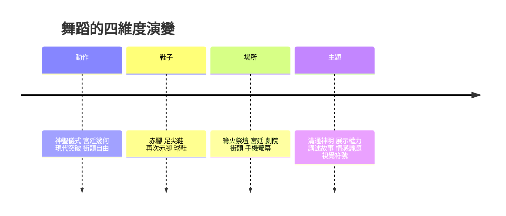

# 舞蹈的故事：從祭祀狂歡到肢體革命的身體史詩

舞蹈是最古老的藝術，也是最短命的藝術：它不需要任何工具，卻在動作結束的瞬間消失。正因如此，舞蹈史是一部「看不見的歷史」——直到攝影與錄影出現之前，所有舞蹈都只存在於文字描述與繪畫之中。本書沿著四條主線展開：動作與規範的演變、鞋子與身體的關係、場所與受眾的遷移、主題表達的擴張，從篝火旁的模仿，一路講到手機螢幕裡的舞姿。

## 第一篇：身體的初音與神聖的狂歡

* 第1章-篝火、巫術與獵場的模仿
    * [1.1-岩畫上的跳躍人影：舞蹈作為最早的語言](01.1-岩畫上的跳躍人影：舞蹈作為最早的語言.md)
    * [1.2-埃及祭祀舞與酒神節：神聖與狂歡的兩極](01.2-埃及祭祀舞與酒神節：神聖與狂歡的兩極.md)
* 第2章-東方的禮樂與神話之舞
    * [2.1-周朝六代樂舞與唐朝霓裳羽衣](02.1-周朝六代樂舞與唐朝霓裳羽衣.md)
    * [2.2-濕婆舞王與《舞論》：宇宙哲學的身體化](02.2-濕婆舞王與《舞論》：宇宙哲學的身體化.md)

## 第二篇：幾何、宮廷與足尖上的奇蹟

* 第3章-太陽王的宮廷奢華與芭蕾的誕生
    * [3.1-從義大利宮廷到法蘭西：凱瑟琳的引進](03.1-從義大利宮廷到法蘭西：凱瑟琳的引進.md)
    * [3.2-路易十四與皇家舞蹈學院：芭蕾的制度化](03.2-路易十四與皇家舞蹈學院：芭蕾的制度化.md)
* 第4章-浪漫主義與足尖上的飛翔
    * [4.1-《仙女》與塔里奧尼：足尖鞋的革命](04.1-《仙女》與塔里奧尼：足尖鞋的革命.md)
    * [4.2-柴可夫斯基三大芭蕾與佩蒂帕的黃金時代](04.2-柴可夫斯基三大芭蕾與佩蒂帕的黃金時代.md)

## 第三篇：脫下束縛——現代舞的身體革命

* 第5章-赤腳的女神與自然的律動
    * [5.1-鄧肯：脫下舞鞋與束腹的赤腳革命](05.1-鄧肯：脫下舞鞋與束腹的赤腳革命.md)
    * [5.2-《春之祭》與尼金斯基：巴黎的肢體暴動](05.2-《春之祭》與尼金斯基：巴黎的肢體暴動.md)
* 第6章-收縮與釋放——現代舞語彙的確立
    * [6.1-瑪莎·葛蘭姆：把痛苦寫進肌肉](06.1-瑪莎·葛蘭姆：把痛苦寫進肌肉.md)
    * [6.2-康寧漢與機遇舞蹈：擺脫音樂的附庸](06.2-康寧漢與機遇舞蹈：擺脫音樂的附庸.md)

## 第四篇：街頭的爆發、大眾文化與影視流行

* 第7章-爵士、百老匯與爵士舞狂潮
    * [7.1-《西城故事》：舞蹈成為敘事語言](07.1-《西城故事》：舞蹈成為敘事語言.md)
    * [7.2-鮑勃·福斯：帽子、手套與微傾的身體](07.2-鮑勃·福斯：帽子、手套與微傾的身體.md)
* 第8章-紐約街頭的派對與Hip-Hop文化
    * [8.1-布朗克斯的破拍與B-Boying的誕生](08.1-布朗克斯的破拍與B-Boying的誕生.md)
    * [8.2-麥可·傑克森與月球漫步：MTV時代的身體](08.2-麥可·傑克森與月球漫步：MTV時代的身體.md)

## 第五篇：跨界融合、數位動態與未來身體

* 第9章-舞蹈劇場與極致的身體探索
    * [9.1-碧娜·鮑許：烏帕塔的泥土與眼淚](09.1-碧娜·鮑許：烏帕塔的泥土與眼淚.md)
    * [9.2-雲門舞集：太極與氣功的當代轉譯](09.2-雲門舞集：太極與氣功的當代轉譯.md)
* 第10章-動態捕捉、短影音與AI時代的舞姿
    * [10.1-TikTok與挑戰舞：全球最快的視覺語言](10.1-TikTok與挑戰舞：全球最快的視覺語言.md)
    * [10.2-動態捕捉與AI舞姿：身體的數位化](10.2-動態捕捉與AI舞姿：身體的數位化.md)

## 核心線索

