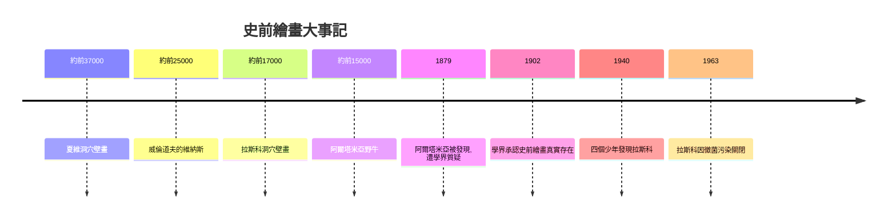

# 1.1 拉斯科與阿爾塔米亞：狩獵巫術與最初的畫家

時間：約西元前35,000年至前3,000年

## 深埋地底的畫廊

1879年，西班牙業餘考古學家桑圖奧拉帶著小女兒瑪麗亞走進阿爾塔米亞洞穴。女兒鑽進低矮的洞道，抬頭一看，驚呼：「牛！牛！」洞頂佈滿了生動的野牛，有些長達兩公尺以上。當時學界根本不相信，他們認為原始人不可能畫出這麼好的畫，甚至指控桑圖奧拉偽造文物，害他抑鬱而終。直到1902年，法國學者布勒伊親自檢驗後才承認：這些畫確實是舊石器時代的真跡。學術界花了二十多年，才願意相信一萬多年前的獵人是優秀的畫家。

1940年9月，法國多爾多地區，四個追球的少年發現了拉斯科洞穴。他們的狗掉進了地洞，探查時意外揭開了這座「史前羅浮宮」：長達兩百多公尺的洞壁上，畫了六百多頭動物，包括著名的「大公牛廳」。畫家利用岩石的凸起與凹陷製造立體感，以礦物粉末調和油脂上色，用吹管把顏料噴在壁面上，做出暈染效果。洞穴深處沒有自然光，他們靠油燈工作，而油燈的殘留至今仍可在地面找到痕跡。

## 為什麼要在黑暗中作畫

這些畫不是裝飾品。拉斯科的許多畫作位於伸手不見五指的深處，必須攀爬、匍匐才能抵達，明顯是為了某種儀式而非日常觀賞。主流學說是狩獵巫術：把獵物畫出來、射進去，就等於在精神世界裡先捕獲了牠。阿爾塔米亞的野牛身上確實有刻痕，拉斯科的馬群周圍也有成簇的箭狀符號。另一派說法是薩滿的出神繪畫，畫者在地底幻象中與動物的精靈溝通。還有學者注意到夏維洞穴中互相重疊的獅子與猛獁象，認為那可能是星象紀錄或季節曆法。真相沒有定論，但可以確定一件事：人類在還沒有文字、金屬、農業之前，就已經有了象徵思維，會把「看不見的意義」寄託在「看得見的形象」上。

## 冰河期的科技與經濟

作畫的顏料是三萬年前的「化工材料」：赭石、赤鐵礦與氧化錳，其中有的礦石採集自數十公里外，說明存在早期的物質交換網絡。夏維洞穴的研究者甚至在附近岩層中找到疑似「繪畫工作台」的痕跡。這一切的前提是冰河期的氣候：歐洲大平原上巨大的獸群養活了依賴狩獵的群體，人們有集體的宗教需求，也有分工——有人狩獵，有人專門執筆。藝術的誕生，是團隊合作與剩餘資源的產物。

## 一條延續三萬年的線

洞穴壁畫是人類視覺紀錄的起點。之後埃及人為死者作畫、希臘人為神作像、教堂的玻璃為上帝發光、攝影機捕捉光線、AI演算法生成影像——每一次技術躍進，本質上都在回答同一個問題：如何把「眼睛看到的」或「心裡想的」固定成可傳遞的形象。冰河期的獵人用吹管與赭石回答了第一遍。當拉斯科洞穴因觀光者的呼吸與黴菌污染而於1963年關閉時，人類也開始用雷射掃描與VR技術複製洞穴，讓後人能隔著螢幕「回到」一萬七千年前。藝術史的第一章，就這樣與最後一章互相呼應。

