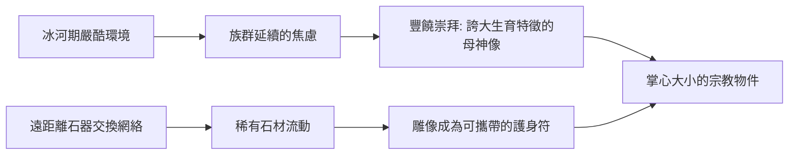

# 1.2 威倫道夫的維納斯：母神崇拜與豐饒的雕刻

時間：約西元前28,000年至前20,000年之間

## 一尊沒有臉的女神

1908年，奧地利瓦豪河谷的威倫道夫附近，考古學家在舊石器時代的遺址中挖出一尊十一公分高的石灰岩小雕像：一位體態豐滿的女性，乳房、腹部與臀部被刻意誇大，雙手合於胸前，頭部卻是捲曲的紋樣，沒有五官。她被命名為「威倫道夫的維納斯」，距今約兩萬五千年，是史前最著名的女性雕像。她的身體表面殘留赭紅色顏料的痕跡——她不只是被雕出來的，還是被「化過妝」的。

這尊小像絕非孤例。從法國到西伯利亞，考古學家在歐亞大陸發現了上百件類似的舊石器時代女性雕像，年代從兩、三萬年前到一萬多年前的勒文斯貝爾格地區出土的肥臀雕像都屬同一家族。它們大小相近、皆可置於掌中，多半強調生殖與哺育的部位，而壓抑個人的面目。這種跨地域的一致性，暗示冰河期的獵人社群之間存在廣泛的文化交流與共享的信仰。

## 為什麼是「她」

最通行的解釋是豐饒崇拜。冰河期的環境嚴酷，族群能否延續，關鍵就在生育與食物。誇大生殖特徵、抹去個人面容，正好指向「母親」這個抽象角色而非任何一個具體的女人。持有她的手可能屬於孕婦、產婦或部落裡主持儀式的人。另一派學者認為這是女性自視的雕刻，甚至是某種護身符或講故事的道具。無論哪種說法成立，都指向同一個事實：在文字出現之前，人類已經用雕像來封存觀念——生命、繁衍、庇護。

值得對照的是洞穴壁畫。拉斯科的畫幾乎全是動物，人類形象極少且簡陋；而「維納斯」雕像幾乎全是女人，動物反而缺席。冰河期的藝術明顯分成兩個系統：洞穴裡與獸群對話的男性獵人傳統，以及營地中與生命和母性對話的母神傳統。兩者並存，構成了人類最早的宗教圖像。

## 材料與流動的社會

威倫道夫的維納斯用的是奧地利當地不產的鰐狀石灰岩，產地遠在數百公里外的義大利阿爾卑斯山南麓或類似的遠處地質帶。這塊石頭是透過早期的交換網絡抵達瓦豪河谷的。換句話說，兩萬五千年前的「藝術品」已經參與了貿易與身份表達——稀有的材料、掌心可握的尺寸，讓她可能被攜帶、贈予、世代相傳。藝術從誕生之初，就是社會關係的一部分。

## 「維納斯」這個名字的誤導

用希臘女神維納斯來命名史前雕像，是十九世紀學者的浪漫想像，帶著把「豐滿」讀成「色情」的偏見。現代學界更傾向稱之為「女性雕像」或「母神像」，因為我們無法知道創作者真正的意圖。這個插曲本身就是一堂課：每一代人看歷史，都戴著自己時代的眼鏡。後面我們會一再看到這種現象——文藝復興用古希臘的尺規丈量世界，啟蒙時期把哥德式建築貶為野蠻，而二十世紀的畢卡索卻在非洲面具裡看到立體主義。藝術史的演進，一半是創作的演進，一半是「眼光」的演進。

