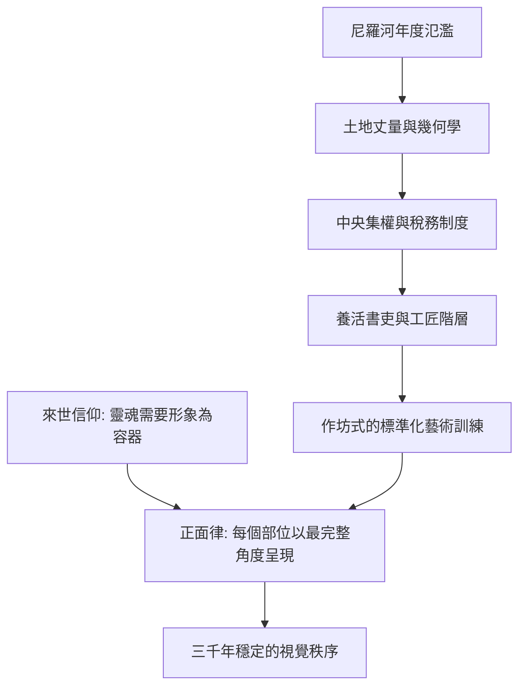

# 2.1 正面律：為死後世界服務的嚴謹法則

時間：約西元前3000年至前332年

## 一條寧可僵化也不改變的規則

如果你把古埃及的墓室壁畫並排看上幾十幅，會發現一件怪事：隔了將近三千年的作品，人的畫法幾乎一模一樣。頭是側面，眼睛卻是正面；肩膀與胸膛是正面，腰與雙腿又是側面；男人塗紅褐色，女人塗淡黃色；主人比僕人大，法老比所有人都大。這套固定的畫法被後世稱為正面律，它不是古埃及人不會畫側面，而是他們根本不打算改。

理解這條規則的鑰匙不在藝術，而在宗教與制度。古埃及人相信死亡不是結束，靈魂「卡」（ka）需要回到身體，而畫在墓壁上的形象就是備用的容器。既然畫像要供靈魂「使用」，那麼每一個部位都必須以最完整、最可辨識的方式呈現：側面的臉能顯示鼻子與下巴的輪廓，正面的眼睛能看到整隻眼，正面的肩膀能看到兩隻手臂。從任何單一角度寫實地看一個人，都會「少掉」什麼。埃及繪畫因此不是某一刻的快照，而是人體的圖解大全——接近文字的性質，而非接近照片。事實上，埃及象形文字與繪畫本來就同源共存，在墓壁上常常就是一行文句接一幅圖。

## 尼羅河、稅務與幾何

這套法則得以維持三千年，靠的是一個高度中央集權的農業帝國。尼羅河每年氾濫後要重新丈量土地，這催生了幾何學與嚴密的行政系統；糧食的集中儲存養活了祭司、書吏與工匠階層。畫師與石匠是國家公務員，在神廟附屬的作坊裡接受標準化訓練，用方格網把人體比例固定下來（站姿約十八格高）。風格的統一，其實是官僚體制的統一。個人創意不是被禁止，而是沒有位置——墓室的目的是永恆，而永恆容不下時尚。

## 為死者服務的藝術生產線

金字塔不只是法老的墳墓，更是一場持續數十年的國家工程，動員數以萬計的工人（近年的考古發現表明工人是領取報酬的平民，而非電影裡的奴隸）。吉薩大金字塔由約兩百三十萬塊巨石砌成，底邊誤差不到二十公分，四邊幾乎精準朝向東南西北。這種工程精度反過來餵養了繪畫與雕刻的秩序感。一座貴族的墓室，從牆面打格、起草、上色到雕刻銘文，是作坊流水線的產物，主題遵循固定的「清單」：耕作、捕魚、宴飲、供品——把死者生前享用的一切，連同僕役與食物，都複製一份帶進永恆。

## 法則的裂縫

但法則並非鐵板一塊。古王國時期的書吏坐像（如收藏於羅浮宮的《書吏凱伊》）眼睛鑲了水晶，寫實得驚人；中王國時期的法老像一度流露疲憊與滄桑。最徹底的例外發生在第十八王朝，下節我們會看到，一位異端法老如何用一場宗教革命，短暫地撼動了這套延續千年的美學秩序。

