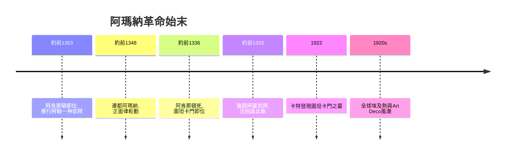

# 2.2 圖坦卡門的金面具與阿瑪納的寫實革命

時間：約西元前1353年至前1323年

## 一個被遺忘的少年法老

1922年11月，英國考古學家霍華德·卡特在帝王谷苦等多年後，終於挖開了一道封閉的墓門。他往裡探望，舉燭照見滿室珍寶，雇主卡納馮伯爵在身後急問：「你看得見什麼嗎？」卡特答出考古史上最著名的一句話：「是的，奇妙的東西。」這座墓屬於圖坦卡門，一個十八歲左右便早逝、在歷史上幾乎被遺忘的少年法老。他的墓因為後世在他墓口上方建造了其他墓室工匠的工棚而意外躲過歷代盜墓者，成為帝王谷唯一幾乎完整出土的法老墓。五千餘件隨葬品中，最著名的是重約十公斤半的黃金面具，青金石、石英與黑曜石鑲嵌出永恆的凝視，額頭上盤踞著眼鏡蛇與禿鷹。

但黃金面具只是序曲。真正讓藝術史家興奮的，是這座墓與少年法老背後的那場革命。

## 阿瑪納：一神教的藝術革命

圖坦卡門的岳父（也是繼父）阿肯那頓，是古埃及史上最離經叛道的法老。約西元前1353年即位後，他廢黜了阿蒙神為首的整個萬神殿，獨尊太陽圓盤「阿頓」，甚至把首都從底比斯強遷到新建立的阿瑪納。這是人類歷史上最早的一次一神教實驗。

宗教革命立刻改寫了藝術法則。延續千年的正面律在阿瑪納鬆動了：法老被畫成長臉、厚唇、細腰、隆腹的怪異模樣，不再是肌肉完美的神王，而是一個活生生（甚至有點病態）的人。更驚人的是私人墓室壁畫的內容——阿肯那頓與妻子娜芙蒂蒂抱著女兒親吻，在陽光下嬉戲。王室成員公開表現家庭溫情，這在埃及藝術中前所未有。柏林博物館收藏的娜芙蒂蒂半身像，以優雅的長頸與高顴骨成為古埃及美的代名詞，正是這場革命的產物。值得注意的是，這尊像的右眼並未鑲嵌，出土後學者推斷可能是工坊中的練習品或未完成之作，反而留下了古代雕塑工藝流程的珍貴線索。

為什麼？一說是宗教寫實——在阿頓教義中，陽光照耀萬物，真實即是神聖，沒有必要再維持理想的公式；一說是政治宣傳——法老一家作為阿頓唯一的人間中介，需要被塑造成一個親密無間的神聖家庭。也可能是阿肯那頓本人真的長成這副模樣（現代醫學曾推測他有馬凡氏症候群或內分泌疾病），宮廷藝術家奉命如實描繪。

## 革命的逆轉

阿肯那頓死後，這場實驗迅速崩潰。年幼的圖坦卡門在舊勢力（以權臣阿伊與將領荷倫希布為首）主導下恢復阿蒙崇拜，改名從圖坦卡頓改為圖坦卡門（「阿門的活形象」），遷回底比斯，並在復辟宣言石碑上痛斥阿瑪納時期「神殿荒蕪、諸神背棄埃及」。阿瑪納的藝術家與風格部分回流，影響了之後短暫的寫實傾向，但整體正面律在後續王朝全面回歸，並延續到托勒密時代。荷倫希布甚至系統性地剷除阿頓崇拜的痕跡，把阿肯那頓從王表上抹去。

這場藝術革命的失敗原因清晰可見：一神教觸動了阿蒙祭司集團的經濟命脈（神廟是全國最大的土地持有者），遷都與關閉舊神殿激起既得利益者的反撲，而阿頓崇拜本身缺乏民間基礎。藝術風格的鬆綁依附於政治權力，權力一倒，風格隨之覆滅。藝術的自主性，要再等兩千多年，等到文藝復興的贊助人體系與市場經濟成長起來，才真正獲得土壤。

## 一場革命的三十年餘波

弔詭的是，圖坦卡門之所以成為二十世紀的文化事件，正因為他是阿瑪納革命失敗的犧牲品：一個被官方歷史除名的法老，墓因此躲過精心盜掘，反而在三千二百年後完整重生。1920年代全球掀起埃及熱，Art Deco裝飾藝術風格的幾何線條、好萊塢的木乃伊電影、時裝上的埃及紋樣，全部源於這次發掘。藝術史再次證明它的一貫邏輯：影響未必發生在當下，藝術品的意義會被後來的世界重新發明。

