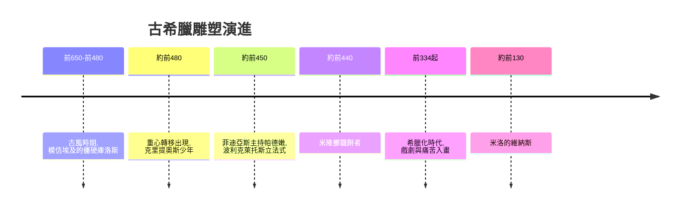

# 3.1 古希臘雕塑：從僵硬到運動中的靈魂

時間：約西元前800年至西元395年

## 從學徒到超越老師

古希臘雕塑的起點並不光彩：是學生。古風時期（約前800年至前480年）的大理石青年像（庫洛斯）明顯模仿埃及，雙臂貼身、左腳前跨、面帶微笑，姿態僵硬得像被釘住。希臘人自己也承認藝術源於埃及。但接下來的三百年，希臘人做了一件埃及人三千年不做的事：不斷修改規則。

古風末期，雕塑家開始讓重點落在重量分配上。西元前480年前後的《克里提奧斯少年》，臀部後傾、右腿承重、左腿放鬆，身體因此有了真實的扭轉——這就是影響此後兩千年雕塑的「重心轉移」（contrapposto）。人像從「立正的圖示」變成「站著的活人」。到了古典時期，波利克萊托斯寫下《法式》（Canon），用數學比例規範理想人體，並鑄造《持矛者》作為示範作品；同一時代，米隆的《擲鐵餅者》把運動員瞬間爆發的扭曲身體凝固在青銅裡。從埃及的正面律到希臘的運動人體，是一場徹底的觀念翻轉：埃及為永恆而畫，希臘為真實而雕。

## 黃金比例與畢達哥拉斯的世界觀

希臘人相信宇宙由數構成。畢達哥拉斯學派發現琴弦長度成簡單整數比時音色和諧，進而推論「美即數的和諧」。他們研究的比例中，一個數列的極限值後世稱為黃金比例

$$\varphi = \frac{1+\sqrt{5}}{2} \approx 1.618$$

帕德嫩神殿的立面比例、許多希臘建築與器物的構圖，都被認為暗含這類比例關係（嚴格的考證仍有爭議，但追求數學秩序的意圖確鑿無疑）。這種「以數求美」的信念，將透過維特魯威傳給文藝復興——達文西的《維特魯威人》正是畫在這條思想血脈的末端：人體是宇宙比例的縮影。

## 公元前五世紀：神殿、城邦與運動會

古典雕塑的爆發有其社會土壤。波希戰爭（前490年馬拉松、前480年薩拉米斯）勝利後，雅典以提洛同盟的貢金重建衛城，菲迪亞斯主持的帕德嫩雕刻群將神話與雅典城邦的榮光縫合為一。同時，奧林匹克等泛希臘賽會讓裸體運動員成為公共景觀，人體之美因此獲得宗教、體育與城邦榮譽的三重正當性——這是其他古代文明罕見的條件。雕塑也開始群像化、戲劇化：前五世紀末的《尼俄柏群像》表現母親與子女被射殺的哀慟，情緒首次成為主角。

## 希臘化時代：從神到人

亞歷山大大帝東征（前334年起）之後進入希臘化時代，藝術的贊助者從城邦擴大到君主與富豪，題材從理想的神與英雄轉向戲劇、痛苦與異國情調。《拉奧孔群像》表現祭司父子被海蛇纏繞的掙扎，肌肉、表情與構圖的張力達到古代頂點；《米洛的維納斯》（俗稱斷臂維納斯，約前130年製作）則以優雅的S形站姿成為古典美的最後總結。羅馬人狂熱地複製希臘雕塑，今天絕大多數希臘名作的「原件」其實是羅馬大理石複製品—— originals 多已佚失，羅馬等於替希臘做了一次大規模備份。

順帶一提：今天我們在博物館看到的白色大理石希臘雕塑，古代原本塗滿鮮豔的彩繪，近年透過紫外線與螢光殘留檢測已大量復原。「希臘是素雅白色」的印象，其實是文藝復興以降的誤讀，這是藝術史上「眼光的演變」又一例證。

