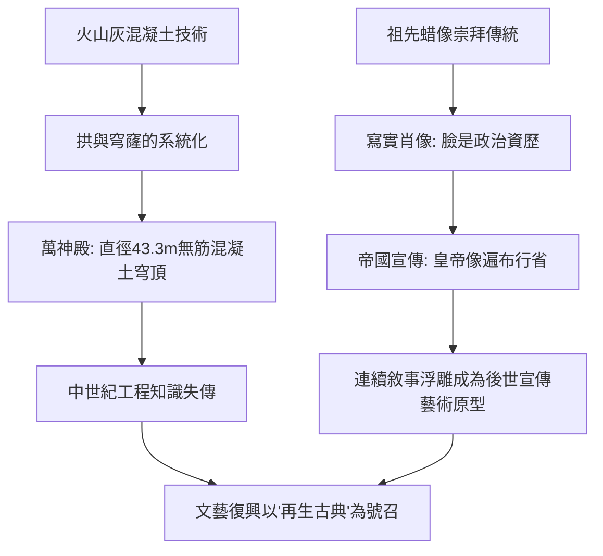

# 3.2 古羅馬的寫實肖像與建築奇蹟

時間：約西元前509年至西元395年

## 醜陋但誠實的臉

如果說希臘雕塑追求理想美，羅馬肖像走的幾乎是相反的路。共和時期（約前一世紀前後）的羅馬貴族胸像，皺紋、禿頭、下垂的嘴角、凸出的顴骨，無一隱瞞。這種「超寫實」有其文化根源：羅馬的「祖先崇拜」要求貴族家中陳列先人蜡像（imagines），喪禮時由親屬戴上蜡像遊行；肖像的重點是身分、履歷與德性，而非美貌。一張寫著滄桑的臉，等於一份可信的政治資歷——經驗與威望（gravitas）是共和國的硬通貨。

帝國時期，寫實傳統與政治宣傳結合。皇帝肖像成為遍佈帝國的「新聞媒體」：奧古斯都的《第一門奧古斯都像》刻意借希臘古典語彙把自己塑造成永遠年輕的統帥與大祭司；而忠於寫實的韋斯帕薌像則一副精明現實的中年政客相貌，這是內戰後新王朝刻意與奢靡的尼祿劃清界線的形象策略。同一套寫實技術，既能美化也能記錄，端看權力的需要。

## 混凝土：改變空間的科技

羅馬建築的偉大，首先是一場材料革命。羅馬人用火山灰與石灰配出混凝土（opus caementicium），並掌握以不同粒料調配強度的技術。混凝土可以澆築出前所未有的巨大穹頂，於是有了羅馬建築的兩大發明：拱與穹窿的系統化運用。

萬神殿（現存建築由哈德良皇帝約於西元118年至128年重建）是古代世界最驚人的空間成就：直徑43.3公尺的無筋混凝土穹頂，至今仍是世界最大的無鋼筋混凝土穹頂，內部高度與直徑相等，恰好放得下一個完整的球。穹頂中央的圓形天眼直徑近9公尺，是唯一的採光口，隨著太陽移動，一道光柱每天在神殿內緩慢巡行。工程細節處處是智慧：混凝土骨料自下而上由玄武岩（重）漸換為火山浮石（輕），牆基厚達六公尺，穹頂頂部僅一點二公尺，且內面以方形藻井（coffer）逐圈減重。羅馬人用科技把「天空」罩進了建築——這個「人間的宇宙」意象，將在一千三百年後的文藝復興由布魯內萊斯基與伯拉孟特接續。

其他傑作同樣以工程取勝：加爾橋水道橋三層疊拱輸水，坡度精算到萬分之幾；羅馬競技場（西元80年落成）以環形拱券結構容納五萬觀眾，設計了從各入口快速疏散的人流系統，其底層的獸籠與升降機構甚至可以讓猛獸「憑空」躍上場中。

## 凱旋門：石頭上的新聞稿

羅馬還發明了一種全新的藝術形式：敘事性紀念建築。圖拉真紀念柱（西元113年落成）以螺旋浮雕連環敘述達契亞戰役的兩千多個人物，像一卷展開的電影膠片；提圖斯凱旋門（約西元81年）的內壁浮雕表現羅馬士兵抬著耶路撒冷聖殿的七枝燭台遊行，是猶太戰爭的勝利紀錄，也是這段歷史最重要的圖像證據。這種「以連續敘事宣傳功績」的程式，將被後世反覆借用——從文藝復興的歷史畫到二十世紀的政治宣傳海報，血脈都可上溯至此。

## 羅馬留給歐洲的雙重遺產

西元476年西羅馬帝國滅亡後，羅馬的工程知識大量失傳，中世紀的歐洲再也造不出萬神殿。但羅馬留下了兩樣看不見的遺產：其一是拉丁語與羅馬法，成為中世紀教會與大學的骨架；其二是「帝國」這個政治想像本身——查理曼、神聖羅馬帝國、乃至拿破崙，都以繼承羅馬為正當性來源。藝術上同樣如此：中世紀的「羅馬式」建築直接以羅馬的拱券技術命名；文藝復興的字面意義就是「再生」羅馬的古典。下一章我們會看到，帝國的另一座都城君士坦丁堡，如何延續羅馬的命脈，並把藝術推向金色與靈性的方向。

