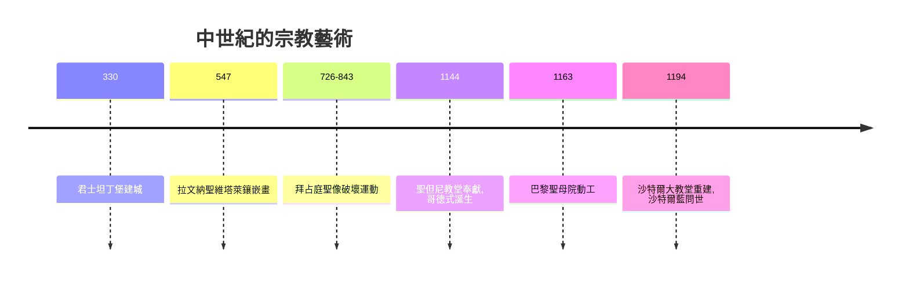

# 4.1 拜占庭鑲嵌畫與哥德式彩色玻璃

時間：西元5世紀至13世紀

## 一次搬家，兩種世界

西元330年，君士坦丁大帝在博斯普魯斯海峽畔建立新都君士坦丁堡。395年羅馬帝國正式分裂，476年西羅馬滅亡，東羅馬（拜占庭）又延續了近千年。藝術史隨之岔出兩條路：西歐在戰亂與教會的庇護下緩慢重建，東方則孕育出一種全新的基督教藝術。

拜占庭藝術的核心是鑲嵌畫（mosaic）。工匠用上千萬片金箔夾層的玻璃馬賽克鋪滿教堂內壁，在搖曳的燭光下，金色背景閃爍流動，人物的輪廓不再是希臘式的肉體，而是漂浮在無限空間中的靈性存在。查士丁尼皇帝（527年至565年在位）興建的拉文納聖維塔萊教堂，其《查士丁尼及其隨從》鑲嵌畫中，皇帝居中、身體僵直、以正面律般的對稱佈局與主教分庭抗禮——注意，這是距埃及正面律千年之後，圖像再次為神權與皇權服務。事實上，查士丁尼的《民法大全》確立了「皇帝是活在法律中的神」，鑲嵌畫正是這種「政教合一」的視覺宣言。

## 聖像破壞運動

拜占庭的宗教藝術在726年至843年間經歷了一場內爆。帝國連敗於阿拉伯人，有人歸罪於聖像崇拜觸怒上帝，皇帝利奧三世下令摧毀聖像，修道院被迫藏匿畫作，畫家被鞭刑甚至處決。這場長達百餘年的聖像破壞運動，本質是政治與經濟鬥爭：皇帝要沒收教會與修道院的龐大地產。843年聖像崇拜最終恢復，但這場危機逼迫神學家說清楚「圖像到底是什麼」——最後的答案是：圖像不是神，是通向神的窗口，人們敬拜的是畫中人而非畫本身。這個神學結論，使「扁平、正面、非寫實」成為東正教聖像的千年定式，也使繪畫徹底脫離了希臘寫實傳統。

## 西歐：石頭與光的世紀

西歐的10至12世紀是羅馬式建築時代，厚重石牆、半圓拱，教堂像堡壘。真正的革命發生在1140年前後：聖但尼修道院院長絮熱重建教堂時提出新理念——光即神聖，要讓建築消解成光。工程技術迎來突破：尖拱分散壓力，肋架拱頂減輕屋頂重量，飛扶壁把側向推力拋到牆外，牆壁因此可以掏空，鑲上巨幅彩色玻璃。巴黎聖母院（1163年動工）、沙特爾大教堂、蘭斯大教堂、科隆大教堂接連拔地而起，直指天際。

彩色玻璃本身是一門光學與化學的工藝：金屬氧化物熔入玻璃——鈷得藍、銅得綠與紅——再以鉛條拼接成敘事圖像。沙特爾著名的「沙特爾藍」至今無法完全複製。對絕大多數不識字的農民而言，教堂玻璃與門楣浮雕就是聖經：這是中世紀的「視覺教育系統」，教會以壟斷圖像壟斷解釋權。

## 經濟基礎：誰在付錢

大教堂動輒修建百年以上，靠的是11世紀以來西歐農業革命（重犁、三圃制、水車）帶來的人口與財富增長、朝聖路線上的城鎮經濟，以及主教、行會與王室的政治競賽——每一座城市都想擁有更高的尖塔。同時期的意大利城邦則透過十字軍東征與地中海貿易累積資本，威尼斯聖馬可大教堂的鑲嵌畫（金底馬賽克面積逾八千平方公尺）就是拜占庭工藝與威尼斯商人財富的合體。商業資本正在悄悄累積，它將在兩百年後，於佛羅倫斯買下一場改變世界的文化革命。

