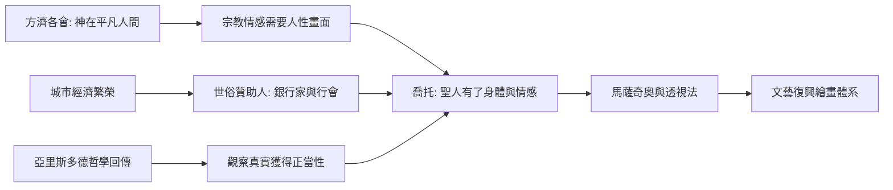

# 4.2 喬托：給聖人穿上人的衣服

時間：約1266年至1337年

## 一個牧羊人的傳說

佛羅倫斯畫家喬托的出身幾乎是傳奇：相傳他本是牧童，在石頭上畫羊被大畫家契馬布埃發現收為徒。故事未必屬實（瓦薩里在兩百多年後寫下這段軼事，添油加醋在所難免），但它的廣為流傳本身就是訊息：人們需要一個「天才從凡間崛起」的敘事。真正確鑿的是，喬托活著時就名滿義大利，受聘於帕度亞、佛羅倫斯與那不勒斯的宮廷，教宗本篤十一世曾遣使索畫（傳說使節請他隨手示範，他畫了一個圓得一筆呵成的圓圈，便於千餘年成為「喬托的圓」這句義大利俗語，形容技藝渾然天成）。但丁在《神曲》裡提到他，比他稍晚的薄伽丘稱他「把被埋沒的繪畫藝術帶回光明」。在還沒有「藝術家」這個職業概念的時代，喬托是第一個以個人名聲簽署時代的畫家。

## 斯克羅威尼禮拜堂：牆上的戲劇

1305年前後，喬托在帕度亞完成了斯克羅威尼禮拜堂（又稱競技場禮拜堂）的壁畫。委託者恩里克·斯克羅威尼是放高利貸致富的銀行家之子，建此禮拜堂為父贖罪——注意這個細節：金錢贖買救贖，藝術成為交易。禮拜堂的藍色拱頂下，三十八幅壁畫依序敘述聖母與基督生平，最後以《最後的審判》收尾。

喬托在這裡做的事，今天看來平淡，當時卻是劃時代：他放棄了拜占庭聖像的扁平面孔與金色虛空，用石膏堆塑出立體的鼻樑與眉骨，以色彩明暗塑造體積；更重要的是他給了人物「表演」。猶大親吻基督的背叛瞬間，耶穌平靜的面容與憤怒圍觀者的手勢互相推擠；《哀悼基督》中，天使在空中痛苦扭身，聖母抱著兒子的屍體，人們的悲傷各不相同。這些聖人第一次擁有了人的身體、人的重量與人的情感。繪畫從「祈禱的圖像」變成「戲劇的舞台」。

## 一場技術與思想的合流

喬托的突破並非憑空而來。其一，13世紀義大利城市經濟繁榮，方濟各會宣導「神在平凡人間」，宗教情感需要人性的畫面來承載——聖方濟各本人就被描繪為可以親近的凡人，傳說中喬托還為阿西西的聖方濟各教堂繪製了聖徒生平（歸屬仍有學術爭論）。其二，亞里斯多德哲學經阿拉伯世界回傳歐洲，托馬斯·阿奎那的神學肯定感官經驗的價值，「觀察真實」獲得思想正當性。其三，但丁、佩脫拉克等人已開始呼喚古典重生，人文主義的空氣正在形成。

喬托沒有發明透視法（系統的數學透視要到一百年後的布魯內萊斯基），他的空間處理仍是經驗性的，人物有時比例失誤。但他確立了方向：繪畫應當像一扇打開的窗，窗內是可觸摸的真實世界。從喬托到馬薩奇奧到達文西，這條線索清晰可循。

## 黑死病與中斷的接力

1348年，黑死病席捲歐洲，義大利人口銳減三分之一以上，藝術贊助與人才培養嚴重斷裂。喬托開創的路線一度讓位於國際哥德式的優雅裝飾，直到15世紀初，佛羅倫斯的馬薩奇奧才重新拾起他的人性化畫法，並加上真正的數學透視。1420年代佛羅倫斯爆發的創造力，是喬托種下的種子在一個世紀後的發芽——而澆灌它的，將是銀行家的金錢、布料的貿易與一場公共建築競賽。這就是我們下一章的故事。

