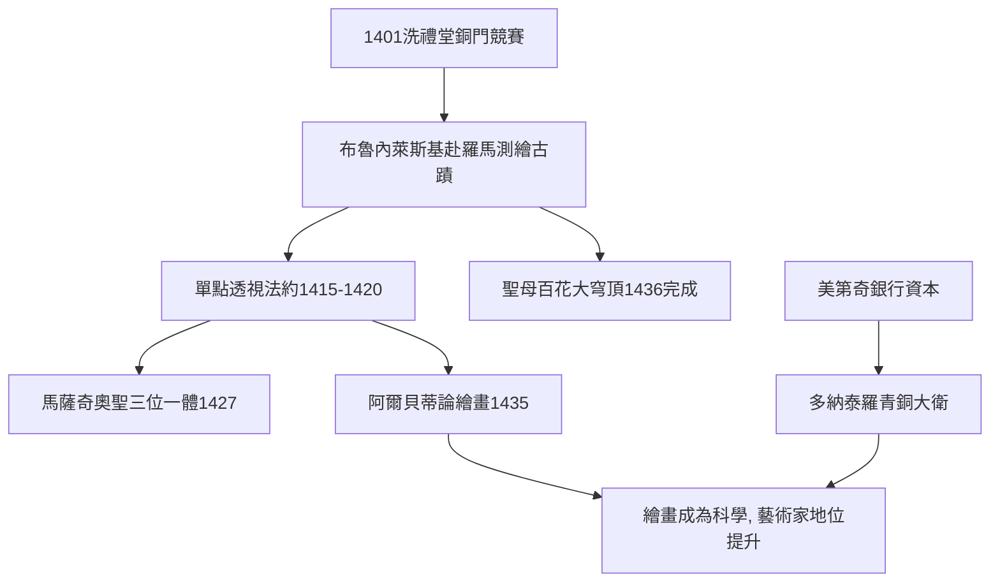

# 5.1 布魯內萊斯基與多納泰羅：透視法與裸體大衛

時間：約1401年至1460年代

## 一場洗禮堂銅門競賽

文藝復興藝術的起跑槍，一般公認是1401年佛羅倫斯洗禮堂的青銅門競賽。七位金匠比賽以「以撒的獻祭」為題製作浮雕，最終吉貝爾蒂勝出，落敗者之一是布魯內萊斯基。年輕氣盛的布魯內萊斯基據此轉向羅馬，與摯友、少年雕塑家多納泰羅同行，去丈量萬神殿與古羅馬廢墟——他成了建築師，一去羅馬，反而學會了古人的數學與工程。這場競賽還有一層時代意義：由羊毛行會出資、市民參觀評選的公共藝術競賽，本身就是城市商業社會的新事物。當時的佛羅倫斯靠布匹與銀行致富，美第奇家族的銀行分支遍佈歐洲，瘟疫後重建的城市充滿自信，而米蘭公國的大軍剛在城外被擊退——藝術，是共和國的驕傲。

## 透視法：把數學帶進繪畫

約1415至1420年間，布魯內萊斯基做了一個著名實驗：他畫下佛羅倫斯洗禮堂從大教堂門口望去的景象，在畫板上鑽一個小孔，觀者從背面透孔看畫，同時以鏡子反射——畫中的建築與實景嚴絲合縫。單點透視法由此誕生：所有平行線匯聚於一個消失點，三維空間被精確地壓平在二維畫面上。這是一個可以用尺規驗證、可教可學的系統。

第一個把透視法用在壁畫上的是馬薩奇奧：1427年他在新聖母教堂畫了《聖三位一體》，觀者仰望時，穹頂的透視線精確指向畫中十字架下的骷髏。畫家烏切洛則痴迷到深夜反覆計算透視，妻子勸他上床睡覺他還說「透視法多麼美妙」。阿爾貝蒂於1435年寫出《論繪畫》，把透視法整理成理論，並寫下那句名言：畫面是一扇窗。從此，繪畫成為一門「科學」，畫家的工作坊開始與數學、解剖學結盟——這直接改變了藝術家的社會地位：從工匠走向知識份子。

布魯內萊斯基自己則回到那場競賽的真正考場：他贏得了聖母百花大教堂穹頂的設計權。這座當時世界最大的磚造穹頂（內徑約43公尺，與萬神殿相當）沒有可用模板支撐，布魯內萊斯基以魚骨式砌磚、雙層殼體與自創起重機完成，1436年封頂，被視為工程與美學的雙重奇蹟——文藝復興人以自己的方式「再造」了羅馬。

## 多納泰羅的《大衛》：千年來第一尊獨立裸體青銅像

他的老友多納泰羅則在雕塑上引爆了另一顆炸彈。約1440年代（一說更早），他為美第奇家族製作了青銅《大衛》：全裸的少年，腳下踩著歌利亞的頭盔，頭戴著帽、手持巨劍，姿態輕鬆帶著挑釁，身體的重心轉移直接承襲古希臘。這是自古羅馬以來第一尊獨立站立的青銅裸體雕像。裸體在基督教中世紀象徵罪與羞恥，多納泰羅卻以裸體呈現聖經英雄，且放在美第奇宮廷的庭院中——這是人文主義的宣言：人本身即是美的、值得凝視的。同一時期，多納泰羅為聖母百花大教堂鐘樓製作的先知像哈巴谷（俗稱Zuccone，禿瓜），面部粗糙深刻的皺紋完全是真實老人的寫照，放在聖經人物身上是前所未有的寫實膽量。

## 為什麼是佛羅倫斯

把這場爆發拆開來看，每個零件都有經濟與制度的來源：羊毛與絲綢行會積累資本並負責公共建築；美第奇銀行的匯兌與放貸（放貸牟利在教義上有爭議，藝術贊助因此成為贖罪與宣傳的手段）提供私人資助；布商與銀行家需要以文化聲望擠入統治階層；1494年前佛羅倫斯維持的共和體制，讓公共藝術具有政治動員功能。藝術革命從來不是天才的獨角戲，而是資本、制度與觀念的合謀。下一步，就是這個系統孕育出的三位曠世天才。

