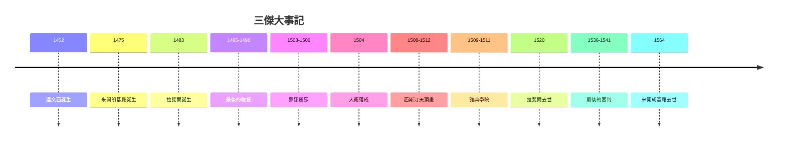

# 5.2 文藝復興三傑：達文西、米開朗基羅與拉斐爾

時間：1452年至1564年

## 達文西：不完成的科學家

李奧納多·達文西（1452年生於佛羅倫斯附近的文西鎮，1519年卒於法國）留下的大約十五件繪畫，卻改寫了繪畫的定義。他是私生子，沒有資格進拉丁語學校，這反而讓他免於經院教育的束縛——他自稱「經驗的門徒」，一生解剖約三十具遺體，研究光學、流體力學、地質與飛行，留下七千多頁手稿（鏡像反寫）。他把這些知識全部灌注到繪畫裡：研究肌肉如何牽動嘴角，於是有了《蒙娜麗莎》那個似有若無的微笑；發明暈塗法（sfumato），以十幾層極薄的油彩讓輪廓融化在光影裡，沒有一條生硬的線。1495年至1498年他為米蘭公爵畫的《最後的晚餐》，以透視法的消失點精確落在基督頭部，十二門徒分成四組三人，戲劇性的一瞬取代了拜占庭式的靜態圖像。可惜他實驗性的濕牆技法使壁畫在他生前就開始剝落。

他的生平也說明藝術贊助的政治本質：佛羅倫斯畫不得志，轉投米蘭斯福爾札公爵；法軍攻陷米蘭後輾轉威尼斯與羅馬；1516年接受法王法蘭索瓦一世之邀赴法國，帶著《蒙娜麗莎》——這就是為什麼羅浮宮藏著義大利的《蒙娜麗莎》。

## 米開朗基羅：石頭裡的痛苦

米開朗基羅（1475年至1564年）自認是雕塑家，上帝只是把形象放在大理石裡，他的工作是把它釋放出來。1499年至1504年，二十多歲的他用一塊別人報廢、閒置多年的巨型卡拉拉大理石雕出五公尺多的《大衛》。與多納泰羅表現勝利後的少年不同，他選擇戰鬥前的一瞬：肌肉繃緊、眉頭微蹙、右手握石的青筋可見。佛羅倫斯共和國把它立在市政廳前——大衛是共和國的化身：以小搏大、對抗暴政。雕塑的政治宣傳功能，與古羅馬如出一轍。

1508年至1512年，他被迫（他一直自稱是雕塑家，不情願地接下壁畫）獨力完成西斯汀禮拜堂天頂畫：五百多平方公尺、三百多個人物，《創造亞當》中上帝與亞當兩根將觸未觸的手指，成為人類藝術最著名的瞬間之一。二十多年後他又畫了《最後的審判》，此時的米開朗基羅經歷了羅馬之劫（1527年）與宗教改革帶來的時代焦慮，基督成了揮臂的法官，聖人們悲憤，畫面充滿絕望——連他自己的臉都被畫在剝下的人皮上。他同時也是建築師：聖彼得大教堂的穹頂設計出自他晚年之手，穹頂直徑41.5公尺，1930年代以前一直是世界最大穹頂。他活到88歲，一生與教宗、美第奇周旋，既被尊崇也受屈辱，把全部的生命換成了石頭與濕壁畫。

## 拉斐爾：和諧的綜合者

拉斐爾（1483年至1520年）比兩位前輩年輕，卻完成了他們未能做到的事：綜合。達文西的暈塗與構圖、米開朗基羅的人體與氣勢，被他消化成溫暖、清晰、平衡的典範。1509年，教宗尤利烏斯二世召他裝飾梵蒂岡簽字廳，他在教宗私人圖書館的牆上畫出《雅典學院》：柏拉圖指天、亞里斯多德指地，幾何學家、天文學家、犬儒學派散佈於宏偉的羅馬式拱廊之間——這幅畫本身就是宣言：基督教教會的心臟，供奉著異教古希臘的智慧。畫中柏拉圖的臉借用了達文西，沉思的赫拉克利特是米開朗基羅，拉斐爾自己也在畫面右側看向觀者。三傑同框，藝術史被壓縮進一幅濕壁畫。1520年，拉斐爾在37歲生日當天病逝，葬於萬神殿——羅馬人給了他古代諸神的歸宿。

## 三種天才，一個時代

三人的差異正是時代的縮影。達文西代表文藝復興的科學精神：藝術與知識合一。米開朗基羅代表奮鬥與崇高，晚年作品中人體越來越像從十字架上扭曲掙脫，預告了樣式主義（Mannerism）的到來。拉斐爾代表和諧與秩序，他死後建立的畫坊模式成為後世學院教育的原型。而撐起這一切的，是1500年前後的世界：古騰堡活字印刷（1450年代）使圖像與理論快速傳播；1494年美第奇被逐與1527年羅馬之劫，把藝術家推向全歐洲宮廷；地理大發現與宗教改革瓦解了舊的世界圖像。文藝復興不是一場溫柔的春天，而是舊秩序崩解時迸發的能量。下一章，我們看到這股能量在北歐與羅馬的兩種變形。

