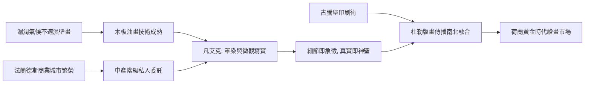

# 6.1 揚·凡·艾克與北方文藝復興

時間：約1390年至1441年

## 顏料革命：油畫的成熟

義大利人在畫蛋彩與濕壁畫時，北歐畫家正在調配一種新東西：以亞麻仁油為媒介的油畫顏料。油彩乾得慢，可以層層罩染、反覆修改；它透明而深邃，疊加數十層後，光線穿透色層再反射回來，產生蛋彩與濕壁畫無法企及的寶石般光澤。阿爾卑斯山以北潮濕多雨，濕壁畫難以附著，木板油畫因此成為北方的自然選擇。這是一個典型的例子：地理與氣候決定了技術路線，技術路線決定了美學風格。

揚·凡·艾克（約1390年至1441年）並非油畫發明者（油性媒介早有使用），但他是把油畫推向極致的第一人。15世紀的義大利人甚至傳言油畫是他發明的，瓦薩里的記載以訛傳訛了數百年。凡·艾克在根特祭壇畫的題記中自稱「盡我所能的第一人」，他的確當之無愧。

## 《阿諾菲尼夫婦》：一面鏡子的宇宙

1434年，凡·艾克在布魯日畫下《阿諾菲尼夫婦》（正式名稱《阿爾諾芬尼婚禮》或《喬凡尼·阿諾菲尼與其妻》）：一對義大利商人夫婦站在布魯日的臥室裡，男人舉起右手似在宣誓，女子置手於腹前。房間裡每件物品都被畫得纖毫畢現：枝形黃銅燭台上有一支蠟燭燃燒（白晝燃燒的蠟燭，學者解釋為婚誓的見證之火或上帝之眼）、桌上的橙子（昂貴的南方進口水果，暗示財富）、木拖鞋（婚禮儀式的象徵或家的神聖）、床邊的長掃帚與紅床（家庭的秩序與生育祝願）、牆上的念珠（虔誠）。最驚人的是背景的凸面鏡：鏡中反射出整個房間，以及房間門口站著的兩個人——其中一人很可能就是畫家本人。鏡框上繞著十個耶穌受難場景的小圓圈。鏡子上方的牆上，畫家以花體字簽名：「揚·凡·艾克在此，1434年」。

這面鏡子把北方文藝復興的核心說盡了：世界的每一寸細節都值得、也必須被忠實記錄，因為細節承載象徵，而真實本身就是神聖的顯現。與義大利人以數學透視建構理想空間不同，北方人用光學般的觀察堆砌真實。根特祭壇畫（完成於1432年）中，人類亞當與夏娃以近乎解剖圖的寫實站立在神聖畫面兩側，那具皮膚、血管與毛髮俱全的身體，連義大利人都為之震驚。

## 商業城市與中產階級的鏡子

北方文藝復興的土壤是法蘭德斯的商業城市：布魯日與根特是當時北歐的金融與布匹中心，漢薩同盟與義大利商人雲集。凡·艾克本人受僱於勃艮第公爵「好人腓力」，是一位領俸的宮廷畫家與外交使節——他曾為公爵遠赴里斯本議婚，並順便為葡萄牙公主畫像帶回相親（據載，這次「看畫定親」相當成功）。委託他作畫的包括公爵、義大利銀行家（如阿諾菲尼，來自盧卡、活躍於布魯日的富商）與教堂。新興的中產階級需要的是肖像、家居題材與可懸掛於私人房間的祭壇畫——藝術品第一次大規模成為「私人財產」，而非公共建築的附屬。這種市場結構，直接塑造了油畫的小尺寸與精細度。

## 一條看不見的技術線：透鏡？

凡·艾克對光學效果的精準（凸面鏡的畸變、金屬器皿的反光）引出一個著名的假說：藝術家大衛·霍克尼與物理學家法爾科推測，15世紀北方畫家可能借助了鏡子或透鏡投影。此說爭議極大，多數藝術史家認為缺乏直接證據，凡·艾克的天才更多來自觀察與技法。但這場爭論本身饒有趣味——它與我們將在第13章討論的AI繪畫遙相呼應：當工具能輔助「看」與「複製」時，藝術家的價值究竟在手上，還是在眼與心？

## 南北交會

北方寫實傳統將透過兩條路線深刻影響歐洲：其一是版畫——杜勒在1490年代兩次越過阿爾卑斯山，把義大利的透視與人體理論帶回德國，又以版畫把北方的精密傳遍歐洲（古騰堡印刷術使版畫得以大量複製，成為史上第一種「可批量傳播的藝術」）；其二是直接影響了卡拉瓦喬一代對光與質地的處理。當16世紀宗教改革來臨，新教地區摧毀宗教圖像，北方的油畫技術轉而服務於肖像、靜物與風俗畫——荷蘭黃金時代的種子，已經埋在這面1434年的凸面鏡裡。

