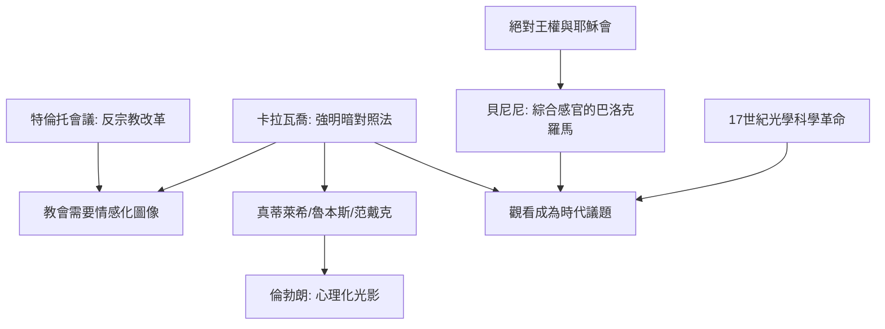

# 6.2 卡拉瓦喬的明暗與貝尼尼的雕塑

時間：約1571年至1680年

## 一個殺人犯畫出了最神聖的畫

米開朗基羅·梅里西·達·卡拉瓦喬（1571年至1610年）的一生像他的畫：強烈對比、劇烈衝突。他在羅馬以市井人物為模特畫聖經場景——《聖馬太蒙召》中的稅吏馬太穿著17世紀的衣服，圍著賭桌數錢，一道斜射的光柱劈開黑暗，指向那隻貴族般優雅的手（手勢借自米開朗基羅西斯汀天頂的亞當）；《多馬的懷疑》裡，多馬的手指真的插進基督復活後的傷口。羅馬教廷一半人為之傾倒，一半人斥之為褻瀆——1500年代初的教會剛在特倫托會議（1545年至1563年）確立反宗教改革路線，需要能激動平民信仰的具體圖像，卡拉瓦喬的寫實與戲劇恰好命中。他發明（或說極端化）的畫法後世稱為明暗對照法（chiaroscuro），極端版本被稱為暗色調主義（tenebrism）：黑暗吞噬畫面，一道劇場聚光燈式的光揭示主題。

而這位畫聖的畫家本人，1606年在羅馬街頭鬥毆殺人（一說是賭債與決鬥），被判死刑，亡命那不勒斯、馬爾他、西西里，一路以畫換庇護，1610年在海灘附近不明原因死去，年僅38歲。他死後名聲迅速黯淡，直到20世紀才被重新評價為西方繪畫最偉大的革新者之一。

## 卡拉瓦喬主義：一場歐洲流行病

卡拉瓦喬的畫法像傳染病一樣席捲歐洲。義大利的阿爾泰米西亞·真蒂萊希以同一種強光畫出《朱蒂斯斬首荷羅孚尼》——學者普遍認為畫中蘊含她16歲時被私人教師強暴、庭審受辱的親身創痛，這是藝術史上少數有完整審判檔案佐證的作品。魯本斯在羅馬親見卡拉瓦喬原作，回法蘭德斯後融合北方的油彩與義大利的戲劇。最關鍵的傳播鏈是：魯本斯的學生與追隨者中出現了范·戴克，而到17世紀中葉，荷蘭的倫勃朗把卡拉瓦喬式的光改造成心理的光——他的《夜巡》以同樣的暗背景與亮主體組織群像，但光照亮的是性格而非肌肉。從羅馬街頭的鬥毆者，到阿姆斯特丹的肖像大師，這條技術血脈貫穿了整個17世紀。

## 貝尼尼：讓大理石流動

同一時代的羅馬，另一位天才把巴洛克推向雕塑與建築。吉安·洛倫佐·貝尼尼（1598年至1680年）24歲時的《阿波羅與達芙妮》表現仙女在被追上的一瞬變成月桂樹：大理石的手指已長出葉子，髮絲化為枝椏——石頭達到了融化般的動態。《聖特雷莎的狂喜》（1647年至1652年）則把神秘經驗變成舞台劇：修女仰面陶醉，天使執箭，背後金色光芒從隱藏的天窗傾瀉而下，整個小禮拜堂成為一件綜合裝置——雕塑、建築、光線與觀眾的融合。這正是巴洛克的定義：藝術不再是獨立物件，而是牽動全身感官的體驗。

貝尼尼也是羅馬的總建築師：聖彼得大教堂前環抱數十萬人的橢圓柱廊（他自比為教會張開的雙臂）、四河噴泉、聖安德烈教堂，皆出自其手。他與法國宮廷的交涉（為羅浮宮東立面提案未果）以及與競爭對手波洛米尼的恩怨，都是17世紀藝術贊助政治的縮影。

## 巴洛克：權力的舞台藝術

「巴洛克」一詞源自葡萄牙語barroco（不規則的珍珠），最初是貶義。它的誕生有明確的政治功能：宗教改革撕裂了歐洲，天主教會在特倫托會議後以感官、情感、戲劇性的藝術贏回信徒（耶穌會教堂是其典範）；同時，絕對王權崛起，路易十四把巴洛克推向凡爾賽宮的鏡廳與儀式化生活，藝術成為君權神授的視覺證明。三十年戰爭（1618年至1648年）的廢墟上，藝術用最華麗的語言宣告秩序與權威的回歸。

戲劇性光線與舞台感，還有一層技術背景：1602年伽利略研究擺的規律，1608年望遠鏡問世，1610年伽利略觀測木星衛星——17世紀是光學與天文學的世紀，人類對「光」與「觀看」的理解正在科學化。藝術家與科學家分享同一種時代興奮：世界比肉眼所見更深、更暗、更遠。這種興奮，在兩百年後的印象派那裡將以另一種方式重演。

