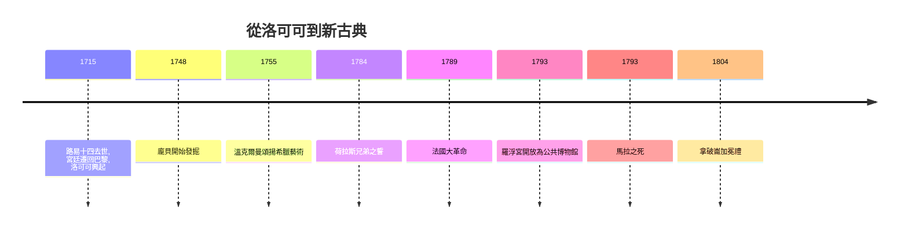

# 7.1 洛可可的輕盈與新古典主義的道德

時間：1700年至1850年

## 洛可可：沙龍裡的甜蜜遊戲

1715年，路易十四去世，五歲的路易十五繼位，攝政王奧爾良公爵把宮廷從凡爾賽遷回巴黎。貴族們離開了那座以儀式為牢籠的宮殿，回到巴黎的宅邸（hôtel particulier），社交生活轉入小巧、私密的沙龍。建築空間變了，藝術也隨之變了：洛可可（rococo，源自rocaille，意指貝殼與岩石的裝飾紋樣）以粉彩、金線、捲曲的藤蔓與輕佻的神話愛情取代了凡爾賽的莊嚴。華鐸的《發舟西苔島》畫戀人們登船赴愛之島，憂鬱與甜美並存；布歇為龐畢度夫人（路易十五的官方情婦、藝術贊助人）畫的維納斯豐腴粉嫩；弗拉戈納爾的《鞦韆》裡，裙裾飛揚的少婦踢出鞋子，藏在花叢中的情人窺視——畫的是調情，買的是上流社會的自我陶醉。

洛可可的興盛有堅實的經濟基礎：法國貴族與富裕市民的消費文化，中國瓷器與漆器經海路大量湧入引發的「中國風」（chinoiserie）時尚，塞夫勒瓷廠與戈布蘭掛毯的國營生產。藝術徹底商品化、時尚化。但革命已在醞釀：奢華的宮廷在債台高築的國家面前越發刺眼，啟蒙思想家（狄德羅曾激烈批評布歇「墮落」）呼喚能教化公民的藝術。

## 新古典：大衛與革命舞台

回應來自羅馬。1748年起龐貝古城的系統性發掘震動歐洲，德國學者溫克爾曼讚頌古希臘藝術「高貴的單純與靜穆的偉大」，考古與美學合流，新古典主義誕生。它不只是風格，更是一套道德與政治語言：以羅馬共和國的公民美德，批判舊制度的腐化。

雅克-路易·大衛（1748年至1825年）把這種語言推向極致。1784年的《荷拉斯兄弟之誓》：三位羅馬兄弟伸手接過父親遞上的劍，宣誓為國赴死；畫面一側是癱軟悲泣的女人們——理性與犧牲對抗情感與私情，筆直的柱式與銳利的光影宣告一種全新的、反洛可可的語言。五年後法國大革命爆發，此畫被奉為革命精神的預言。大衛本人投身革命，成為國民議會議員，投票處死國王；他為遇刺的革命英雄馬拉畫下《馬拉之死》：浴缸中的殉道者姿態如被創傷的基督——古典的宗教圖像學被精準移植到政治宣傳上。這是藝術史上第一次，一位大畫家同時是政權的官方宣傳總監。

## 從皇帝到博物館

大衛的政治嗅覺總能找到新的主子：恐怖統治後他入獄，出獄後接受拿破崙委託，畫出《拿破崙翻越阿爾卑斯山》（馬前揚蹄，實際上拿破崙騎的是騾子）與兩公尺高的《加冕禮》——1804年加冕典禮上，拿破崙從教宗手中奪過皇冠自己戴上，大衛選擇畫下拿破崙為皇后加冕的瞬間，既記錄了僭越又掩飾了僭越。拿破崙同時把歐洲各地的藝術珍品劫往巴黎，羅浮宮從王室收藏轉型為公共博物館（1793年開放），「全民共享偉大藝術」這個觀念隨著法軍的刺刀傳遍歐洲。滑鐵盧後，劫掠品大多被迫歸還，但公共博物館的理念已在各國生根。

## 一場意味深長的接力

新古典主義培養的學院體系（素描、解剖、歷史畫的等級制度）將統治歐洲官方藝術一百年，直到它被自己的叛徒推翻。大衛的學生安格爾成了學院正統的化身，而大衛畫室的另一條血脈——他的學生格羅筆下的戰場血腥，以及遠在西班牙的宮廷畫家哥雅（他曾臨摹委拉斯開茲，後以《1808年5月3日》記錄槍決、以《狂想曲》版畫撕開人性黑暗）——已經越過了古典的邊界，走向浪漫主義與現代性。藝術的鐘擺，正要從理性盪向情感。

