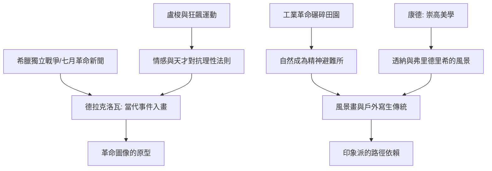

# 7.2 浪漫主義：情感與狂野自然的爆發

時間：約1780年至1850年

## 對理性的反叛

新古典主義相信秩序、理性與規範，浪漫主義則相信情感、想像與個體。這場轉折的思想根源在德國與英國：盧梭喊出「回歸自然」，主張情感先於理性；德國的狂飆運動（歌德《少年維特的煩惱》1774年讓全歐洲為情感自殺的青年落淚）宣告天才不受法則束縛；康德的美學把「崇高」（the sublime）——那種面對浩瀚、恐怖、超越理解之物時的戰慄快感——推到美學中心。工業革命同時在改造世界：蒸汽機、紡織廠、鐵路與煙囪席捲英國，田園消逝，城市骯髒擁擠。浪漫主義既是對工業化的抵抗，也是對它的幻象回應——在阿爾卑斯山的霧、北海的暴風雨與中世紀廢墟中，人們尋找被機器碾碎的靈魂。

## 英國：風景與詩

浪漫主義最深的根在風景畫。透納（1775年至1851年）畫的不再是風景，而是天氣、光與災難：《奴隸船》（1840年）中颱風與血色海面吞沒被拋下船的奴隸，《被拖去解體的戰艦無畏號》為蒸汽時代埋葬風帆時代——他晚年把物體溶化在純粹的光與色彩裡，比印象派早了三十年（莫內後來在倫敦見過他的畫，承認受到啟發）。康斯塔伯則相反，堅持對著薩福克的田野寫生，1824年他把《乾草車》送去巴黎沙龍，其鮮活的綠色與顫動的光讓法國畫家震驚——德拉克洛瓦看後回去重畫了自己作品的局部。藝術史常常如此：革命性的技術（對景寫生、明亮的戶外色彩）先在這裡發明，卻要等下一代的別人把它引爆。

## 法國：德拉克洛瓦與街壘

法國浪漫主義的主帥是德拉克洛瓦（1798年至1863年）。1824年他展出《希阿島的屠殺》，以拜倫詩歌與新聞報導中的希臘獨立戰爭慘案為題，色彩濃烈、構圖散漫、屍橫遍野，學院派罵他是「魯本斯的屠夫」。1830年七月革命爆發（推翻復辟的查理十世），三年後他畫出《自由引導人民》：寓言中的自由女神袒胸赤足、一手高舉三色旗、一手持槍，跨過街壘與屍體，身旁是戴禮帽的市民、學生與拿雙槍的少年。這是第一幅把當代政治事件與神話寓言融為一體的大畫，也是此後一切「革命圖像」的原型——從蘇聯海報到國際特赦組織的標誌，血脈都可上溯至此。有趣的是，此畫至今仍是法蘭西共和國的圖騰，印在百元法郎上、被德拉克洛瓦的《跨越阿爾卑斯山》所不及。

## 北方：弗里德里希與精神風景

德國浪漫主義走的是另一條內省之路。卡斯帕·大衛·弗里德里希（1774年至1840年）的《霧海上的旅人》：一個背對我們的男人拄杖立於山岩，腳下雲海翻湧。背影（Rückenfigur）是他的發明——我們看不見他的臉，只能代入他的凝視；風景不再是背景，而是精神的容器。修行的孤寂、廢墟、月光下的修道院，他的畫安靜得像祈禱。這種「風景即心靈」的觀念將透過挪威與俄國畫家傳承，最終匯入蒙克的《吶喊》——那是浪漫主義內省路線的終點站，也是現代焦慮的起點。

## 浪漫主義的遺產

浪漫主義把三樣東西永遠留給了藝術：其一，藝術家的自我——畫家從受僱的工匠變成表達靈魂的天才，梵谷的出現以它為前提；其二，題材的解放——當代事件、異國情調、瘋狂、夢境都可以入畫；其三，風景與自然的尊嚴——沒有浪漫主義對自然的崇敬，就沒有印象派走向戶外的衝動。而它的反面教訓同樣重要：當學院把浪漫主義的激情也變成公式（歷史大場面、異國美女、暴風雨），真正的革命就會來自那些厭倦了「高級情感」的年輕人——他們要畫的，是此時此刻、肉眼可見、轉瞬即逝的光。

