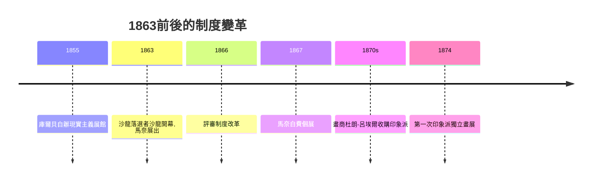

# 8.1 1863年落選者沙龍：馬奈的審美震盪

時間：1863年

## 一個拒絕率超過六成的沙龍

要理解1863年的醜聞，得先理解法國的藝術制度。自17世紀以來，巴黎沙龍（官方年度大展）由法蘭西藝術院主導，評審由學院派大師出任。入選沙龍等於獲得官方認可，買家、批評家、榮譽勳章乃至教職都由此而來；落選則近乎職業死刑。到19世紀中葉，沙龍已是藝術世界唯一的正門，而申請人數暴增——1863年約五千位藝術家提交作品，評審拒絕了近三千件，拒選率高達六成，落選者中不乏後來的名家（包括塞尚、畢沙羅、方丹-拉圖爾等）。

怨聲大到驚動了皇帝。拿破崙三世親往視察，宣布落選作品可另行展出，地點就在工業宮的另一翼——「落選者沙龍」（Salon des Refusés）。這是國家首次為官方體系之外的藝術開門，其背後是第二帝國的自由主義姿態，也是學院壟斷開始鬆動的訊號。參觀者蜂擁而至，多數人是去看笑話的，但他們記住了一幅畫。

## 《草地上的午餐》：為什麼這幅畫讓人生氣

馬奈的《草地上的午餐》畫的是兩位衣著完整的紳士（其中一人是他弟弟）與一位全裸女子在林間野餐，女子直視觀者，毫無羞怯。今天看來溫和，當時卻犯了三重禁忌。

第一，裸女不是神話人物。學院傳統中，裸體唯有披上維納斯、寧芙之名才可入畫；馬奈畫的是現代的巴黎女子（模特維克多琳·默朗，她也是下節《奧林匹亞》的模特），裸體出現在野餐現場，等於撕掉了古典的遮羞布。第二，構圖的來源是古典大師——拉伊蒙迪版畫複製的拉斐爾構圖（河神與寧芙）與喬爾喬內《田園合奏》，評審認出他把神聖典範用於不體面的當代場景，這是故意的挑釁。第三，也是最深層的：畫法本身。沒有柔和的過渡與層層罩染，而是大塊平塗的色彩、生硬的光線、壓扁的空間——背景的森林缺乏透視縱深，裸女的皮膚在樹蔭下亮得刺眼，物體的體積感被削弱。左拉後來為之辯護：「馬奈沒有創造新畫法，他只是誠實。」誠實，正是對學院「理想化」傳統最致命的攻擊。

## 制度的裂縫與藝術家的新出路

落選者沙龍只辦過幾屆（1863、1874、1875等），但它示範了一件事：官方體系之外可以有自己的展覽。接下來的十年，制度變革接連出現——1866年評審制度改革引入藝術家投票；1867年庫爾貝自費辦個展（他早在1855年就開過先例，那次的「現實主義展館」是藝術家自主辦展的起點）；畫商杜朗-呂埃爾（他從1870年代起長期收購印象派）證明市場可以繞過沙龍。藝術品開始從「入選—受勳—國家收購」的科層流程，轉向「畫室—畫商—私人買家」的市場邏輯。這一轉變的經濟基礎，是法國第二帝國與第三共和初期的新興資產階級：鐵路、百貨公司、銀行養出了一大批有錢、無爵位、厭倦學院的人。

另一條看不見的線索是攝影。1839年達蓋爾法公布後，攝影迅速商業化，畫家對「精確再現」的壟斷被機器奪走。馬奈一代的年輕人想得很透：既然機器可以記錄外表，繪畫就必須做機器做不到的事——記錄觀看本身。他們開始研究日本浮世繪（1850年代流入歐洲的浮世繪以平塗色塊與大膽構圖震動歐洲畫家）、光學、色彩理論（謝弗勒爾的色彩同時對比定律）。畫要畫「看到的樣子」，而不是「物體應該的樣子」——這一步，馬奈用一幅醜聞邁出，而把它推到底的，是那些聚在蓋爾布瓦咖啡館的年輕人。下節，他們要走到戶外去。

