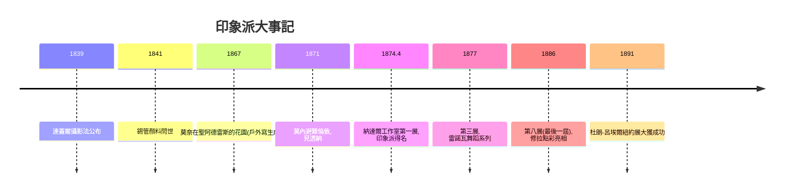

# 8.2 1874年第一次印象派畫展與莫內

時間：1860年代至1886年

## 從蓋爾布瓦咖啡館到攝影師納達爾的樓上

1860年代末，一群年輕畫家固定聚會於巴黎蓋爾布瓦咖啡館：莫內、雷諾瓦、畢沙羅、西斯萊、竇加、摩里索，後來還有塞尚（他是那裡最不受歡迎的人，口袋裡總揣著求救信以防被趕走時可以報警）。他們的共同敵人是沙龍評審，共同信仰是一件事：畫眼睛真正看到的東西。馬奈雖年長且從未參加他們的畫展，卻被他們奉為先驅。1870年至1871年普法戰爭爆發，莫內與畢沙羅避難倫敦，在那裡看到透納的畫（光的溶解），並結識了畫商杜朗-呂埃爾——這位畫商將用三十年時間，把這群窮畫家賣到全世界。

戰後的巴黎正在蛻變：奧斯曼男爵的都市改造把中世紀巴黎拆成林蔭大道與煤氣街燈，鐵路把巴黎人送到郊外，度假、浴場、遊艇成為新中產的生活方式。要畫「現代生活」，戶外是必須的，而兩項技術讓戶外作畫成為可能：其一，1841年美國畫家固特異改良錫管顏料，顏料可以揣進口袋帶出畫室；其二，鐵路把塞納河畔的風景送到一小時車程之內。技術、城市與休閒經濟，共同孕育了印象派。

## 1874年4月15日：無名畫家協會的第一展

1874年4月，三十五位藝術家在攝影師納達爾工作室（卡皮西納大道35號）舉辦了「無名畫家、雕塑家、版畫家協會展」——他們刻意不叫沙龍，向官方制度宣戰。莫內展出了一幅勒阿弗爾港口的晨景，記者路易·勒魯瓦在諷刺刊物上戲謔地借用畫名，稱他們為「印象派」：這畫的只是一種印象吧，牆紙都比這幅海景完成度高。莫內索性把侮辱變成旗幟。

《印象·日出》畫的是霧中港口一輪橙日與水面倒影，筆觸粗率如草稿。批評家的憤怒有真實的美學依據：這些畫沒有輪廓、沒有細節、沒有「完成」，架上繪畫的完成標準（光滑表面、精確素描、歷史題材）被全部拋棄。更根本的是認識論上的翻轉：過去繪畫回答「事物是什麼樣」（恆定的形體、固定的色彩），印象派回答「此時此地我看見的是什麼樣」（隨光線、天氣、時間變化的視覺事件）。一棵乾草堆在清晨與黃昏不是同一棵；莫內在1890年代畫了二十多幅《乾草堆》系列、三十多幅魯昂大教堂——同一主題在不同時刻反覆描繪，繪畫的主體從物體變成時間。塞尚後來說莫內「只是眼睛，但那是怎樣的一雙眼睛」。

## 科學與商業的雙重後盾

印象派的畫法有科學依據。化學家謝弗勒爾的色彩同時對比理論指出，並置的補色會互相增強；畫家因此放棄調色板上混合，改用並置的純色小筆觸，讓觀者的視網膜自己「調色」。太陽光譜的物理學、視覺暫留的生理學，都在為「眼睛的畫」背書。商業上，杜朗-呂埃爾的冒險初期慘淡（1891年他在紐約辦展卻大獲成功，美國新貴成了印象派的救星），但到19世紀末印象派價格起飛，莫內與雷諾瓦生前即享富貴——藝術市場第一次證明：背離官方學院，也能活下去。這個範式的重要性怎麼強調都不過分：它使藝術的進化動力從「宮廷與學院」轉移到「畫商、批評家與市場」，現代藝術生態自此定型。

## 八次畫展與各自的離場

印象派共辦了八次展覽（1874年至1886年），人員來去離散。第三次展覽起，批評逐漸轉為好奇與尊重；1880年代，巴黎的私人收藏家（卡耶博特的遺贈、卡蒙多的收藏）與畫廊體系已經成形。1886年最後一屆展出時，兩位新人預告了下一場革命：修拉的《大傑特島的星期日下午》以科學化的點彩把印象派推向結構；而塞尚、梵谷與高更這三位「後印象派」，即將把印象派抓住的光，重新注入形體、情感與象徵。光線被他們捕捉到了，但藝術要的更多。

