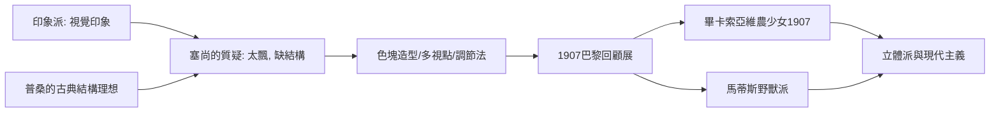

# 9.1 塞尚：現代藝術之父的幾何結構

時間：1839年至1906年

## 來自普羅旺斯的落選者

保羅·塞尚生於普羅旺斯艾克斯的銀行世家，父親替他報了法學院，他卻跑到巴黎追隨兒時摯友左拉去畫畫。他性格孤僻易怒，多次落選沙龍，是蓋爾布瓦咖啡館裡最笨拙的人，甚至隨身帶著求救信以防被欺負。1877年他參加過印象派畫展，但很快與之決裂——他不滿意印象派的答案，他在給初戀情人（後成為妻子）的信中說：想在自然面前實現自己的感覺，卻覺得無能為力。這種近乎絕望的執念，驅使他離開巴黎，回到家鄉，對著聖維克多山畫了幾十年。

## 用圓柱、球體與圓錐看自然

塞尚與印象派的分歧在哪裡？印象派忠實於轉瞬即逝的視覺印象，塞尚認為那樣的畫「飄」，沒有實體。他要找回普桑式的堅實結構——但不用學院素描，而用觀察。他的方法是：讓色塊本身承擔造型，放棄傳統的明暗輪廓；同時消解單點透視，一張桌子上讓左側與右側呈現不同的視點，因為眼睛本來就是移動著看的。他說要用圓柱體、球體與圓錐來處理自然——不是說自然真的由幾何構成，而是說繪畫必須把感覺組織成結構。《聖維克多山》系列中，山體與松樹、房屋與田野被拆成一片片交錯的色彩筆觸，遠近的空間開始搖晃，卻比照片更「真實」——那是人在世界中移動的視覺經驗本身。

他還留下兩項技術發明：一是「調節法」（modulation），同一色相的筆觸並置以塑造體積而不靠明暗；二是故意留下畫布的空白與未完成的邊緣，讓畫面保持結構的張力。畢卡索稱他為「我們所有人的父親」，馬蒂斯說他是「繪畫的上帝」。

## 被誤解的一生與死後的爆發

塞尚生前幾乎默默無聞：1895年，畫商伏拉爾為他舉辦首次個展（他已五十六歲），巴黎年輕一代才驚覺有這樣一位畫家。1906年他在暴雨中寫生，感染肺炎去世。死後十年，他的影響核爆般展開：1907年巴黎舉辦塞尚回顧展，畢卡索看了之後一年內畫出《亞維農的少女》——立體派誕生的直接催化劑。塞尚把形體拆解成多視點的色塊，畢卡索與布拉克把拆解推向極致；他強調繪畫是獨立於再現的結構，這句話成為整個現代主義的憲法。

## 思想背景：繪畫的自我意識

塞尚的出現有更廣的時代背景。哲學上，叔本華與柏格森強調直觀與綿延，知覺本身成為哲學對象；心理學上，馮特的實驗室與亥姆霍茲的視覺研究證明：我們看到的不是世界，而是大腦建構的世界。塞尚的天才在於，他在畫布上做了哲學家與心理學家在理論上做的事——承認知覺的建構性，並讓繪畫坦白自己的建構過程。從這個意義上說，現代藝術的「抽象」「觀念化」傾向，全部從這裡出發。

他畫得極慢（水果會爛掉，畫友笑稱他畫靜物得用假水果），一生自我懷疑。他對兒子說過一句話：「我畫得很慢，因為我看見很多東西。」現代藝術史公認他是真正的起點，因為他第一個問出了現代的問題：繪畫，到底是複製世界，還是建構世界？此後一百年的藝術，都是這個問題的不同答案。

