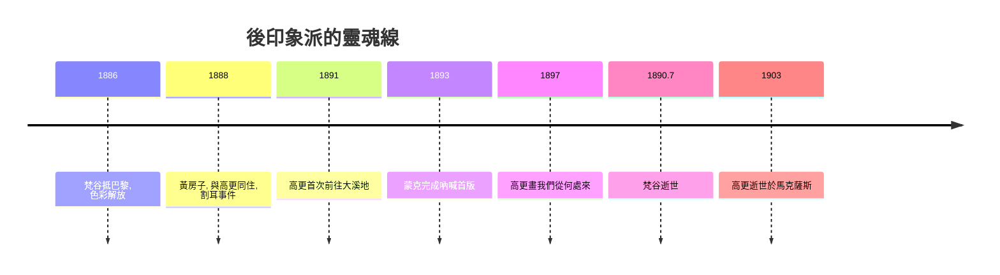

# 9.2 梵谷、高更與蒙克：色彩、野性與焦慮

時間：1880年代至1900年

## 梵谷：燃燒的十年

文生·梵谷（1853年至1890年）27歲才開始畫畫，此前他當過畫廊店員、教師與煤礦傳道人，全部失敗。他的人生在短短十年內燒完：1886年到巴黎，遇見印象派與日本浮世繪（他臨摹過歌川廣重，色彩突然明亮起來）；1888年2月南下阿爾，普羅旺斯的烈日讓他的色彩徹底解放——向日葵的金黃、麥田的鉻黃、夜空的群青。他畫得驚人地快，有時一天一幅，顏料厚得像浮雕（他直接把顏料從錫管擠上畫布）。

1888年10月，他盼望已久的高更終於來到阿爾的黃房子。兩人共同生活了兩個月，爭吵不斷——梵谷要畫眼睛看到的熱情，高更要畫記憶與想像的綜合。12月23日夜，兩人激烈衝突後，梵谷持剃刀威脅高更，隨後割下自己的左耳（當代學者依據警方的醫療紀錄指出可能割的是大部分左耳，而流行的「耳垂」說證據不足），用報紙包好送給附近妓院的女子。次年5月他住進聖雷米療養院，在發病的間隙畫出《星夜》：從病房鐵窗望出的夜空被畫成旋轉的漩渦，柏樹像黑色火焰竄向星空，村莊的燈火安靜地蜷縮在山腳——騷動的天與安靜的地之間，是無法安放的靈魂。1890年7月27日，他在麥田裡朝自己胸口開槍，兩天後去世，年37歲。生前只賣出一幅畫（《紅葡萄園》，400法郎，由弟弟西奧的畫商朋友促成），死後成為史上最著名的畫家之一——他與弟弟西奧的六百多封信，是藝術史上最動人的文獻。

## 高更：逃向大溪地

保羅·高更（1848年至1903年）原本是巴黎的股票經紀人，業餘畫畫、收藏印象派。1882年股市崩盤斷了生計，他索性棄家從藝，妻兒回到丹麥娘家。他先追隨印象派，隨後走向反方向：在布列塔尼的阿凡橋村，他提出「綜合主義」——不畫眼前所見，而畫記憶消化後的內在感受，以大面積平塗的象徵性色彩、粗黑輪廓（受日本浮世繪與彩色木刻影響）取代光影寫實。《黃色的基督》中，布列塔尼農婦跪在金黃色的十字架前，色彩與信仰的關係是象徵的而非寫實的。1891年他借貸籌款遠赴法屬大溪地，尋找「未被文明污染的天堂」——雖然殖民化的現實讓他失望，他仍畫出《我們從何處來？我們是誰？我們往何處去？》這幅近四公尺的哲學遺言（畫完後他曾自殺未遂），以及充滿爭議的塔希提少女像。1903年他病逝於馬克薩斯群島。他的原始主義深刻影響了野獸派（馬蒂斯）與象徵主義，但他與殖民地少女的關係（多為未成年、以家庭義務結合）在當代被重新嚴肅批判——偉大作品與道德污點可以同屬一人，這正是歷史研究者必須直視的問題。

## 蒙克：焦慮成為圖像

愛德華·蒙克（1863年至1944年）是挪威畫家，父親有精神疾病傾向，妹妹被診斷精神分裂，母親與姐姐早死於肺結核。他說：「疾病、瘋狂與死亡，是守護我搖籃的黑色天使。」1892年起他旅居柏林與巴黎，吸收了梵谷的筆觸與高更的象徵色彩，但用途完全不同：他要畫的不是外部世界的光影，而是內心的恐懼、嫉妒、慾望與死亡（他稱之為「靈魂的圖解」）。

1893年的《吶喊》是藝術史的分水嶺。橋上一個骷髏般的人形，雙手捧臉，血紅的天空（蒙克記載其靈感來自奧斯陸峽灣的晚霞，他聽見「大自然穿越一切的巨大吶喊」）捲成焦慮的波紋。這幅畫（共有四個版本，兩幅油畫、兩幅粉彩）畫出了即將到來的20世紀的心理底色——兩次大戰、都市異化、精神危機。2012年，其中一幅粉彩版在蘇富比以近1.2億美元成交。蒙克畫的是先知式的預感：在他之後，表現主義（德國橋社、柯勒惠支、乃至戰後的培根）都承認這條血脈。

## 三條路，一個共同的轉向

三人表面上截然不同——梵谷燃燒、高更逃逸、蒙克內省——卻共同完成了同一個轉向：繪畫的價值不再取決於再現的準確，而在於表達的強度。色彩可以與視覺無關（梵谷的夜空在現實中並不旋轉），構圖可以服從情緒（蒙克的波浪是心理的），題材可以是觀念（高更的哲學三問）。這個轉向的社會條件值得注意：他們都是被資本主義都市與市場放逐的人（失敗的傳道人、破產的經紀人、異鄉的挪威人），而他們的救贖媒介恰恰是新興的獨立藝術市場與批評體系。20世紀的兩場革命已經就位：塞尚提供了結構的語言，這三人提供了表達的許可。下一站，巴黎，1905年。

