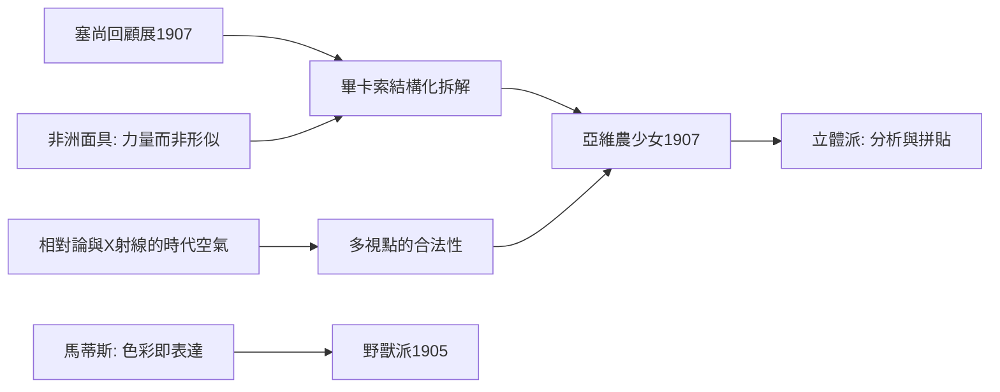

# 10.1 馬蒂斯的野獸派與畫家的色彩革命

時間：1905年前後

## 1905年秋季沙龍：被稱為野獸的房間

1905年巴黎秋季沙龍，第七展廳裡掛著馬蒂斯、德朗、弗拉曼克、烏拉曼克與盧奧等人的畫。批評家路易·沃克塞勒走進展廳，看見廳中央擺著一件古典風格的少年胸像（屬於文藝復興雕塑家風格的仿作），四周卻是狂野平塗的純色風景，脫口而出：「多納泰羅被野獸包圍了！」野獸派（Fauvism）之名由此而來，帶著貶義，卻被畫家們欣然接受——這是印象派之後，又一次把批評家的謾罵變成旗幟。

野獸派做了什麼？他們把色彩從「描述」中解放出來：樹不必是綠的，臉不必是肉色；色彩成為純粹的表達，像梵谷那樣服從情緒，但更極端——平塗、無明暗、無輪廓漸變，色塊之間直接相撞。馬蒂斯的《戴帽子的女人》（畫的是他妻子，頭頂紅綠雜陳）與《奢華、寧靜與愉悅》，德朗筆下的科利烏爾港把影子畫成藍色與粉色——他們承認靈感來自塞尚的結構、高更的平塗、修拉的色彩科學，並把三者熔成一爐。馬蒂斯說，他夢想的是「平衡、純淨、寧靜的藝術，像一把舒適的安樂椅」——《舞蹈》（1910年，為俄國收藏家舒金而畫）正是這句話的極致：五個狂舞的紅色人體環繞在藍與綠的純色空間裡，快樂本身成為畫的主題。

## 畢卡索與《亞維農的少女》：拆掉文藝復興的房子

與馬蒂斯的安樂椅相對的，是畢卡索的炸藥。1906年底至1907年初，畢卡索在盧森堡宮的塞尚回顧展反覆流連，又與畫商沃拉爾洽購塞尚的《五大浴女》（那幅被稱為浴女金字塔的作品，形體已開始碎裂成色面）。同期，他也在特羅卡德羅人類學博物館盯著非洲與大洋洲的面具看——那裡的雕刻不描摹外表，而直接呈現力量。他在筆記中寫道：面具不是為了形式，而是為了魔法。

1907年，二十六歲的畢卡索完成了《亞維農的少女》：五個妓女站在療養院般的粉紅與藍色空間裡，身體被拆成稜角分明的碎片，右邊兩人戴著非洲面具般的臉，中間的人體來自塞尚浴女的結構，左邊的人物持埃及式正面姿態，背景的桌布與水果則像被壓進同一個平面。最駭人的是：文藝復興以來四百年的單點透視、立體塑造、人體理想——全部被拆掉了。塞尚說要用圓柱與球體看自然，畢卡索走得更遠：多視點同時呈現，正面與側面的眼睛畫在同一張臉上，因為繪畫不該模仿真實空間，而該誠實地顯示它自己是平面的幻象。

這幅畫當時只有極少人看過（長期滾在畫室地板上，直到1920年代才公開展出），連馬蒂斯都認為是暴行，摯友布拉克說這像「要我們喝汽油吃繩子」。但布拉克隨即與畢卡索合作：1908年至1914年，兩人如同一架飛機的雙翼（布拉克語），發展出分析立體主義——把對象拆成幾何碎片，以近乎單色的棕灰重組；繼而發展綜合立體主義，直接把報紙、壁紙、樂譜貼上畫布（拼貼誕生），繪畫第一次公開使用現成品碎片。他們甚至畫了《瓶、玻璃與小提琴》系列，讓對象在碎片中若隱若現——立體派證明：繪畫可以只處理繪畫自身的問題。

## 時代的溫床

1907年前後的巴黎為何如此躁動？其一，科學衝擊常識：1905年愛因斯坦的相對論、X射線（1895年發現）與無線電波讓「看不見的實在」成為公眾話題，四維空間的通俗讀物風行，多視點的立體派與之共振（儘管畢卡索否認受科學影響，時代空氣是無法否認的）。其二，非西方藝術的輸入：殖民博覽會與人類學博物館把非洲、大洋洲、高棉的雕刻送到巴黎，藝術家第一次意識到「寫實」只是諸多選項之一。其三，藝術市場已能容忍激進風格：畫商康維勒自1907年起與畢卡索簽約，杜朗-呂埃爾則收購野獸派——離經叛道有了商業閥門。

## 一個時代的頂點與裂縫

野獸派短促（1905年至1907年前後即告解散），立體派影響深遠（從俄國構成主義到包浩斯，都可循此追溯），但兩者共同宣告了同一件事：繪畫的任務從「再現世界」變成「創造對等物」。然而1914年8月，第一次世界大戰爆發，布拉克、德朗、盧奧應徵入伍，布拉克頭部重傷，阿波里奈爾負傷。文明自毀的景象，把一批年輕人推向更瘋狂的方向——既然製造屠殺的正是這些「理性文明」，那就連藝術本身也該被嘲弄。下一節，是杜象與他的小便斗。

