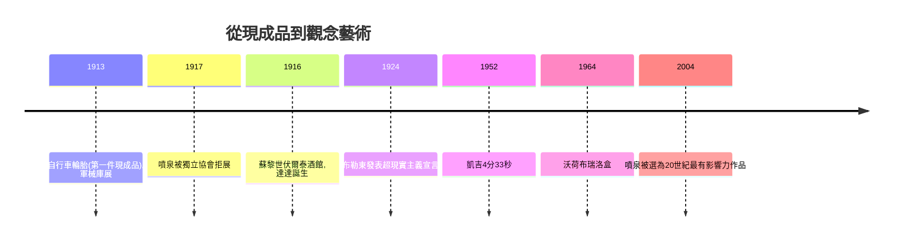

# 10.2 杜象的《噴泉》：小便斗裡的哲學炸彈

時間：1917年

## 一場展覽與一個簽名

1917年4月，紐約獨立藝術家協會舉辦展覽。協會章程宣稱：任何人交一美元會費、六美元参展費，任何作品都會被展出，不設評審——這是一群厭倦了沙龍專制的人組織的自由宣言。展前兩天，一件從J. L. 莫特鐵器行（Mott Works）買來的標準瓷質小便斗被送到會場，署名R. Mutt，題為《噴泉》（Fountain）。協會董事會辯論後，將它藏在了幕後。

杜象當時是協會董事之一，事後他辭職抗議，並在《盲人》雜誌上發表了那篇著名的辯護：「莫特先生是否親手製作了《噴泉》並不重要，他選擇了它。他取了一件平常的生活用品，把它放在特定的視角下，使它的實用意義在新標題與新視角下消失——它成為了一件新的對象。」這段話是20世紀藝術的分水嶺：藝術的定義從「製作」轉移到「選擇」；從「作品的品質」轉移到「觀念的提出」。杜象為這類作品發明了一個詞：現成品（readymade）。《噴泉》原件當場遺失（可能被丟棄），今天美術館裡的是1964年授權複製的十七件之一。

## 杜象其人：拒絕成為「視網膜的僕人」

馬塞爾·杜象（1887年至1968年）生於法國諾曼底，兄弟三人皆為藝術家。1912年他的《下樓梯的裸女》以機械式重疊的動態人體參加巴黎立體派展，被評為「太像立體主義的漫畫」而遭婉拒；同年它卻在紐約軍械庫展（1913年）引起轟動，被媒體嘲諷為「木材廠爆炸」，杜象因此在美國成名。此後他愈發厭倦繪畫本身——他說自己想做的是「擺脫視網膜的僕人身份」：自文藝復興以來，繪畫一直服務於眼睛（透視、色彩、美感），而他要讓藝術服務於頭腦。1913年他把自行車輪胎倒裝在木凳上（第一件現成品），1915年赴紐約，1917年即有《噴泉》。他的另一件巨作《大玻璃》（《新娘甚至被光棍們剝光了衣服》，1915年至1923年，最終「未完成」）以玻璃、塵埃與機械圖示構成，根本拒絕成為傳統意義上的繪畫。晚年他幾乎放棄藝術而下棋，宣稱「呼吸就是藝術」的活著本身就是作品。

## 觀念藝術的譜系：從達達到凱吉到觀念主義

《噴泉》的影響分成三條線。第一是達達：蘇黎世的雨果·巴爾與查拉1916年在伏爾泰酒館發起達達運動，以無意義的詩、噪音音樂與荒誕表演抗議把歐洲推入屠殺的「理性文明」；杜象與曼·雷、皮卡比亞在紐約呼應。達達本質是反藝術的藝術：既然邏輯通向凡爾登絞肉機，那就以荒謬對抗邏輯。第二是超現實主義：布勒東1924年發表宣言，把達達的荒謬改造成對夢與潛意識的系統探索——下一章的主角。第三是最深遠的一條：觀念藝術。美國作曲家凱吉（曾受杜象影響）以《4分33秒》（1952年）把「無聲」變成音樂，他們的學生佛拉文、帕克等人在1960年代宣告「觀念先於物件」；1964年，安迪·沃荷展出布瑞洛盒（Brillo Box），與杜象的雪鏟《在斷臂之前》遙相呼應；哲學家丹托因此提出「藝術的終結」：當任何東西都可以是藝術，藝術的定義權從視覺轉移到了理論。

## 一百年後的驗證

1917年時，《噴泉》幾乎無人理解；2004年，英國泰特美術館五百位專家投票，《噴泉》被選為20世紀最有影響力的藝術作品，壓過畢卡索與馬蒂斯。這一百年間，藝術的邊界被一步步推到極限：行為藝術以身體為媒介、地景藝術以荒漠為畫布、裝置藝術把整個展廳變成作品——它們的共同祖先，都是那個署名R. Mutt的瓷製小便斗。

但杜象留下的也是一個開放性的危險：當「選擇」取代「製作」，判斷一件作品價值的依據是什麼？如果答案是「觀念的原創性」，那觀念也可以被複製、被投機、被拍賣行炒作——12章的班克西與13章的NFT，將在這條線上繼續衝撞。杜象炸開的不只是藝術的邊界，也是它全部的麻煩。

