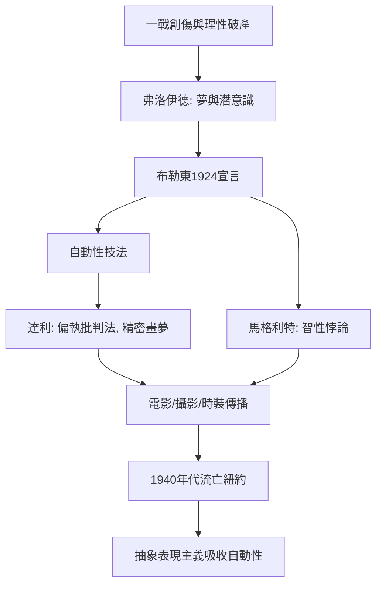

# 11.1 達利與馬格利特：把夢境畫在畫布上

時間：1920年代至1960年代

## 弗洛伊德進入藝術

第一次世界大戰的瘋狂之後，歐洲的文化精英找到了一個新的礦脈：維也納醫生佛洛伊德的心理分析。1900年《夢的解析》問世，1919年戰後各國精神科醫生大量診治彈震症（shell shock），夢、幻覺、被壓抑的慾望成為嚴肅的科學對象。巴黎的年輕詩人布勒東戰時在神經精神中心工作，親身接觸弗洛伊德學說，1924年發表《超現實主義宣言》，把「純粹的心理自動性」定為綱領——不經理性控制，直接記錄思想的流動。自動書寫、催眠實驗、集體遊戲（精美的屍體cadavre exquis）在巴黎的寓所裡瘋狂上演。繪畫很快加入：恩斯特的拓印（frottage）、米羅的符號、馬松的自動繪畫。但把超現實主義變成大眾圖像的，是兩位畫技精湛的「夢境工程師」。

## 達利：偏執狂的精密畫家

薩爾瓦多·達利（1904年至1989年）是西班牙加泰隆尼亞人，馬德里美術學院因不服管教被開除，1920年代末抵巴黎，以兩撇翹鬍子與極端表演迅速成為媒體寵兒。他發明的方法叫「偏執批判法」（paranoiac-critical method）：以瘋狂的方式觀看世界，卻以學院級的精密技巧畫下來。1931年的《記憶的堅持》：軟化如乳酪的懷錶攤在荒涼的海岸上（他說靈感來自晚餐吃軟化的卡芒貝爾奶酪時對時間流逝的聯想），遠處是家鄉利加特港的岩岸，左下角蜷縮著他反覆出現的模糊自我形象。永恆的時間融化了——這是達達與立體派之後，繪畫對「現實是唯一的現實」最優雅的反擊。

1936年他登上《時代》封面，1939年為紐約世博會做「雨中計程車」，為希區考克的《意亂情迷》設計夢境場景，為品牌設計商標（Chupa Chups棒棒糖的logo），與香奈兒合作服裝。布勒東為此開除他（罪名是「為金錢與政治反動效力」，將其字母重組為貪財的Avida Dollars），但達利毫不在意，他自稱「與超現實主義的差別，就是我即超現實主義」。他的名字成為一種商品，這件事本身就是20世紀後期「藝術明星化」的預演——下一節的沃荷將把它推向極致。

## 馬格利特：安靜的悖論

比利時畫家雷內·馬格利特（1898年至1967年）走的是完全相反的路線：不表演、不瘋狂，一生大半在布魯塞爾安靜度日，靠廣告畫與壁紙設計維生（這份商業經驗直接滲入他的繪畫語言：清晰的商品式圖像、乾淨的配色）。他的武器是悖論：一個戴禮帽的男人、一片雲、一隻蘋果，被放進不可能的關係裡。《圖像的背叛》（1929年）畫一個菸斗，下方寫著「這不是一支菸斗」（Ceci n'est pas une pipe）——他說：畫當然不是菸斗，你不能用它抽菸。這句話是藝術史上最鋒利的哲學公案之一，後來哲學家傅柯專門為它寫了一本書。《人的境況》系列中，窗外的風景與畫架上的畫布無縫相接，真實與再現的邊界被抹去。馬格利特不畫夢的內容，他畫清醒時的荒謬——這種「智性的超現實主義」成為戰後波普藝術、觀念藝術與廣告視覺的地下源頭（他晚年目睹自己的圖像被廣告界 wholesale 挪用，惱火之下開始複製自己的作品以示抗議）。

## 超現實主義的社會土壤

超現實主義能成為國際運動，靠的不只是弗洛伊德。一戰後的幻滅使理性與進步的信仰破產；共產主義與托洛茨基的交往讓布勒東相信革命需要改造人的無意識（1938年他赴墨西哥會見托洛茨基，共同起草《走向獨立革命藝術宣言》）；電影（布紐爾與達利的《一條安達魯狗》1929年，割眼的開場震驚巴黎）、攝影（曼·雷的物影照片）與時裝（夏帕瑞麗的龍蝦裙）把它傳播到中產階級的客廳。1930年代末，戰爭陰雲再度籠罩，達利、恩斯特、馬塔等超現實主義者流亡美國——這場流亡，決定了戰後世界藝術首都的遷移。

## 從夢境到畫布之外的戰場

1940年代，紐約迎來這批歐洲流亡者。年輕的美國畫家們（波洛克、羅斯科、紐曼）在超現實主義的自動性技法中找到了直接造作的途徑——但很快，他們嫌畫夢境還不夠徹底，乾脆放棄了形象本身。同時，大眾消費社會正在太平洋對岸的另一個大陸成形，另一些人將盯著廣告與罐頭。兩條路，都通往紐約的崛起。

