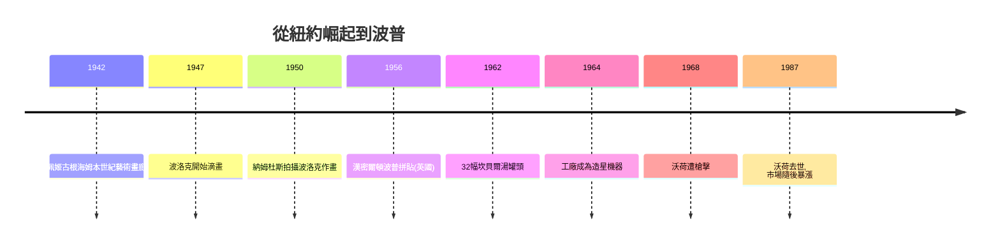

# 11.2 波洛克的滴畫與安迪·沃荷的罐頭

時間：1940年代至1960年代

## 藝術首都的搬家

1940年前後，世界藝術的中心完成了一次史無前例的遷徙：從巴黎到紐約。原因清晰而殘酷——納粹入侵使巴黎淪陷，達利、恩斯特、馬塔、萊熱、夏卡爾、蒙德里安等超現實主義與現代主義大師流亡紐約。佩姬·古根海姆的「本世紀藝術」畫廊（1942年開幕）成為歐洲與美國年輕畫家的接觸面。美國畫家第一次不需要漂洋過海就能看到畢卡索與米羅。羅斯科後來說，1930年代的美國畫家像被拒於門外的孤兒，戰爭年間，門突然打開了。

另一個推手是美國政府與財團：冷戰期間，抽象表現主義被中央情報局資助的文化組織（如文化自由大會）有意識地推向歐洲巡展——它自由、個人、無形象，與蘇聯的社會主義寫實主義形成鮮明對照。藝術第一次成為意識形態鬥爭的軟武器，這件事近年已由解密檔案（CIA前官員1995年承認）確證。

## 波洛克：行動作為繪畫

傑克遜·波洛克（1912年至1956年）生於懷俄明州牧場，跟隨區域主義畫家本頓學畫，受過超現實主義自動性技法與墨西哥壁畫家（西蓋羅斯工作坊）的影響。1947年前後，他在長島Springs的穀倉裡發明了徹底的方法：把巨大畫布平鋪在地，提著鐵罐、棍棒甚至注射器，繞行畫布滴灑、甩動工業琺瑯漆與沙石。他說：「我在畫中，我不是站在畫外面。」動作與顏料同時成為作品的內容——《Autumn Rhythm（30號）》（1950年）近三公尺高、五公尺多寬，整片交織的線條沒有中心、沒有上下，觀者被淹沒在其中。

1950年，攝影師納姆杜斯為他拍攝作畫過程的影片，「行動繪畫」的概念經批評家羅森伯格命名而誕生。批評家格林伯格把波洛克樹為「架上繪畫的終結者」：當繪畫不描繪任何東西，只剩下顏料、平面與行動，它就抵達了自身純粹性的極限。1956年波洛克酒駕車禍身亡，44歲。他的滴畫成為美國「文化獨立」的圖騰：2006年他的《No. 5, 1948》以1.4億美元私下易手，創下當時畫作成交紀錄。

## 沃荷：銀色工廠與罐頭

安迪·沃荷（1928年至1987年）生於匹茲堡的斯洛伐克移民家庭，父親是煤礦工人。他先成為紐約最成功的商業插畫師（畫鞋與廣告），1962年在洛杉磯費魯斯畫廊展出32幅《坎貝爾湯罐頭》：機械絲網印刷、每罐一個口味、排列如超市貨架。批評家問：這是藝術嗎？沃荷的回答成為時代注腳：「我想成為一台機器。」同年他畫瑪麗蓮夢露、迪亞哥、死亡與災難系列——絲網印刷讓圖像可以無限複製，名人的臉成為可量產的商品。

他的紐約工作室被稱為「銀色工廠」（The Factory），像一部運轉的造星機器：地下絲威爾樂隊在這裡排練，伊迪·塞奇威克在這裡成名，電影拍攝如流水線（《帝國大廈》八小時不動機位拍攝一棟建築）。他給自己戴上銀髮假髮、墨鏡與平庸的採訪辭令，把自己製作成品牌。1968年，激進女權分子索拉納斯開槍擊中他，重傷未死。1987年他因膽囊手術併發症去世。他生前備受學院質疑，死後卻被證明是20世紀下半葉最精準的預言家：當代藝術與名人文化、時尚、廣告、金融資本的全面合流，正是沃荷的劇本。

## 波普的語境：消費社會的鏡子

波普藝術不是憑空而來。戰後美國的富裕社會（廣告、電視、超市、汽車文化）製造了史無前例的圖像洪流；英國的獨立小組（漢密爾頓1956年的拼貼《究竟是什麼使今日家庭如此不同、如此有魅力？》——裡面有第一個進入美術館的罐頭與當紅健美先生）先一步用「流行、短暫、消費、機器」定義了Pop。波普同時是鏡子與諷刺：沃荷以絲網印刷的機械複製，正好呼應麥克魯漢的媒體理論與班雅明1936年《機械複製時代的藝術作品》的預言——靈光（aura）在複製中消逝。有趣的是，資本市場用最諷刺的方式回應：沃荷的複製品越機械，原作越昂貴（1987年後他的市場價格暴漲，如今年成交額常居全球藝術家之首）。

## 一體兩面

波洛克與沃荷看似兩極——一個是內心的爆發，一個是外部的複製——卻共同終結了一件事：現代主義的「純粹性」信仰。波洛克證明藝術可以是行動與過程，沃荷證明藝術可以是觀念與品牌。藝術從此不再是掛在牆上的物件，而可以是身體、行為、事件、影像與系統。1960年代之後的藝術家們，將把這兩種自由推到極致——下一章，阿布拉莫維奇將把自己的身體與生命押在桌上。

