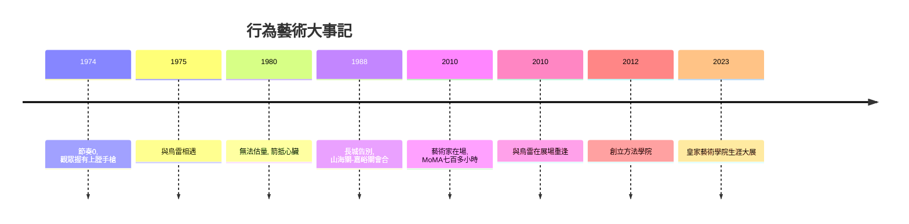

# 12.1 阿布拉莫維奇：以身體為畫筆

時間：1946年至今

## 藝術家在場：從物件到事件

1960年代的西方，一場大規模的藝術出逃正在發生。極簡主義與觀念藝術清算架上繪畫之後，年輕藝術家發現：如果藝術不再需要是物件，那它可以是行為、事件、過程。1960年代伊夫·克萊因讓模特沾滿藍色顏料在樂隊伴奏下撲向畫布（人體測量系列），1960年代弗魯克薩斯往自己手上釘釘子，白南準把電視機當雕塑。身體，成為最後的媒介——因為身體無法被買賣、無法被複製（這個天真假設後來被市場證偽，但當時無人懷疑）。行為藝術（performance art）由此誕生。

瑪麗娜·阿布拉莫維奇（1946年生於貝爾格勒）在這條路上走得最遠、最狠。她的父母是南斯拉夫的鐵托游擊隊英雄，家中的紀律與榮譽讓她自稱「童年像軍隊」。1970年代她在貝爾格勒美術學院畢業後，開始以自己的身體做實驗：《節奏0》（1974年，那不勒斯）——她在桌上擺了72件物品（玫瑰、蜂蜜、鞭子、剪刀、刀，以及一把上膛的手槍），宣稱自己是物件，觀眾可以在六小時內對她做任何事。人群從羞怯的玫瑰與香水，升級到割破她的皮膚、指向她咽喉的手槍——直到有人阻止。這件作品成為行為藝術的經典：它測試的不是藝術家的勇氣，而是觀眾的人性邊界。她說：「一旦你把決定權交給公眾，他們可能殺了你。」

## 《空間中的關係》與烏雷

1975年她在阿姆斯特丹遇見德國行為藝術家烏雷（Uwe Laysiepen），兩人成為情侶與合作者，一同度過了十幾年。他們的作品以兩人的身體為材料：《空間中的關係》系列裡，他們背對背擠進門框、互撞至倒地；《無法估量》中，她握弓、他持箭，箭頭抵著她的心臟，兩人後仰至箭與弓緊繃—— microphone 擴大著兩顆心臟的跳動。1980年代他們決定用一場告別結束關係：《長城》（The Great Wall，1988年）——她從渤海之濱的山海關出發，他從戈壁的嘉峪關出發，各自步行約二千五百公里，在長城中央會合，擁抱，然後分手。她後來說，這段旅程讓中國的長城成為他們關係的句號，也讓她認識了中國。2010年她在MoMA的《藝術家在場》回顧展中重逢烏雷（他未受邀而突然出現，坐在她對面流淚）——那段一分多鐘的影片成為網路時代的藝術傳說。2013年兩人因合作版權訴訟對簿公堂，2020年烏雷去世，恩怨以法律與遺憾一同落幕。

## 沉浸、共處與拍賣行

阿布拉莫維奇晚期的方向從「痛」轉向「在」：《藝術家在場》（2010年，MoMA）——她連續七百多小時靜坐，觀眾輪流與她對視，有些人在她面前幾分鐘即淚流不止。這件作品重新定義了行為藝術的「長時間、高強度、觀眾即材料」，全球排隊人潮成為社會現象（排隊者中不乏名流）。她的作品被博物館永久收藏（行為藝術如何「收藏」成為新課題：協議、重演授權與紀錄文件成為拍賣品類），2012年起她在紐約哈德遜河谷創立阿布拉莫維奇方法學院，推廣「耐力與專注」的訓練法。2023年她在倫敦皇家藝術學院舉辦生涯大展，行為藝術正式進入學院白盒子。

## 行為藝術的經濟學難題

行為藝術的悖論在於：它的本質是「不可重複的當下」，但市場需要「可持有的物件」。這催生了一套新制度：作品以「證書、錄像、重演權」的形式出售，藏家買到的是重演的授權而非物件本身（提諾·賽加爾的表演以保密協議與口述傳承出售，無文件、無重播）。這套制度與傳統繪畫市場並行，形成了當代藝術金融的新層。同時，地景藝術（史密森的《螺旋防波堤》1970年、克里斯托夫婦的包紮計畫）與沉浸式裝置（teamLab、草間彌生的鏡屋）把藝術推向體驗經濟——在社群媒體時代，藝術展成為自拍景點，沉浸式成為流量密碼。藝術與資本的共舞，正在醞釀下一場戲劇性的衝突。下一節，是班克西與他的碎紙機。

