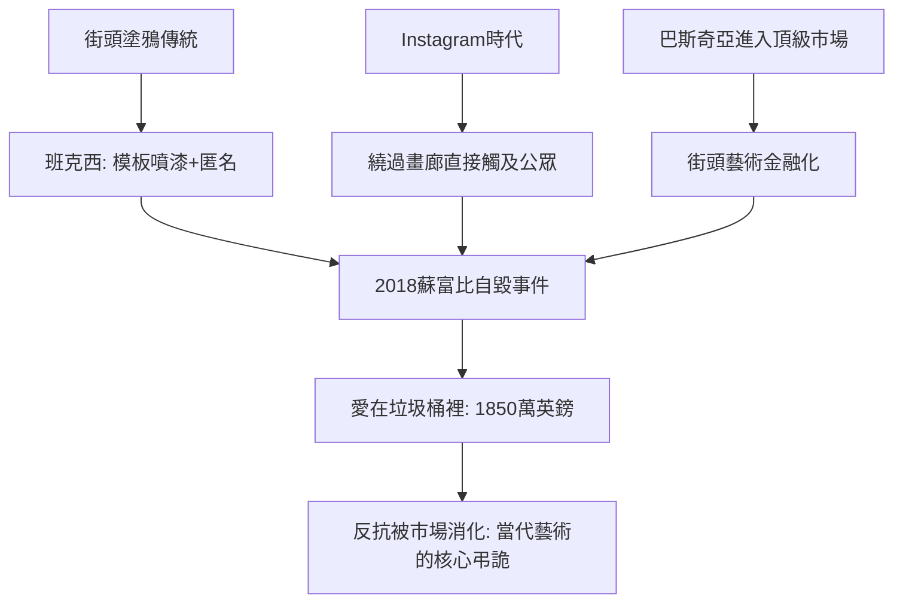

# 12.2 班克西：垃圾桶裡的愛與資本市場的嘲弄

時間：1974年（生年推測）至今

## 匿名的塗鴉者

班克西是當代藝術最大的謎：享譽全球，卻沒有人能百分之百確定他的真實身份（媒體調查普遍指向英國布里斯托出身、畢業於公立學校的羅賓·甘寧漢姆，本人從未證實）。1990年代他從布里斯托的地下塗鴉圈起步，發明（或改良）了模板噴漆（stencil）技法：事先刻好紙模，深夜噴印於牆面，幾分鐘完成——這讓他得以在被抓之前批量生產精細圖像。老鼠、警察、猴子、降落傘的女孩、掛著「歡迎來到地獄」的路牌，出現在倫敦、巴勒斯坦隔離牆、新奧爾良與加薩。他始終以「藝術品權的破壞者」自居，宣言只有一句：「藝術應該讓人心裡一震，而不只是讓牆上多點顏色。」

他的行動充滿劫掠式的幽默：把虛構的史前石雕偷偷放進大英博物館（警方三天後才撤下）、在加薩隔離牆上畫九幅巨型作品（2005年）、在巴黎郊外難民營作畫（2015年）、買下一艘船救地中海難民（2019年， MV Louise Michel）。他的每個動作都是一次媒體行動——在社群媒體時代，匿名本身成為最強的品牌策略。

## 垃圾桶裡的愛：一場事先張揚的自毀

2018年10月5日，倫敦蘇富比，班克西的《氣球女孩》（2006年版）以106萬英鎊落槌。幾秒鐘後，畫框內傳來警報聲，畫布底部開始滑動，一幅藏在畫框內的碎紙機啟動，畫作被條狀裁切，一半從畫框底端滑出懸掛在畫框外——現場譁然，拍賣人員與觀眾全體愣住。班克西隨即在Instagram發布現場影片，配文「幾年前我秘密在畫框裡安裝了碎紙機，以防這幅畫有一天被拍賣」，並引用畢卡索：「摧毀的衝動也是創造性的衝動。」

事件的反轉極具當代性：蘇富比事後確認，拍賣成交已經完成，碎紙發生在成交之後，買家（歐洲女藏家）決定保留——她為這件新作品重新命名為《愛在垃圾桶裡》（Love is in the Bin）。藝術界普遍認定，這場「自毀」實際上完成了一次創作：一件2006年的噴繪，在2018年被轉化為一件前所未有的、融合表演與物件的作品。2021年10月，這件「被毀掉的畫」在蘇富比以1850萬英鎊成交，約為2018年成交價的十八倍。摧毀行為成為增值機器——班克西對資本市場的嘲弄，被資本市場以最講究的方式消化。這正是當代藝術最深的弔詭：連反抗都會被定價。

（附帶一提：2020年一位比利時藝術收藏家發現班克西2014年贈予的《氣球女孩》壁畫被從牆上整塊鑿走，後被畫廊以複製品歸還——班克西的街頭作品長期面臨被牆主整體切割出售的問題，他甚至為此發明「破壞即真跡」的說法來反向定義自己的作品。）

## 街頭、市場與社會批判的三角

班克西的成功有具體的時代條件。其一是社群媒體：Instagram讓匿名藝術家繞過畫廊與評論體系直接觸及全球觀眾，這是班克西之前所有塗鴉者（巴斯奇亞、哈林）都不曾擁有的工具。其二是街頭藝術的合法化與金融化：巴斯奇亞1980年代從街頭進入畫廊、2017年他的《無題》以1.1億美元成交，為街頭藝術進入頂級市場鋪路；倫敦的畫商（如拉扎里德斯）與拍賣行為班克西建立了二級市場。其三是公共議題的高漲：難民、反戰、監控、資本主義批判，讓他的圖像成為可分享的社會情緒載體。

但弔詭也隨之而來：他對拍賣體系的嘲弄，反而讓蘇富比獲得史無前例的免費宣傳；他的反消費姿態，成為最高效的消費品；他拒絕身份，反而使「班克西」成為無法被批評家攻擊的品牌。批評家一度懷疑班克西是否是某種「集體行銷」——這種懷疑本身就是時代的症狀。

## 從自毀到演算法

班克西的碎紙機證明了兩件事：其一，藝術的價值可以被「事件」而非「物件」重新定義（這是杜象之後觀念藝術的商業成熟）；其二，在金融化的藝術世界裡，連「反市場」都是最強的市場策略。這兩條線，將在下一章匯合：當數位檔案可以被區塊鏈「確權」，當演算法能夠生成圖像，藝術的所有權、原創性與人的位置，都將被重新談判。班克西碎掉的那幅畫，其實是整個前數位時代的藝術秩序。

