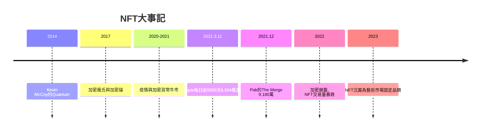

# 13.1 Beeple的六千九百萬美元：NFT重塑所有權

時間：2021年3月11日

## 一場拍賣，五千万次圍觀

2021年3月11日，佳士得拍賣行以6,934萬6,250美元的價格成交了一幅「畫」：美國藝術家Beeple（本名麥克·溫克爾曼，Mike Winkelmann）的《每一天：前5000天》（Everydays: The First 5000 Days）。這幅作品是藝術家連續十三年每天創作一件數位圖像的總合集，將五千張圖拼接成一張巨大的JPEG（尺寸逾21,000×21,000像素）。它沒有實體，任何人在網路上都能免費觀看、下載、列印。但買家得到的是一件區塊鏈上不可偽造的所有權憑證——NFT（非同質化代幣）。

這是佳士得240年歷史上第一次純數位作品以NFT形式拍賣，也是第一件生前在世數位藝術家進入頂級拍賣行並創下天價的作品。拍賣過程有近兩千兩百萬人次線上圍觀。此前，Beeple的印刷品在二級市場只賣一百美元左右；一夜之間，他成為全球最貴的在世藝術家之一（僅次於傑夫·昆斯與大衛·霍克尼）。

## NFT是什麼：所有權的重新發明

NFT的核心技術是以太坊區塊鏈。簡單說，區塊鏈是一種由全球節點共同維護、無法被單方篡改的公開帳本。NFT則是在這本帳本上登記的一個「唯一編號＋元數據」條目，指向某件數位檔案（通常存於IPFS等分散式儲存系統）。它的革命性在於解決了數位藝術長達半世紀的市場難題：數位檔案可以無限複製，傳統上無法像油畫那樣「擁有原作」。NFT人為創造了數位領域的「原件」概念——你可以複製圖像，但你複製不了鏈上那筆「這是屬於某人的編號#4091」的紀錄。

這一技術的源頭可以追溯到2014年藝術家Kevin McCoy的Quantum（第一個被廣泛承認的NFT）與加密朋克（CryptoPunks，2017年）、加密貓（CryptoKitties，2017年底）。2020年至2021年的疫情期間，加密貨幣暴漲帶來流動性過剩，NBA Top Shot（球星灌籃瞬間NFT）吸引主流用戶，數位藝術家集體爆紅。加密龐氏式投機的陰影同時浮現：Beeple的六千九百萬美元買家（Metakovan，真實姓名Vignesh Sundaresan）是加密貨幣基金創辦人，他坦言這次拍賣是為了證明加密技術可以打進傳統藝術界——這是一場有明確市場策略的「宣傳行動」。

## 傳統藝術市場的震盪與降溫

NFT熱潮瞬間席捲藝術機構：蘇富比、富藝斯爭相舉辦NFT專場，烏克蘭數位藝術家Pak的《The Merge》2021年底以9,180萬美元成為史上最貴NFT；紐約惠特尼美術館、倫敦蛇形畫廊先後舉辦加密藝術展；Cryptovoxels、Decentraland等虛擬世界裡的「數位土地」以千萬美元計價。傳統藝術家紛紛嘗試：達明安·赫斯特把萬點畫（The Currency）一半以NFT一半以實體的形式發行，買家需在一年內二選一（結果4,847位買家中約5,000張作品被「燒掉」換NFT，展現了數位所有權的吸引力）。

降溫同樣迅速。2022年加密貨幣崩盤（Terra、FTX事件），NFT交易量暴跌九成以上，絕大多數NFT淪為無人問津。但技術留下了：佳士得、蘇富比已將NFT拍賣納入常規業務；大博物館（羅浮宮、烏菲茲、惠特尼）開始試驗NFT募資與數位授權；「鏈上作品、鏈下展覽」成為新一代藝術家的工作方法。2023年後，NFT從投機狂潮沉澱為藝術市場的一個固定品類。

## 所有權的哲學問題

Beeple事件留下的核心問題不是「值不值六千九百萬」，而是「擁有」到底是什麼。買家擁有的鏈上憑證並不附帶著作權（版權仍在Beeple手中），也不阻止他人複製檔案。批評家指出，NFT所有權更像一種「社會契約」：大家共同承認鏈上紀錄的意義。這其實並不新鮮——當代藝術早已在出售「證書與概念」（卡斯特利奧尼的空氣、克萊因的「空間」、賽加爾的口述表演），觀念藝術的市場機制本就是「承認的契約」。NFT只是把這個契約從人際信任轉移到數學信任。

更有意思的是對比：一百年前杜象用小便斗證明「選擇即藝術」；Beeple用五千張數位圖證明「鏈上紀錄即所有權」。兩者都在攻擊同一個堡壘——「藝術品的物質唯一性」。杜象摧毀了工藝的必要，NFT摧毀了實體的必要。剩下的堡壘，只有「人是誰」——這正是下一節的問題。

