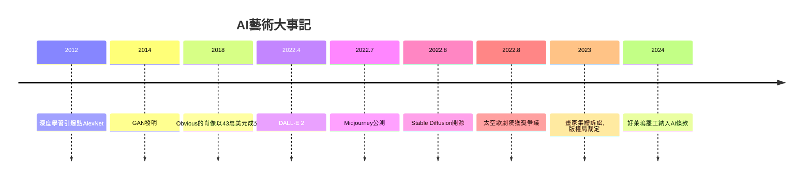

# 13.2 生成式AI時代：人類藝術家的靈魂在哪裡

時間：2022年至今

## 一場比赛的獲獎者

2022年8月，美國科羅拉多州博覽會的數位藝術比賽揭曉，一等獎作品《太空歌劇院》引發軒然大波：它由遊戲設計師傑森·艾倫使用Midjourney生成，再以Photoshop微調、Upscale放大。藝術家們在推特上群起抗議：「我們眼看著藝術的死亡。」艾倫辯稱自己花費數百小時、生成上百張圖才挑出這一幅——這是「工具的使用」，與使用Photoshop無異。這場爭論成為生成式AI衝擊藝術的序幕。

2022年有兩款改變一切的產品問世。其一是DALL·E 2（OpenAI，4月），其二是Stable Diffusion（Stability AI，8月開源）——後者可以免費在自己電腦上運行，引爆了全球的圖像生成浪潮。Midjourney（2022年7月公測）則以極佳的美學輸出成為創作者的寵兒。2022年11月ChatGPT發布，生成式AI全面破圈。一夜之間，任何人輸入一句話，就能在幾十秒內得到一幅專業水準的圖像。

## 技術的血脈：從神經網路到擴散模型

這場革命不是憑空而來，它有自己的科學史。1950年代神經網路萌芽，1986年反向傳播演算法成熟；2012年AlexNet在ImageNet競賽中引爆深度學習；2014年GAN（生成對抗網路）讓機器學會「創作」，藝術家Obvious以GAN作品《埃德蒙·貝拉米肖像》在2018年佳士得以43.25萬美元成交；2020年OpenAI的GPT-3證明大語言模型的力量；2020年至2022年，擴散模型（diffusion model）成為圖像生成的主流技術——它透過逐步「去噪」的方式生成圖像，配合網路海量的圖像—文字配對資料（如LAION-5B，六十億組圖文對）訓練出驚人的泛化能力。2014年亞馬遜的Alexa、2016年AlphaGo、2022年Stable Diffusion，技術的進步曲線一路陡升，藝術是最後被觸及的堡壘，也是最受衝擊的堡壘。

## 爭議的焦點：訓練資料與著作權

藝術家們的憤怒有具體的經濟理由。Stable Diffusion與Midjourney的訓練資料來自網路爬取的數十億張圖像，其中包括數百萬藝術家的作品——在未經授權、未付報酬的情況下。2023年1月，三位畫家（包括以概念設計聞名的莎拉·安德森）對Stability AI、Midjourney與DeviantArt提起集體訴訟；Getty Images起訴Stability AI未經授權使用一千兩百萬張照片（部分生成圖像甚至出現歪曲的Getty浮水印，成為訓練資料的鐵證）。2023年美國版權局裁定：純AI生成的圖像不受版權保護（因缺乏人類作者），引發「人類貢獻多少才有版權」的持續論戰。插畫家、概念設計師、原畫師職業受到實質衝擊，2024年好萊塢編劇與演員罷工中，AI使用成為核心條款之一。藝術家們開始使用「反AI」工具（Glaze、Nightshade）在作品上投毒以干擾訓練——這是藝術史上第一次，創作者用技術手段對抗技術。

## 靈魂問題：藝術家剩下什麼

回到這本書最初的問題：當演算法能夠畫出畫作，人類藝術家獨一無二的「靈魂」在哪裡？

歷史提供了意外的安慰。攝影發明（1839年）時，肖像畫家們的生計被摧毀，繪畫被迫放棄「精確再現」，轉而探索攝影做不到的事——結果是印象派、表現主義、抽象藝術的大爆發。機器搶走了繪畫的一種功能，卻逼它發現了更多的自己。AI時代可能正在重演這個劇本：當「生成圖像」變得廉價，人類藝術的稀缺價值將轉移到機器難以複製的層面——作品的來源與身體（手工的痕跡、行為藝術的當下、現場的不可複製）、作品背後的生命經驗與倫理承擔（誰為這件作品負責、它承載誰的故事）、以及作品與特定歷史時刻的綁定（戰地畫家、街頭藝術家的現場性）。班克西的碎紙機之所以震撼，正因為那裡有一個真實的人在對世界說話；阿布拉莫維奇的靜坐之所以動人，正因為那是她本人的七百小時。

另一種更具建設性的答案是：AI成為新的畫筆。當年油畫取代蛋彩、攝影取代寫實肖像、數位繪圖板取代顏料，每一次都有藝術家哀嘆藝術的死亡，每一次都誕生了新的大師。早期採用AI的藝術家（如Refik Anadol的資料雕塑、以Nature Morte展出的AI合作作品）已經在探索「人機共創」的語法。批評家葛羅伊斯說過，當代藝術早已是「觀念與脈絡」的藝術，AI不過是加入了新的觀念工具箱。

## 三萬年的線索

回到第一章：冰河期的獵人在黑暗洞穴裡用吹管噴上赭石。那時繪畫是巫術，畫家是薩滿。三萬年來，藝術經歷了神權的秩序、帝國的宣傳、教堂的靈光、宮廷的奢華、市場的革命、前衛的反抗、觀念的解放、品牌的狂欢、鏈上的確權——每一章的驅動力，都是當時最新的技術與最深的焦慮。AI只是最新的一章。如果歷史有什麼啟示，那就是：技術會改變藝術的形態，卻從未取消藝術的根源——人類需要在黑暗中留下印記，證明自己來過、愛過、恐懼過、夢過。這份需要，演算法沒有；這份需要，就是靈魂。

