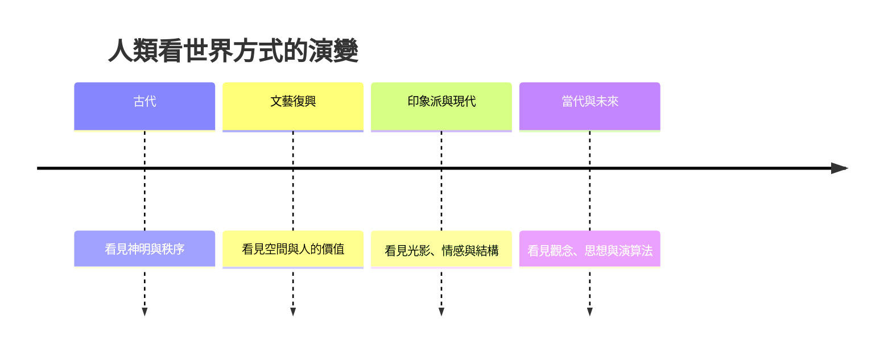

# 藝術的故事：從洞穴壁畫到數位時代的靈魂演義

這是一本關於人類如何「看世界」的歷史。藝術從來不只是美麗的物件，它是宗教信仰、帝國權力、科技發明、經濟結構與思想革命共同作用的結果。從黑暗洞穴中的火光，到演算法生成的影像，這條路走了三萬多年。

全書分五篇、十三章，依時代順序展開。

## 第一篇：靈魂的曙光與神聖的秩序（古代篇）

* 第1章-黑暗洞穴裡的火光
    * [1.1-拉斯科與阿爾塔米亞：狩獵巫術與最初的畫家](01.1-拉斯科與阿爾塔米亞：狩獵巫術與最初的畫家.md)
    * [1.2-威倫道夫的維納斯：母神崇拜與豐饒的雕刻](01.2-威倫道夫的維納斯：母神崇拜與豐饒的雕刻.md)
* 第2章-永恆的法老與神廟的秩序
    * [2.1-正面律：為死後世界服務的嚴謹法則](02.1-正面律：為死後世界服務的嚴謹法則.md)
    * [2.2-圖坦卡門的金面具與阿瑪納的寫實革命](02.2-圖坦卡門的金面具與阿瑪納的寫實革命.md)
* 第3章-完美的人體與神話的神殿
    * [3.1-古希臘雕塑：從僵硬到運動中的靈魂](03.1-古希臘雕塑：從僵硬到運動中的靈魂.md)
    * [3.2-古羅馬的寫實肖像與建築奇蹟](03.2-古羅馬的寫實肖像與建築奇蹟.md)

## 第二篇：信仰的光影與文藝復興的曙光

* 第4章-金色背景下的神聖靈光
    * [4.1-拜占庭鑲嵌畫與哥德式彩色玻璃](04.1-拜占庭鑲嵌畫與哥德式彩色玻璃.md)
    * [4.2-喬托：給聖人穿上人的衣服](04.2-喬托：給聖人穿上人的衣服.md)
* 第5章-解開透視法與人性的復甦
    * [5.1-布魯內萊斯基與多納泰羅：透視法與裸體大衛](05.1-布魯內萊斯基與多納泰羅：透視法與裸體大衛.md)
    * [5.2-文藝復興三傑：達文西、米開朗基羅與拉斐爾](05.2-文藝復興三傑：達文西、米開朗基羅與拉斐爾.md)
* 第6章-北方的細節與巴洛克的戲劇性
    * [6.1-揚·凡·艾克與北方文藝復興](06.1-揚·凡·艾克與北方文藝復興.md)
    * [6.2-卡拉瓦喬的明暗與貝尼尼的雕塑](06.2-卡拉瓦喬的明暗與貝尼尼的雕塑.md)

## 第三篇：革命、光影與傳統的破裂

* 第7章-宮廷的奢華與革命的號角
    * [7.1-洛可可的輕盈與新古典主義的道德](07.1-洛可可的輕盈與新古典主義的道德.md)
    * [7.2-浪漫主義：情感與狂野自然的爆發](07.2-浪漫主義：情感與狂野自然的爆發.md)
* 第8章-走訪戶外，捕捉瞬間的光線
    * [8.1-1863年落選者沙龍：馬奈的審美震盪](08.1-1863年落選者沙龍：馬奈的審美震盪.md)
    * [8.2-1874年第一次印象派畫展與莫內](08.2-1874年第一次印象派畫展與莫內.md)
* 第9章-後印象派與靈魂的吶喊
    * [9.1-塞尚：現代藝術之父的幾何結構](09.1-塞尚：現代藝術之父的幾何結構.md)
    * [9.2-梵谷、高更與蒙克：色彩、野性與焦慮](09.2-梵谷、高更與蒙克：色彩、野性與焦慮.md)

## 第四篇：現代主義爆發與觀念的革命

* 第10章-拆解世界與無理性的顛覆
    * [10.1-馬蒂斯的野獸派與畢卡索的立體派](10.1-馬蒂斯的野獸派與畢卡索的立體派.md)
    * [10.2-杜象的《噴泉》：小便斗裡的哲學炸彈](10.2-杜象的《噴泉》：小便斗裡的哲學炸彈.md)
* 第11章-潛意識、夢境與紐約的崛起
    * [11.1-達利與馬格利特：把夢境畫在畫布上](11.1-達利與馬格利特：把夢境畫在畫布上.md)
    * [11.2-波洛克的滴畫與安迪·沃荷的罐頭](11.2-波洛克的滴畫與安迪·沃荷的罐頭.md)

## 第五篇：當代藝術、數位浪潮與未來的邊界

* 第12章-身體、裝置與拍賣場上的狂歡
    * [12.1-阿布拉莫維奇：以身體為畫筆](12.1-阿布拉莫維奇：以身體為畫筆.md)
    * [12.2-班克西：垃圾桶裡的愛與資本市場的嘲弄](12.2-班克西：垃圾桶裡的愛與資本市場的嘲弄.md)
* 第13章-AI畫筆、NFT與藝術的終極叩問
    * [13.1-Beeple的六千九百萬美元：NFT重塑所有權](13.1-Beeple的六千九百萬美元：NFT重塑所有權.md)
    * [13.2-生成式AI時代：人類藝術家的靈魂在哪裡](13.2-生成式AI時代：人類藝術家的靈魂在哪裡.md)

## 核心線索

藝術的故事本質上是人類看世界方式的演變史：

