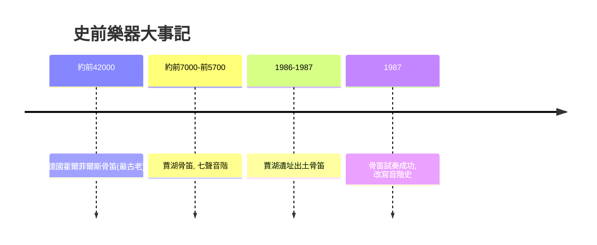

# 1.1 賈湖骨笛：九千年前的七聲音階

時間：約西元前7000年至前5700年

## 一支改寫音樂史的鶴骨

1986年至1987年，河南省舞陽縣賈湖遺址的考古發掘中，出土了一批用丹頂鶴尺骨製成的管狀器物，上有整齊的圓孔。經測定距今約九千年（約西元前7000年至前5700年），它們是世界上最古老的、仍然可以吹奏的管樂器——賈湖骨笛。共發現四十餘支，多數開七孔。1987年，研究者請笛子演奏家蕭興華等人用其中的M282:20號骨笛試奏，竟吹出了河北民歌《小白菜》的旋律，音階接近今日的七聲音階，音準可以辨認出十二平均律的音名。

這個發現震動了音樂史。此前的通行假設是：人類早期音階以三、四聲為主，五聲、七聲音階是數千年文明發展的產物。賈湖骨笛證明，九千年前的人類已經掌握七聲音階的音程概念，並且具備了精確計算孔位的能力——有些骨笛上有先鑽小孔再校正的痕跡，甚至有刻度記號，說明製作過程經過了音程測算。這不只是一支笛子，它是一套知識體系的物證。

## 為什麼是骨笛

工具的選擇透露了經濟結構。丹頂鶴是遷徙鳥類，賈湖遺址位於淮河上游的沼澤地帶，正處於候鳥路線上。賈湖人處於狩獵採集向早期農業（他們同時種植稻作、馴養家犬與家豬，是亞洲最早的稻作遺址之一）過渡的階段，食物相對穩定，才可能有人力與時間投入非實用性的精密製作。用鶴骨而非竹木，是因為禽類尺骨骨質堅硬中空、管壁均勻，是最理想的天然管腔。出土的骨笛多有使用磨損與修補痕跡（有的斷裂後鑽孔繫繩修復繼續使用），說明它們是長期使用的珍貴物品，而非一次性器物。

## 音樂的功能：從模仿到儀式

骨笛的用途沒有文字可考，但線索指向儀式。賈湖遺址中，骨笛多與龜甲（內裝石子，可搖動作響）、骨叉形器一同出土於墓葬，墓主多為成年人，且部分墓葬隨葬品明顯豐厚於他人——這暗示社會分工與階層已經出現，而音樂的執掌者很可能是原始宗教儀式中的特殊人物。丹頂鶴本身也可能具有象徵意義：候鳥隨季節來去，古人以牠的骨頭發聲，或許是在「呼喚」季節、豐收或亡靈。音樂從誕生之初就不是娛樂，而是人與不可見世界溝通的技術。

## 全球最早的樂器家族

賈湖骨笛並非孤例。德國斯瓦比亞地區的霍爾菲爾斯（Hohle Fels）洞穴出土過約四萬年前的猛獁象牙與禿鷲骨笛，是目前所知最古老的樂器；法國比利牛斯山的Isturitz洞穴也有兩萬多年前的鳥骨笛。再加上最古老的音樂傳統——敲擊（全球舊石器遺址中大量發現的共鳴石與石磬類器物，以及最古老、最普遍的樂器：人身體本身的拍擊與吟唱）——可以描繪出一幅圖景：音樂與人類的象徵思維幾乎同時誕生。繪畫把看不見的意義畫出來，音樂把看不見的意義「奏」出來。

## 一條延續九千年的線

賈湖骨笛的七聲音階，與兩河流域的調式傳統、與後來畢達哥拉斯的弦長比例、與巴哈的平均律、與今天你手機裡的每一首歌，走的是同一條數學血脈：人類總是在有限的音高中尋找無限的組合。九千年前的製笛者不知道十二平均律的計算公式，但他用耳朵與經驗，把同樣的音程關係鑽進了鶴骨。音樂史的第一課是：音階不是發明的，是「聽」出來的；而能把聽到的固定下來、傳給下一代，靠的是工具與制度——這將是本書反覆出現的主題。

