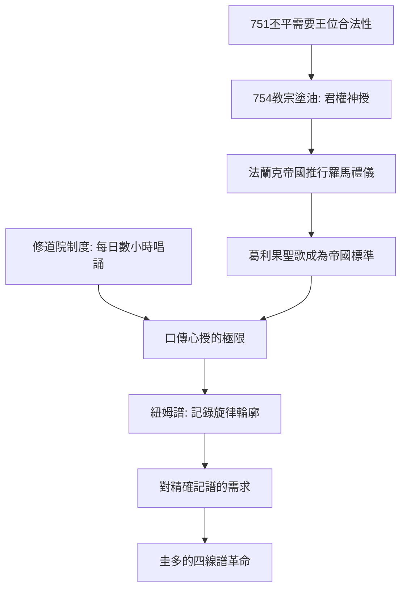

# 2.1 葛利果聖歌：單聲部的神聖秩序

時間：西元6世紀至14世紀

## 以教宗之名

葛利果聖歌（Gregorian chant）得名於教宗葛利果一世（Gregory I，590年至604年在位）。傳說聖靈以鴿子的形象停在他肩上，向他口授聖歌——這個傳說出自9世紀，是後世教廷的「品牌工程」。史實層面，葛利果本人與這些旋律的直接關係薄弱，聖歌體系是數百年間累積、由多個源頭（羅馬、法蘭克、拜占庭、猶太會堂傳統）匯流而成。但把統一的聖歌體系冠以葛利果之名，這個決定本身就是歷史：9世紀的加洛林王朝與教廷結盟，以「回溯至羅馬正統」的名義，把一套標準化的禮儀聖歌推行到整個拉丁西方，作為政治與宗教統一的工具。

這裡的因果鏈值得細看：751年，法蘭克宮相丕平為取得王位，需要教廷的祝聖；754年教宗司提反二世為丕平塗油，確立「君權神授」的先例。作為交換，法蘭克王國把羅馬禮儀（含聖歌）強制推行於其廣大領土。查理曼進一步頒布敕令，要求全帝國教會統一用羅馬聖歌，並從羅馬延聘歌手教授。換句話說，葛利果聖歌的傳播是法蘭克王國與教廷政治交易的文化附件——音樂史上第一次，一種音樂風格透過國家機器與行政命令大規模推廣。

## 單聲部的美學與神學

葛利果聖歌是單聲部（monophony）：一條旋律，無伴奏，全體同時唱同一個音。這不是技術不足，而是神學選擇。全體會眾的聲音匯成一條線，象徵教會的合一；旋律漂浮，節奏自由（依歌詞的呼吸），不追求世俗的動感，而追求祈禱的綿延。調式系統（8種教會調式）繼承自古希臘理論經波埃修斯的轉譯，不同的調式對應不同的靈性氣質。聖歌分為音節式（一字一音）、紐姆式（一字數音）與花腔式（一字長串裝飾音，如〈阿里路亞〉的Jubilus），在彌撒與時辰祈禱的架構中各就其位。

## 修道院：音樂的生產體系

聖歌得以精確保存與傳播，靠的是修道院制度。本篤會的作息（一天七次時辰祈禱加夜禱）意味著修士每天花數小時唱聖歌，唱錯不只是藝術問題，是對神的冒犯。於是修道院發展出完備的教學與記譜需求：學唱靠口傳心授，一個旋律要教幾個月。9世紀起出現紐姆譜（neume）：在歌詞上方用點、線、勾記下旋律輪廓，作為記憶的輔助——它記錄「怎麼唱」而非「什麼音高」，因為學者本來就會唱。這套口傳＋輪廓記譜的體系，使用了兩百年。

真正的飛躍，出現在一個想要「偷懶」的修士身上——下一節的圭多。在進入記譜史之前，還需記住一件事：中世紀的音樂與當時的世界觀同構。聖歌是一元的世界：一個真理、一條旋律、一個教會。當經濟復甦、城市興起、人的經驗開始多元化時，這條單聲部的線，必然分裂成多聲部——複音音樂不是音樂技術的進化，而是社會結構在聲音中的倒影。

