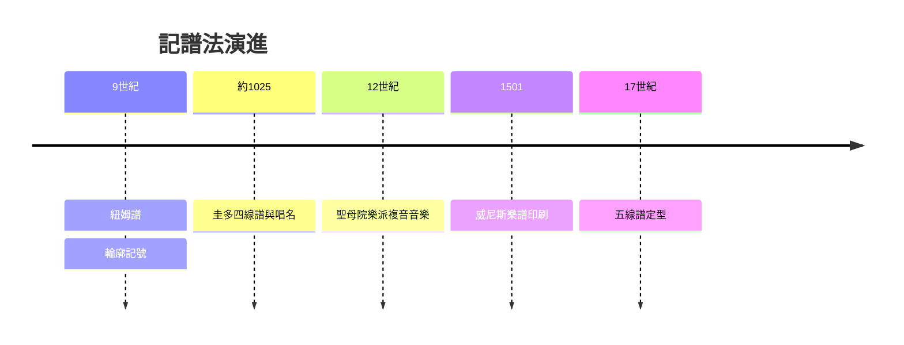

# 2.2 阿雷佐的圭多：四線譜與Do-Re-Mi

時間：約991年至1033年

## 學生的記憶問題

阿雷佐的圭多（Guido d'Arezzo，約991年生，約1033年卒）是本篤會修士，後任阿雷佐地區的唱詩班教師。他面對的實際問題很具體：訓練一個歌手要花幾個月甚至數年，因為所有聖歌靠口傳心授，學生必須在老師在場時一首一首學。他在《微闡》（Micrologus）中寫道，用他的新方法，「一個從未見過的旋律，你可以讓自己或別人幾天之內唱出來；而沒有它，可能要幾個星期都在苦練」。據傳他的教學法太有效，引起周邊修院修士的反感（學生流失到他這裡），圭多因而離開本篤會轉投阿雷佐的主教座堂——教學改革惹來同行排擠，這是教育變革的永恆劇情。

圭多的貢獻是一套組合：其一，四線譜——在紐姆符號下方加平行線，並用不同顏色（F線紅、C線黃）標定固定音高，使每個符號的高度對應明確的音；其二，把音高歸入Ut-Re-Mi-Fa-Sol-La的階梯系統（六個音的hexachord體系）；其三，以手為記憶工具的「圭多手」——在左手每個指節上標定二十個音位，教師以手指點位教唱，學生看著手就能複習任何旋律。

## Do-Re-Mi的出處：一首聖歌

唱名的出處極為優雅。圭多選取了聖約翰節讚美歌《 UT queant laxis 》，每一行的第一個音恰比上一行高一音級，而行首單詞的第一音節依次是：

```
UT queant laxis        → Ut (後來改為 Do)
REsonare fibris        → Re
MIra gestorum          → Mi
FAmuli tuorum          → Fa
SOLve polluti          → Sol
LAbii reatum           → La
```

這六個音節就這樣變成了六個唱名，沿用至今近千年。後世補上第七音Si（17世紀取自Sancte Iohannes），英語世界的Ti則出自《音樂之聲》的通俗化改寫。一首奉獻給聖約翰的聖歌，成為全世界音樂教育的密碼。

## 記譜革命：音樂第一次可以被「儲存」

四線譜的意義怎麼估計都不過分。在圭多之前，音樂是「行為」：它存在於表演的當下，像舞蹈一樣無法儲存；口傳使曲目難以遠播、難以累積、難以複雜化——你想寫一個十個聲部的合唱，靠口傳根本教不出來。記譜法改變了音樂的存在方式：旋律可以被寫下、被寄到千里之外、被幾百年後的人精確復原。音樂從此成為可以累積的文本，如同法律與文學。這一變革的制度後盾是修道院的抄寫室（scriptorium）與羊皮紙生產，以及11世紀西歐的文化復興（大教堂學校、最早的大学在圭多死後一百年內出現）。

直接後果很快顯現：11至12世紀，聖馬夏爾學派與聖母院樂派（巴黎，約1160年至1250年，佩羅坦與雷奧南）開始寫作多聲部音樂——兩聲、三聲、四聲部的奧爾加農。沒有精確記譜，複音音樂在技術上不可能。音樂史在此展示了它的一貫邏輯：傳播技術決定音樂形態。圭多的四線譜之於複音音樂，正如古騰堡印刷之於宗教改革、錄音之於爵士樂、MP3之於流行樂、串流之於當代——每一次載體革命，都重塑了音樂本身。

## 連鎖反應

順著這條線往下走：記譜使作曲成為獨立的職業（作曲者可以死後存續，作品名聲開始附著於「作者」——現代意義的作曲家概念誕生）；樂譜的抄本與印刷（1501年佩特魯奇的威尼斯樂譜印刷所是商業樂譜出版之始）使音樂成為跨國商品；而當16世紀的作曲家能寫出幾十個聲部的複雜複音時，宗教改革與反宗教改革的教會卻開始擔心歌詞聽不清了——這場張力，就是下一章帕勒斯替那的故事。


