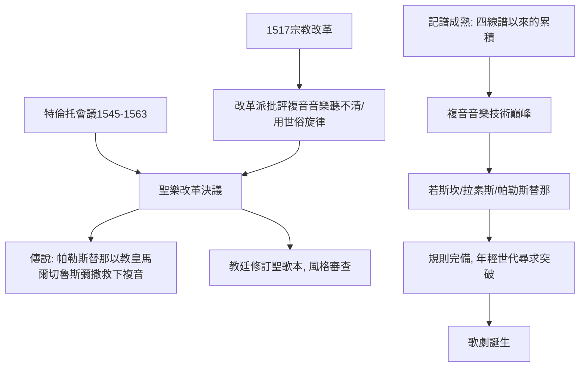

# 3.1 帕勒斯替那與複音音樂的黃金時代

時間：約1525年至1594年

## 一個關於「音樂被處死」的傳說

16世紀中葉，天主教會面臨嚴峻危機：路德的宗教改革（1517年《九十五條論綱》）撕裂了西方教會。改革者攻擊的不只是教義與腐敗，還有宗教音樂——加爾文派幾乎廢除複音音樂，只留會眾詩篇吟唱；茨溫利更連管風琴都拆了。天主教內部則批評複音音樂華而不實：幾十個聲部你追我趕，歌詞完全聽不清，還大量借用世俗香頌的旋律（巴黎化彌撒，把酒館情歌作為彌撒的定旋律）——神聖的彌撒唱著香頌，這在宗教改革的語境下是致命的攻擊點。

特倫托會議（1545年至1563年）回應這場危機，其中1562年第22次會議的決議要求聖堂音樂除去「放縱與不潔」的成分。此後流傳一個著名的傳說：教廷曾考慮禁止複音音樂、只留素歌，而羅馬聖彼得大教堂唱詩班指揮帕勒斯替那以一部《教皇馬爾切魯斯彌撒》證明複音音樂可以既精美又字字清晰，從而「救下了複音音樂」。這個故事出自17世紀的傳記，細節難以考證（其中教宗為馬爾切魯斯三世、只當了二十二天教宗，與史實有出入），但它流傳至今，因為它精確地抓住了時代問題：聖樂的清晰性與美感，是否可以兩全？

## 《教皇馬爾切魯斯彌撒》：克制的完美

帕勒斯替那（1525年至1594年，羅馬人）的答案是克制。在這部六聲部彌撒中，他把各聲部寫得機會均等，避免過度的模仿糾纏；關鍵歌詞（如「垂憐我們」）讓聲部同時發音、緩慢莊重；每一個不協和音都經過精心準備與解決，尖銳的瞬間立即融化為和諧。英國音樂學家伯尼18世紀聽後感動落淚；19世紀的德國音樂學家菲蒂斯稱之為「宗教音樂的範本」。現代聽來，帕勒斯替那的風格像是一座純白大理石的建築：沒有一個多餘的裝飾，卻處處平衡。他一生寫了一百多部彌撒、數百首經文歌，全部為天主教禮儀而作，風格終生未變——他不追求新，他追求「正確」。

## 特倫托之後的音樂政策

不論傳說真偽，教廷確實在1560至1580年代採取了行動：教宗國音樂委員會審查聖樂，1577年教廷下令修訂聖歌本（梅迪奇版聖歌本，1614年完成），刪除「野蠻、冗長、輕浮」的成分。帕勒斯替那本人受聘參與這項修訂（他對聖歌的改動比上級期望的少，後被解職，改由他的學生喬瓦尼·納尼諾完成）。這是音樂史上少數幾次由中央權力直接干預作曲風格的案例，其邏輯與柏拉圖《理想國》的音樂管制一脈相承：音樂影響人心，人心關係秩序。

## 複音音樂的巔峰與「規則的盡頭」

帕勒斯替那身處的時代，正是複音音樂技術的頂點。此前，荷蘭樂派（若斯坎、拉呂斯的奧克岡、蓋內甘）已把模仿對位推向極致，若斯坎（約1440年至1521年）更首次大量使用「主題模仿」讓各聲部共享音樂動機，被馬丁·路德本人讚譽（路德是複音音樂的熱愛者，他說複音音樂是「上帝恩賜的最美之物」，新教的眾讚歌chorale傳統正是由此而來——宗教改革的音樂不是消滅複音，而是讓歌詞可懂）。到了帕勒斯替那的同代人拉素斯（1532年至1594年，尼德蘭人，任慕尼黑宮廷樂長），複音技術已爐火純青：他晚年作的《懺悔詩篇》七首據傳是為了洗刷兒子殺人的恥辱而作（此說存疑），七首各用不同調式，情感濃烈直逼巴洛克。

帕勒斯替那之後，複音音樂的「規則」寫進了教科書（扎利諾《和聲體制》1558年確立純律理論；福克斯1725年的《藝術之泉》把帕勒斯替那風格定為對位法教學範本，至今仍是音樂學院教材）。但規則的完備，恰恰是變革的前夜：當一切都已被規範，年輕人要表達的卻是規範之外的東西——戲劇、情感、獨唱的榮耀。佛羅倫斯的一群貴族文人正在做實驗：讓音樂像古希臘悲劇那樣，為戲劇服務。下一節，是《奧菲歐》。

