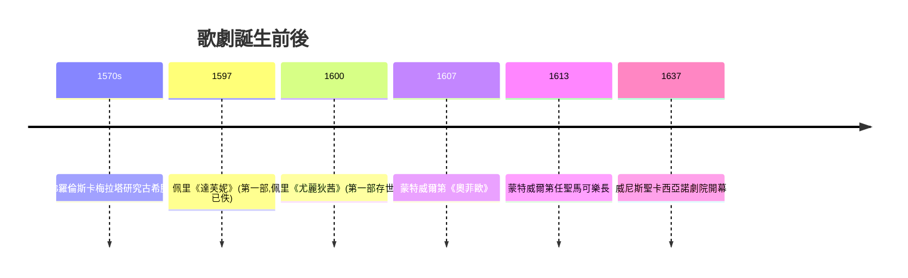

# 3.2 蒙特威爾第的《奧菲歐》：歌劇的誕生

時間：1597年至1607年

## 佛羅倫斯的沙龍實驗

歌劇不是音樂家的發明，而是一群人文主義文人的「考古復原」實驗。1570年代，佛羅倫斯的巴爾迪伯爵與科爾西家中聚集了詩人、樂器演奏家與學者，人稱佛羅倫斯卡梅拉塔（Camerata）。他們的出發點是復興古希臘悲劇：古人（他們根據典籍推斷）唱的不是我們這種多聲部纏繞的複音，而是一種接近說話的獨唱，能把語言的情感直接傳到人心。數學家伽利雷（伽利略的父親）在其中提出關鍵理論：只有單聲部旋律才能表達語言的情感細微變化，複音音樂讓多個旋律互相干擾，「誰也聽不清歌詞在說什麼」。

理論化為實踐：佩里的《達芙妮》（1597年，音樂已佚失）被認為是第一部歌劇；1600年佩里與卡奇尼的《尤麗狄茜》在梅迪奇家族的婚禮上演出，是第一部存世的歌劇。這些早期作品用的是「宣敘調」（recitative）：一種模仿說話的半唱半唸，由持續低音（數字低音basso continuo）支撐。技術上，這正是從帕勒斯替那的世界逃出來的路：放棄複音的糾纏，回到單聲部——諷刺的是，這恰恰是畢達哥拉斯以來「和諧」觀念的反面，卻成就了全新的戲劇音樂。

## 曼圖亞的宮廷與《奧菲歐》

把這種實驗推成藝術品的，是克勞迪奧·蒙特威爾第（1567年至1643年）。他生於克雷莫納（小提琴製作之城），先在曼圖亞貢扎加公爵宮廷任樂師，1607年為宮廷婚禮（或慶典）寫作《奧菲歐》，腳本出自斯特里吉奧，取材奧菲歐下冥府救妻的神話。

《奧菲歐》與前輩作品的不同在於三點。其一，規模：五幕、數十人的樂隊（約四十件樂器，包括兩台羽管鍵琴、兩架管風琴、維奧爾琴、小號與長笛——樂器編制本身成為戲劇手段，冥府用長號與低音管，田園用牧歌式弦樂）。其二，開場：奧菲歐在極度悲痛中唱出〈無限的悲傷〉，然後轉入音階式下行的〈強大的神〉詠嘆調——獨唱第一次在音樂中承載完整的性格弧線。其三，技術上他把宣敘調寫得富於表現力，同時加入詠嘆調式的抒情段落與器樂間奏（利都奈羅），兩種手法（戲劇的話語與歌曲的美感）在此後四百年的歌劇中持續辯證。首演極為成功，宮廷為之震撼。

## 為什麼此時此地：宮廷、印刷與職業音樂家

歌劇誕生的土壤是：其一，義大利宮廷的競爭性消費——梅迪奇、貢扎加、埃斯特家族用音樂與視覺藝術展示權力，一場婚禮就是一次文化軍備競賽；其二，職業音樂家階層成熟——蒙特威爾第是第一位以宮廷薪俸與出版版稅（1610年《晚禱》等作品出版）過活的音樂家，1613年他被威尼斯聖馬可大教堂聘為樂長（薪俸是曼圖亞的三倍），威尼斯的公共劇院（1637年聖卡西亞諾劇院開幕，世界第一家對公眾售票的歌劇院）使歌劇從宮廷特權變成市民商品；其三，樂譜印刷業（威尼斯的加爾達諾出版社）讓作品跨越宮廷傳播。蒙特威爾第身後出版的《牧歌集》八冊，記錄了他從文藝復興複音走向巴洛克情感的完整軌跡——他自稱第二種做法（seconda pratica）：「歌詞是音樂的主人，而不是僕人。」

## 一種全新的藝術社會學

歌劇的誕生還標誌著音樂功能的大遷移。中世紀聖歌服務上帝，複音彌撒服務教會，宮廷音樂服務公爵——歌劇則是第一種以「講故事」為核心的音樂形式，音樂成為敘事的工具。更根本的變化是聽眾結構：歌劇需要付費買票的市民，於是「受歡迎」開始成為音樂的價值標準之一——作曲家的命運第一次部分地繫於票房。這條線從威尼斯出發，經巴黎（呂利）、倫敦（韓德爾的歌劇與神劇）、維也納（莫札特）一路延伸到今天的好萊塢與百老匯。音樂從服務對象中解脫的方式，不是革命宣言，而是一場宮廷婚禮上的一齣戲。

