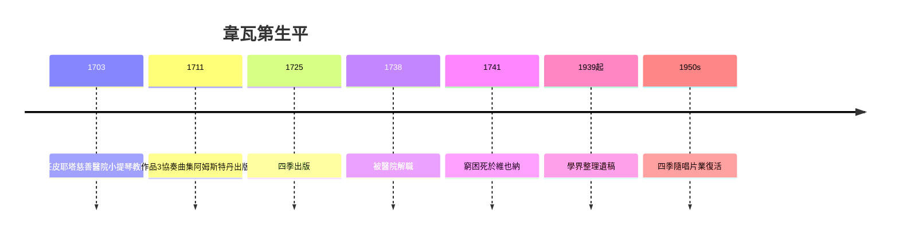

# 4.1 韋瓦第與《四季》：協奏曲的戲劇性

時間：1678年至1741年

## 紅髮神父與孤女樂團

安東尼奧·韋瓦第（1678年至1741年）生於威尼斯，父親是聖馬可大教堂的小提琴手。他25歲受任神職（因紅髮被稱為「紅髮神父」il Prete Rosso），但長期健康不佳（自述胸悶，可能是氣喘），很快獲准停止主持彌撒，轉而投身音樂。他一生的主要職務在威尼斯的皮耶塔慈善醫院（Ospedale della Pietà）：這是四所收容孤女與棄女的慈善機構之一，以音樂教育聞名。女孩們組成優秀的管弦樂團與合唱團，定期演出（遊客從全歐洲慕名而來，法國遊客德·布羅斯稱之為「全威尼斯最棒的音樂」，並驚訝於她們的技巧——據傳部分學生男裝演奏低音提琴等「不宜女性」的樂器）。

韋瓦第在這裡的職責是教小提琴、作曲、每個節日供應兩部協奏曲——工作制度本身決定了產量：他一生寫了五百多部協奏曲（保留曲目約五百部），其中小提琴協奏曲二百多部。這是史上第一次，音樂創作像工坊接單一樣批量生產，作品的數量反映出慈善醫院體系（社會福利制度）對音樂的需求——這個傳統後來演變為孤兒院與音樂學院結合的模型，巴黎與那不勒斯都有類似機構（那不勒斯的音樂院conservatorio本義即孤兒收容所，今天音樂學院conservatory一詞即源於此）。

## 《四季》：音樂在描繪什麼

1725年，韋瓦第在阿姆斯特丹出版《和聲與創意的實驗》作品8號，前四曲即《四季》。這是音樂史上最著名的「標題音樂」之一：每首協奏曲附有十四行詩（據考證可能出自韋瓦第本人），詩句被逐句標註在樂譜上——鳥鳴（第一樂章的兩把小提琴模仿杜鵑）、夏天暴風雨（樂譜甚至標註「狗吠」）、秋天酒神的狂歡、冬天冰上滑倒。韋瓦第在出版題記中不無得意地說明：「每首協奏曲的主題，都與詩句對應，不會有疑義。」

從音樂史的角度看，《四季》確立了協奏曲的戲劇結構：獨奏與全體（ripieno）的對抗與合作。這種結構的來源有二：一是巴洛克歌劇的宣敘與詠嘆之間的張力，二是威尼斯的節日文化——協奏曲本來就是「協同」（concertare，拉丁語原義有「競爭」之意）。韋瓦第把協奏曲三樂章結構（快—慢—快）定型，並確立了「獨奏者作為英雄」的模式——這個模式將在莫札特與貝多芬手中發揚，在浪漫主義時期成為炫技明星的舞台。而《四季》對大自然的具象描繪，也預告了浪漫主義標題音樂的到來（貝多芬《田園》交響曲直接繼承此傳統）。

## 生前的光環與身後的遺忘

韋瓦第生前名滿歐洲：1720年代他的作品在阿姆斯特丹、巴黎出版（法國宮廷以演出《四季》慶祝路易十五之女婚禮），巴赫親手改編了他的數部協奏曲（BWV 972等）——巴赫從韋瓦第學到了協奏曲的形式與動機發展技巧。但1730年代風格轉向（喜歌劇興起、觀眾口味改變），1738年他被皮耶塔醫院解職，1741年窮困潦倒地在維也納去世（一說為了向皇帝查理六世求職，帝已駕崩），葬禮用「窮人」規格，墓地無存。

遺忘持續了近兩百年。1939年，義大利音樂學家真蒂利與法国音乐学家皮諾開始整理韋瓦第遺稿（杜林大學藏有大量手稿）；1950年代起，《四季》隨著唱片業（特別是LP長壽唱片）的興起重新走紅。今天《四季》可能是唱片史上錄音次數最多的古典作品（超過一百種版本），證明載體革命如何從墓中喚醒作曲家——與巴哈的復興（孟德爾頌1829年重演《馬太受難曲》）異曲同工。

