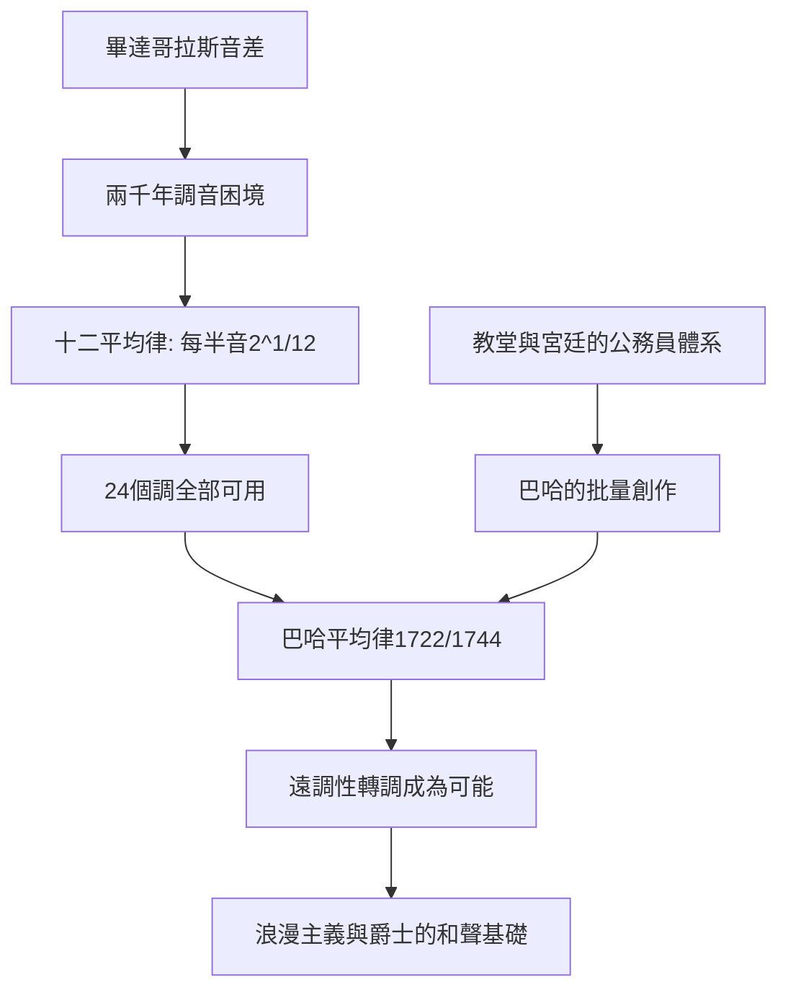

# 4.2 巴哈與《平均律鍵盤曲集》：數學的巔峰

時間：1685年至1750年

## 一份工作申請書：萊比錫的教堂樂長

約翰·塞巴斯蒂安·巴哈（1685年至1750年）生於德國艾森納赫的音樂世家（家族兩百年間出了五十多位音樂家）。他一生主要的工作是僕役性的：1708年至1717年任魏瑪宮廷管風琴師，1717年至1723年任科騰親王的宮廷樂長，1723年起任萊比錫聖托馬斯教堂樂長——應聘時萊比錫市政委員會原本屬意泰勒曼（被漢堡截胡），退而求其次才選了巴哈，評語中還抱怨他是「平庸的候選人」。他的合約規定要「為教堂提供優美音樂」，並服從市政委員會與教會的指示。他與僱主的關係經常緊張：1730年他向市議會控訴唱詩班學生素質低劣、津貼被挪用；市議會的備忘錄中稱他「固執」。這是音樂史的關鍵事實：巴哈不是「天才」被世界追捧，而是一名教堂公務員，他的偉大作品是「工作交付」。

《平均律鍵盤曲集》第一部（BWV 846–869）1722年完成於科騰，第二部1744年完成於萊比錫。每部各24首前奏曲與賦格，涵蓋全部十二個大調與十二個小調。巴哈在手稿扉頁寫明用途：「為使青年音樂家受到教益，並為已嫻熟者提供消遣。」這是一部教學用書——今天仍是全世界音樂學院鍵盤與作曲課的核心教材。

## 平均律：一道數學裂縫的解決方案

要理解這部曲集的革命性，得回到第一章的畢達哥拉斯音差：五度循環生律十二次後無法封閉於八度，因此傳統調音（純律與中全音律）必須讓某些音程不純，或者限制可用的調性——有些調在當時的樂器上根本「不准」，作曲家不敢用（遠調如升C大調被視為刺耳）。

解決方案是十二平均律：把八度平均分為十二個等比半音，每個半音的頻率比為

$$2^{1/12} \approx 1.05946$$

純五度因此略微偏小（約比純律低2音分），但代價換來了巨大收益：十二個調全部可用、可任意轉調，且每個調的性格相對接近。這個數學解16世紀已有理論（1596年西蒙·斯特芬），17世紀逐步應用於鍵盤樂器（早期德國鍵盤調音的well temperament是平均律的近親，仍保留部分調性色彩）。巴哈的《平均律》以創作證明了這個體系的豐饒：他用全部24個調寫作，展示遠關係調的色彩差異與轉調的可能性。沒有平均律，就沒有貝多芬的遠調性轉調，沒有蕭邦的24首前奏曲，沒有浪漫主義的半音化和聲，也沒有爵士樂的和聲系統。

## 賦格：聲音的建築

《平均律》中每首前奏曲之後是一首賦格（fugue）：主題在每個聲部依次呈現（答句模仿），然後經過發展、密接和應（stretto）與再現，最後壯麗收束。賦格不是旋律，而是「程序」：一個主題被複製、倒影、增值、縮減、在各聲部之間追逐。這是巴洛克理性主義的音樂化身——與同時代的萊布尼茲（微積分）與牛頓共享同一種思維方式：從簡單規則生成複雜秩序。巴哈晚年（1747年）訪問普魯士腓特烈大帝，以國王出題的六聲部主題即興賦格（《音樂的奉獻》），並在臨終前寫作《賦格的藝術》——一部把對位法推向極限的未完成之作（最後一章在第239小節中斷，親筆寫著「在最後的賦格中，主題B-A-C-H出現的地方，作曲者去世了」——此說流傳甚廣，出自其子與傳記作者之筆，具體情形仍存爭議）。

## 遺忘與復活

巴哈生前以管風琴師與對位大師聞名，去世後作品逐漸被視為過時（莫札特與貝多芬對巴哈的認識有限，貝多芬以《平均律》自學並稱之為「音樂的舊約聖經」）。真正的復興在1829年：21歲的孟德爾頌在柏林指揮重演《馬太受難曲》（自1750年後首次），德國知識界為之震撼，巴哈學會（1850年成立，巴哈逝世百年）開始系統出版其全集。今天，巴哈被視為西方音樂的最高峰之一——而他的作品能被我們聽見，依賴的正是他當年在萊比錫教堂工作時留下的一批手抄譜（多數作品當時未出版）。音樂的生存，是制度、紙張與後世熱情的共同產物。

