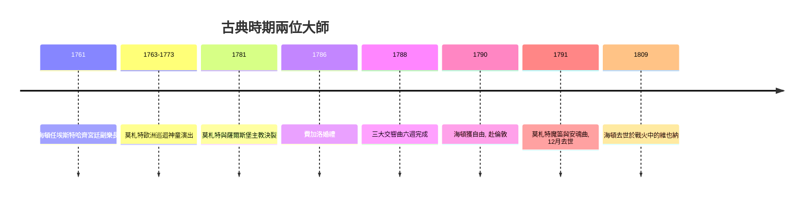

# 5.1 海頓與莫札特：平衡、理性與形式之美

時間：1732年至1791年

## 海頓：一位僕人的六十二首交響曲

約瑟夫·海頓（1732年至1809年）生於奧地利下奧地利州的農家，八歲入維也納聖史蒂芬教堂唱詩班，聲音變聲後被解僱，一度靠給人當伴奏與僕役謀生。1761年，他獲得了改變一生（也改變音樂史）的職位：埃斯特哈齊親王（匈牙利巨富，效忠哈布斯堡王朝）的宮廷副樂長（後任樂長），合約要求他「譜寫親王所需的音樂」，樂團成員與他本人如同僕人（每天必須著制服，在海頓的堅持下，樂手們獲得了一日兩餐）。

這個職位持續了約三十年，海頓為此寫下了一百多部交響曲（傳統編號共106部）與六十多部弦樂四重奏。宮廷的偏遠（艾森施塔特與埃斯特哈扎宮遠離維也納）使海頓有完整的創作環境與固定的樂團可以實驗——他自己說：「我與世隔絕，因此被迫成為原創者。」1765年起他開始整理作品目錄（Entwurf-Katalog），這是作曲家為自己作品建立系統檔案的早期實例，反映了18世紀的啟蒙理性主義風氣。

交響曲在海頓手中從宮廷娛樂定型為四樂章的嚴肅藝術：快板奏鳴曲式、慢板、小步舞曲、終曲。奏鳴曲式（sonata form）——呈示部（兩個主題與調性對立）、發展部（動機的辯證）、再現部（解決）——成為古典時期的核心思維，它本身就是啟蒙時代的精神：衝突、論辯、和解。海頓還擅長幽默：第94號交響曲「驚愕」在慢板中突然以全樂團強音襲擊打瞌睡的倫敦貴婦（據說他自己承認「想讓女士們跳起來」）；《告別》交響曲的終曲，樂手逐一熄燭離場，暗示親王該放大家回維也納休假（親王看懂了，次日准假）。

## 1790年的解放：倫敦與職業作曲家

1790年，尼古勞斯親王去世，繼任者解散樂團。59歲的海頓獲得自由，隨即接受劇場經理薩洛蒙的邀請赴倫敦——那裡有公開售票的音樂會、新興的中產階級聽眾與出版商。兩次倫敦之行（1791–92、1794–95）帶來十二首「倫敦交響曲」（第93–104號），場場爆滿，海頓收入豐厚（一次倫敦之行賺得相當於他十年俸祿的金額）。這是音樂史的轉折點：作曲家第一次以市場（而非宮廷）為生。海頓晚年以《創世紀》與《四季》兩部神劇享譽歐洲，1809年在拿破崙軍隊砲轟維也納期間去世，法軍為他舉行了榮譽衛兵儀式。

## 莫札特：神童、自由與赤貧

沃夫岡·阿瑪迪斯·莫札特（1756年至1791年）的童年是18世紀的巡迴演出奇觀：父親列奧波德（薩爾斯堡宮廷小提琴手）帶著六歲的莫札特與姐姐南內爾巡迴歐洲宮廷（慕尼黑、維也納、巴黎、倫敦、羅馬），小莫札特矇眼演奏、即興作曲、視奏任何譜子。1773年起他在薩爾斯堡大主教府任職，但與僱主關係惡劣（大主教科洛雷多視他為僕役，讓他與廚師、馬夫同桌），1781年爆發衝突，莫札特被解僱——據傳是在一封著名的羞辱信中被「踢出門」（歷史細節有爭議，但分道揚鑣確鑿）。

此後十年，莫札特是維也納第一位「自由作曲家」：以教學、出版、訂購音樂會與歌劇為生。他1880年代的維也納歲月是創作爆發期：《後宮誘逃》（1782）、《費加洛婚禮》（1786）、《唐喬望尼》（1787）、《魔笛》（1791），以及最後三首交響曲（1788年夏天，六週內完成，無人委託——可能是為計畫中的音樂會或出版）。但他的財務狀況動盪：一方面收入可觀（1786年前後是維也納頂級演奏家），另一方面消費無度、投資失敗，晚年靠借貸度日（他給共濟會兄弟帕赫格的求救信至今存世）。1791年12月5日，35歲的莫札特死於急性風濕熱（死因學界有腎炎、風濕熱等爭論，中毒說無據），葬於維也納聖馬克墓園的公共墓（此為當時約瑟夫二世改革下的普通葬制，並非「窮困到無墓」的浪漫想像）。

## 兩種命運，一個時代

海頓與莫札特相差24歲，是朋友（海頓對莫札特的父親說：「你兒子是我所知最偉大的作曲家」），也代表著同一時代的兩種生存方式：海頓先依附宮廷、後走向市場；莫札特先叛逆宮廷、後困於市場。他們共同把古典風格推向完美：清晰的形式、對稱的結構、樂句如言語般優雅。這種「理性」風格的社會土壤是約瑟夫二世的開明專制、維也納的中產階級與出版業、以及啟蒙思想對「秩序即美」的信仰。但完美的秩序，正等著被一位耳聾的天才打破。

